> 🧪 **Status: In Development.** Written October 2026 from the instructor's walkthrough of a
> karaoke setup in BH 109, recorded while a student engineer set it up, and from photos of the
> rig. The settings below are the ones that worked that day. A few details are still open. See
> **Technical verification**.

## 🎚️ What this is

A small **karaoke** setup in the **BH 109 choir room**: singers on **SM58s** and a laptop playing
karaoke videos, mixed on a **Behringer Xenyx QX1204USB**. One extra mic goes through a **Zoom V3**
vocal effects processor for robot, harmony and pitch-correct voices. The room's own rack and wall
speakers are the PA. Nothing gets carried in except the small rig.

The same rig works for anything that's a few vocal mics plus playback: an open mic, a talk with
music, a sing-along.

Two parts:

- **Setup**, from **Get the gear** to **Sound check**: the normal steps, in order.
- **Full reset**, near the end: every knob in its known-good position. Run it when the board looks
  like someone else has used it, and before you pack the board up.

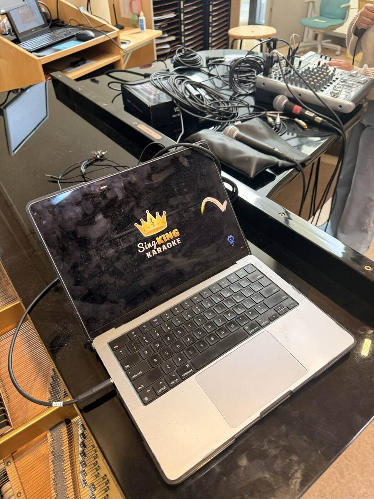

## 🗝️ Key terms

**signal flow** · **line mixer** · **power amp** · **passive speaker** · **gain** · **low cut** ·
**compressor** · **aux send** · **aux return** · **unity** · **+4 dBu / −10 dBV** · **PFL** ·
**phantom power** · **XLR to TRS**

## 🔀 Signal flow

From each singer to the room's speakers:

```
SM58 ×4 ──XLR──► Xenyx CH 1–4 (MIC)
Laptop headphone jack ──3.5 mm → dual 1/4"──► Xenyx LINE IN 5/6 (L + R)
SM58 ──XLR──► Zoom V3 MIC IN … V3 OUTPUT L ──1/4" TS──► Xenyx LINE IN 7/8 L (MONO)

Xenyx CH 1–4 FX sends ──► built-in effects (DLY + REV) ──► STEREO AUX RETURN 2 ──► MAIN MIX

Xenyx MAIN OUTPUTS L/R (XLR) ──XLR → TRS──► rack AUX AUDIO INPUT LEFT/RIGHT
  ──► Ashly LX-308B Ch.1 "AUX AUDIO" ──► Crown XLi 2500 amp ──► the room's passive wall speakers
```

**Where's the amplifier?** In the room's rack: the **Crown XLi 2500** at the bottom drives the
**passive** wall speakers. The Xenyx and the Ashly only pass line level.

## 🧰 Equipment and materials

- [ ] **Behringer Xenyx QX1204USB** and its **IEC power cord**
- [ ] **Zoom V3** vocal processor, its **USB power brick**, and its **USB cable**
- [ ] **SM58s**: up to four for the Xenyx, one for the V3 (the **Live Sound Mics** case)
- [ ] **XLR cables**, one per mic (the **XLR** bins)
- [ ] **Two XLR-to-TRS cables**: Xenyx MAIN OUTPUTS → the rack
- [ ] **One 3.5 mm TRS to dual 1/4" TS cable** (about 15 ft): laptop → LINE IN 5/6
- [ ] **One 1/4" TS cable** (about 15 ft): V3 → LINE IN 7/8
- [ ] **A power strip or extension cord** (the **AC** crate)
- [ ] The **karaoke laptop** and its **charger**
- [ ] **Headphones** (optional, for PFL)

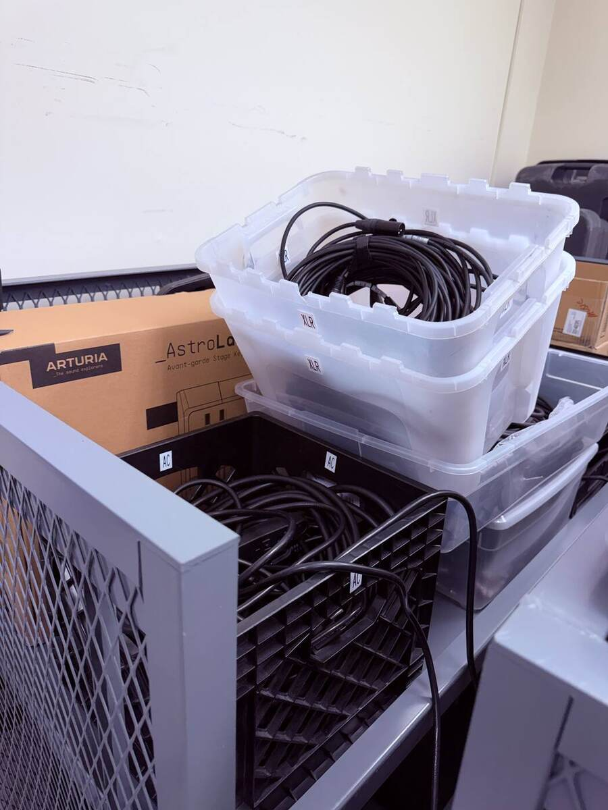

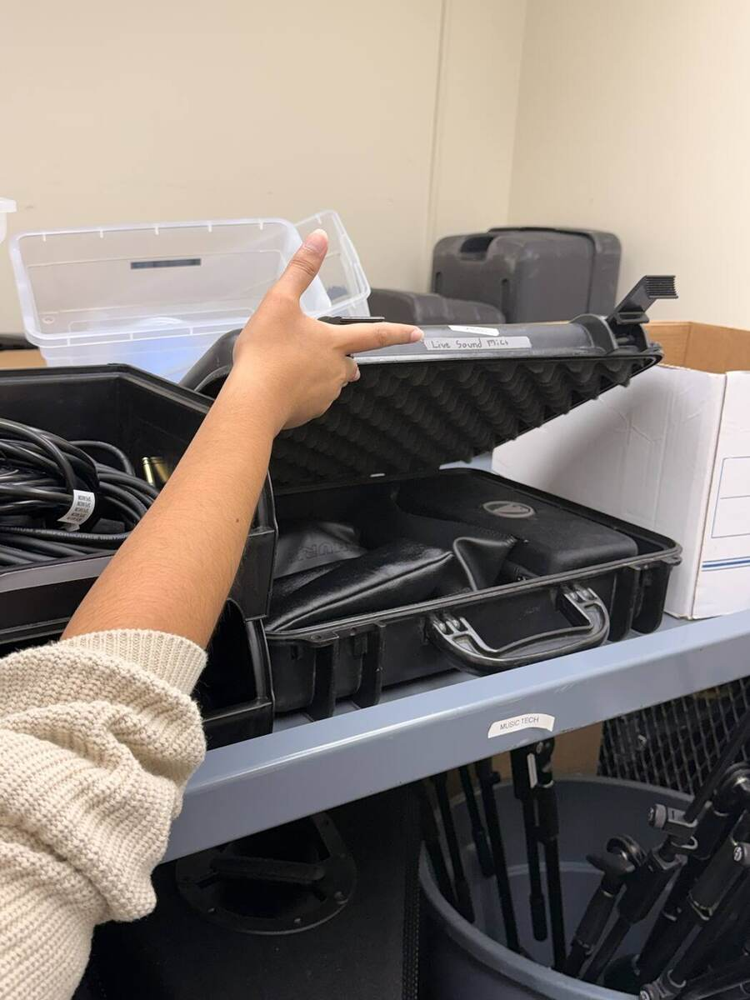

## ⚠️ Before you touch anything

- 🛑 **The room's rack stays on.** It's labeled **DO NOT SHUT DOWN THIS RACK**. You plug into it
  and turn one knob. Nothing else.
- 🛑 **The Ashly's Ch.1 stays on LINE, never MIC.** MIC adds 30 dB to a signal that's already line
  level. That's instant feedback through the wall speakers.
- 🔇 **The Crown amp is always on**, so the speakers are live the moment anything reaches them.
  Keep the Xenyx's **MAIN MIX faders down** while you plug in, power up, or unplug anything.
- 🎹 **Ask before using the piano as a table.** The photos show the rig on the grand piano's lid.
  See **Technical verification**.
- 🙋 **Ask when you're not sure.** A wrong guess on the rack affects every class that uses the room.

## 🚚 Get the gear

- 🚩 Ask Borecki where the gear is today: the **Salmon storage closet (BH 102)** or **upstairs
  (BH 208/209)**. It moves.
- 🚩 Take everything in **Equipment and materials**. Check the five mics and five XLR cables before
  you leave the closet.

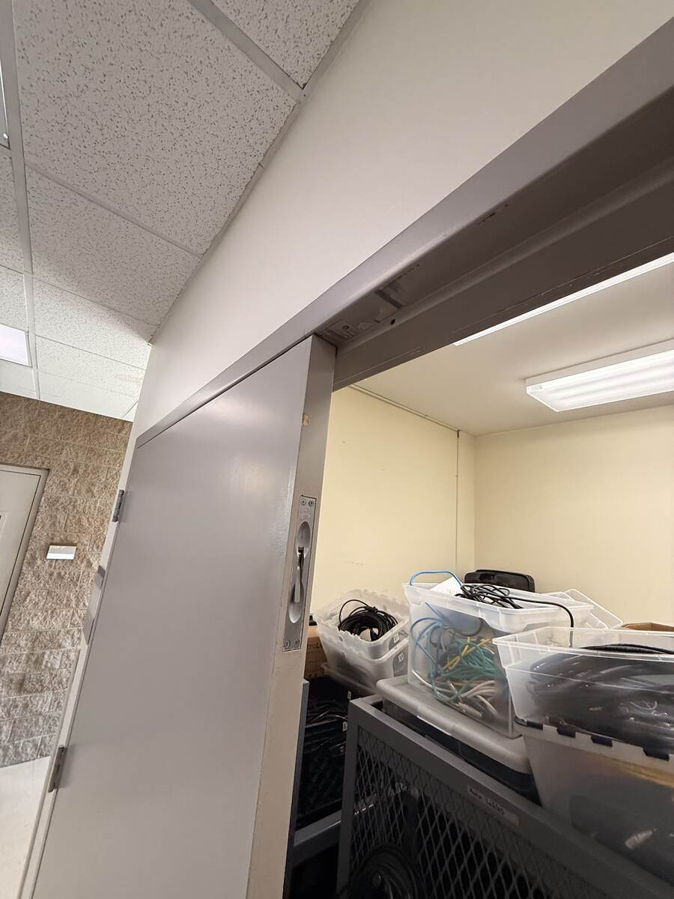

## 🔌 Power

- 🚩 Power strip into a wall outlet near the piano.
- 🚩 Xenyx: **MAIN MIX faders down**, IEC cord into the back, then **POWER on**.
- 🚩 Xenyx rear **PHANTOM: off**. SM58s are dynamic mics and don't need it.
- 🚩 Zoom V3: its USB brick into the **Furman** power strip at the top of the room's rack, or into
  your power strip. Then the USB cable into the V3, and its **OFF–ON** switch to **ON**.
- 🚩 The laptop on its charger, not on battery.

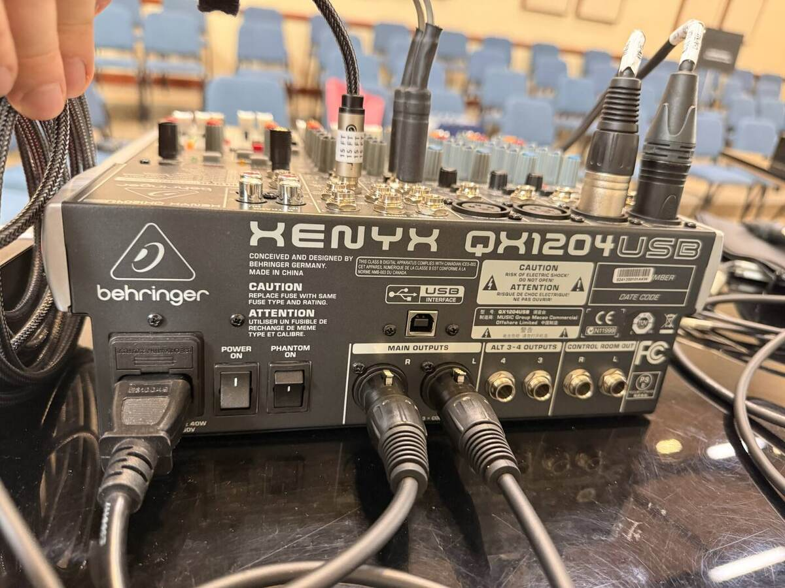

## 🔗 Patch

- 🚩 SM58s into the Xenyx **CH 1–4 MIC** (XLR) jacks, starting at 1. Channels 1 and 2 are printed
  **WIRELESS MIC 1/2**: that's for an optional receiver. Wired SM58s go there too.
- 🚩 Laptop headphone jack → **3.5 mm to dual 1/4"** → **LINE IN 5/6**, one plug in **L**, one in
  **R**.
- 🚩 The V3's SM58 into the V3's **MIC IN** (XLR).
- 🚩 V3 **OUTPUT L** → **1/4" TS** → Xenyx **LINE IN 7/8 L (MONO)**. Left only is fine: a plug in
  the L (MONO) jack alone feeds both sides of the channel.
- 🚩 Xenyx **MAIN OUTPUTS L** and **R** (XLR, on the back) → **XLR-to-TRS** cables → the rack's
  **AUX AUDIO INPUT LEFT** and **RIGHT** (1/4", on the Extron plate under the Ashly mixer). L to
  LEFT, R to RIGHT.
- 🚩 The **AUX VIDEO INPUT** (RCA) next to it stays empty.

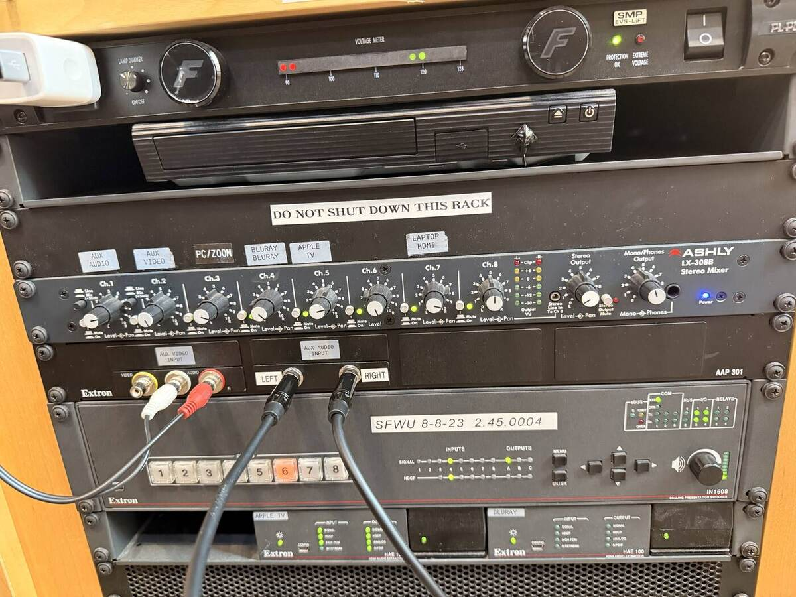

**Q1 (fill in the blank).** The Xenyx's MAIN OUTPUTS are ______ connectors and the rack's AUX AUDIO
INPUT jacks are ______, so the cable between them is XLR to ______.

✅ **Answer.** **XLR** outputs, **1/4"** inputs, so an **XLR-to-TRS** cable. TRS keeps the line
balanced all the way to the rack.

## 🎛️ Xenyx: mic channels 1–4

Do these on every mic channel you use, top to bottom:

- 🚩 **LOW CUT: on** (pressed). Voices don't need the low end, and it cuts handling noise and rumble.
- 🚩 **GAIN: about 3 o'clock.** Fine-tune it in the **Sound check**.
- 🚩 **COMP: about 3 o'clock**.
- 🚩 **EQ: flat.** HIGH, MID and LOW all pointing straight up.
- 🚩 **AUX 1** (red): not used. Its **PRE** button doesn't matter.
- 🚩 **FX** (orange, aux 2): up. This is each singer's reverb. Turn one up or down for more or less
  on that singer.
- 🚩 **PAN: center**.
- 🚩 **MUTE / ALT 3-4: up** (not pressed). Pressed, it moves the channel to ALT 3-4, which isn't
  used here, so the singer disappears.
- 🚩 **Fader: about −10** to start.

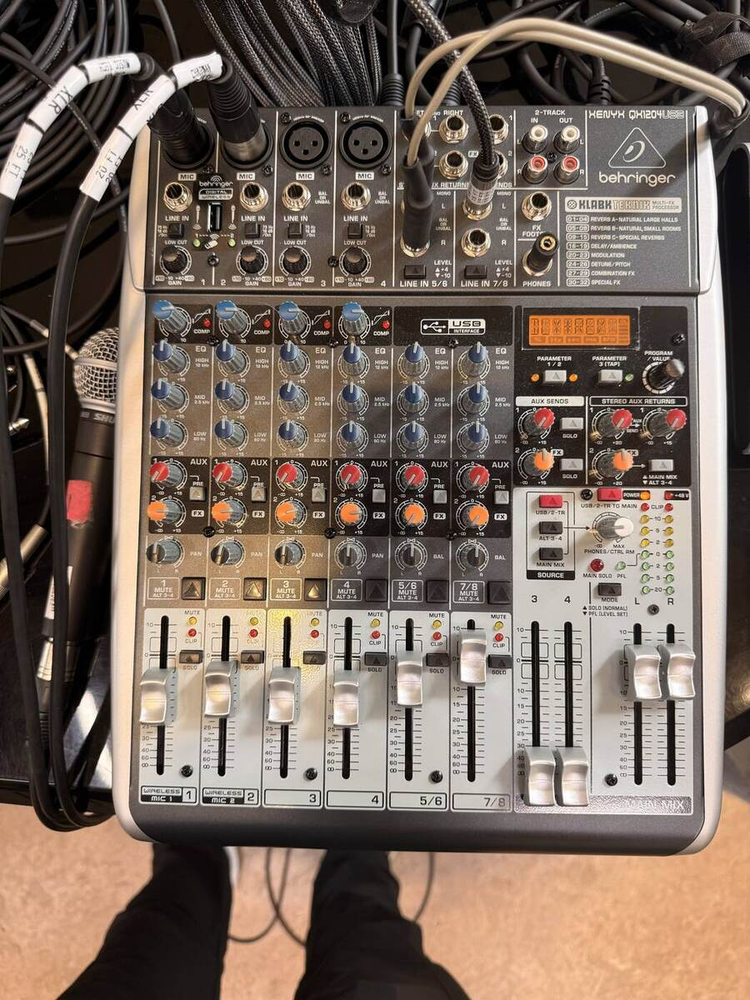

## 🎛️ Xenyx: stereo channels 5/6 and 7/8

- 🚩 **5/6 is the laptop, 7/8 is the Zoom V3.** (They could swap. Keep them this way so they match
  this page.)
- 🚩 **LEVEL switch** above each, at the top of the board: **−10** (pressed down) on **both**. The
  laptop and the V3 are consumer-level gear; at **+4** they come in about 12 dB too quiet.
- 🚩 **EQ: flat. BAL: center. MUTE / ALT 3-4: up**.
- 🚩 Faders: set by ear in the sound check.
- 🚩 The **laptop's own volume** is a level control too. Pick a level and leave it. If someone turns
  it down, the Xenyx can't make up for it.

**Q2 (short answer).** The karaoke track is quiet even with channel 5/6's fader near the top. The
laptop's volume is up. What do you check on the Xenyx?

✅ **Answer.** The **LEVEL switch for LINE IN 5/6**: it should be at **−10**. At +4 a consumer
device like a laptop comes in about 12 dB low.

## ✨ Xenyx: effects (reverb and delay)

- 🚩 The effects display should show the preset **DLY + REV**, one of the **COMBINATION FX**
  (27–29). If not, turn **PROGRAM / VALUE** to it.
- 🚩 It's saved with **balance at +25**, favoring the reverb over the delay, and **reverb decay at
  1 second**. **TAP** tempo doesn't matter here.
- 🚩 **AUX SENDS 2 (FX)** master: at **unity**.
- 🚩 **STEREO AUX RETURNS 2 (FX)**: at **unity**.
- 🚩 The button under RETURN 2: **up, MAIN MIX** (not ALT 3-4), so the reverb reaches the room.

**Q3 (short answer).** No singer has any reverb. Name three places on the Xenyx to check.

✅ **Answer.** Any three: each mic channel's **FX** knob; the **AUX SENDS 2 (FX)** master; the
**STEREO AUX RETURN 2** level; RETURN 2's button set to **MAIN MIX**, not ALT 3-4; the **PROGRAM**
(DLY + REV). The send goes out on aux 2 and has to come back through the return.

## 🎚️ Xenyx: master section

- 🚩 **USB/2-TR TO MAIN: up.** No USB or 2-track playback here.
- 🚩 **ALT 3-4 faders: down.** Not used.
- 🚩 **MODE: PFL** (pressed down). It makes no audible difference unless something is very loud,
  and the gain is already set.
- 🚩 **+48 V** light: off.
- 🚩 **MAIN MIX faders:** up to about **0** once everything is patched. The room level is set on the
  Ashly.

## 🗣️ Zoom V3

- 🚩 **PHANTOM: off**.
- 🚩 **Mic gain: about 3 o'clock**.
- 🚩 **Output level: all the way up**, clockwise as you look at the back.
- 🚩 **ENHANCE: on**.
- 🚩 Singers can pick the rest themselves. The **EFFECT ADJUST** dial at the top changes the
  current effect.

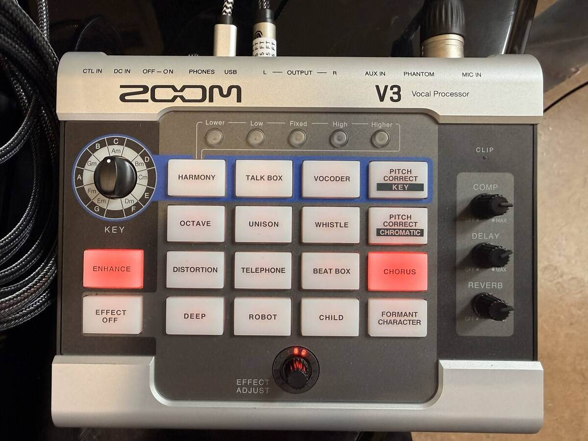

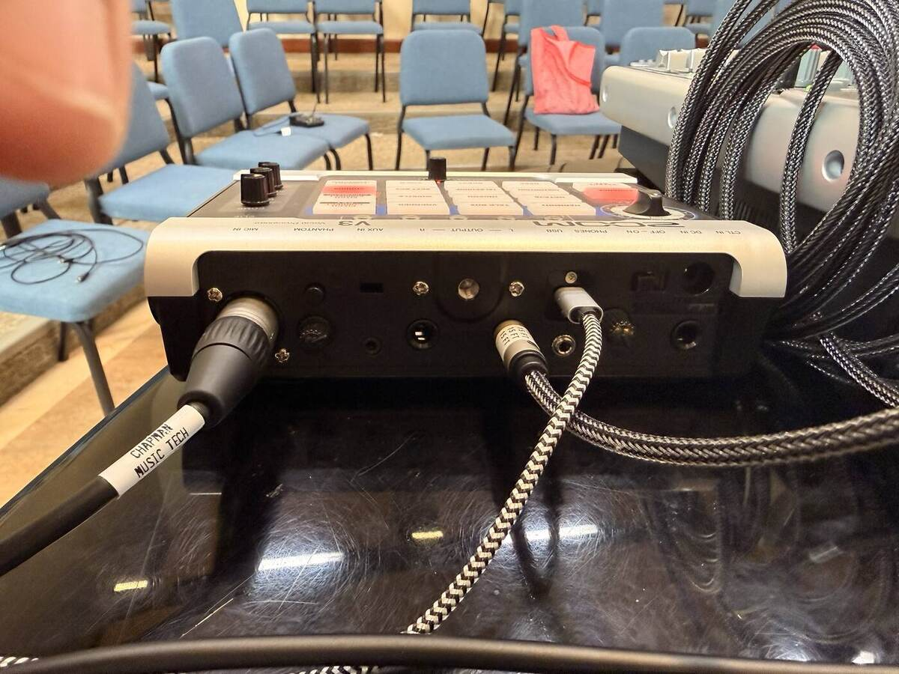

## 🏠 The room's rack: Ashly LX-308B

You only touch **Ch.1, AUX AUDIO**.

- 🚩 **Line / Mic button: up, LINE.** Never MIC (see **Before you touch anything**).
- 🚩 **Level** (the inner white cap): **about 3 o'clock**.
- 🚩 **Pan** (the outer black ring): **pointing straight up**.
- 🚩 **Mute / On:** its green light is **on**.
- 🚩 Every **other** channel: green light **on**, left as you found it. They stay on all the time.
- 🚩 **Stereo Output**: leave it. It sits lower than you'd expect, and that's correct.
- 🚩 **Mono/Phones Output** doesn't feed the wall speakers. Leave it.
- 🚩 The **Extron** switcher isn't needed: the line mixer feeds the speakers directly. It only
  matters if the room PC plays the audio, and that isn't the plan.

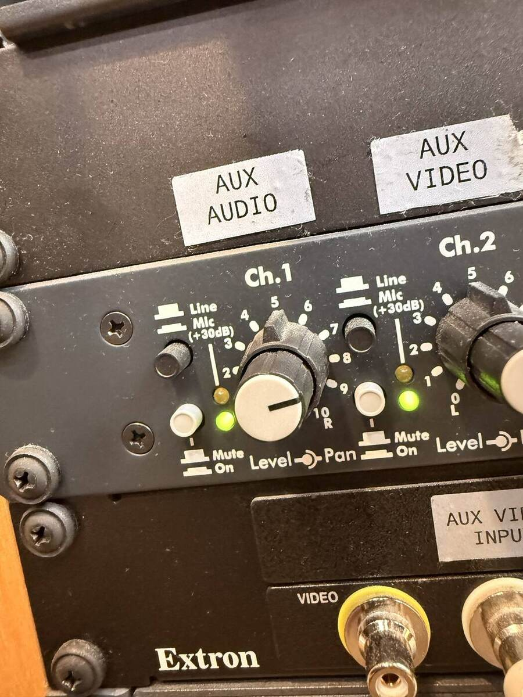

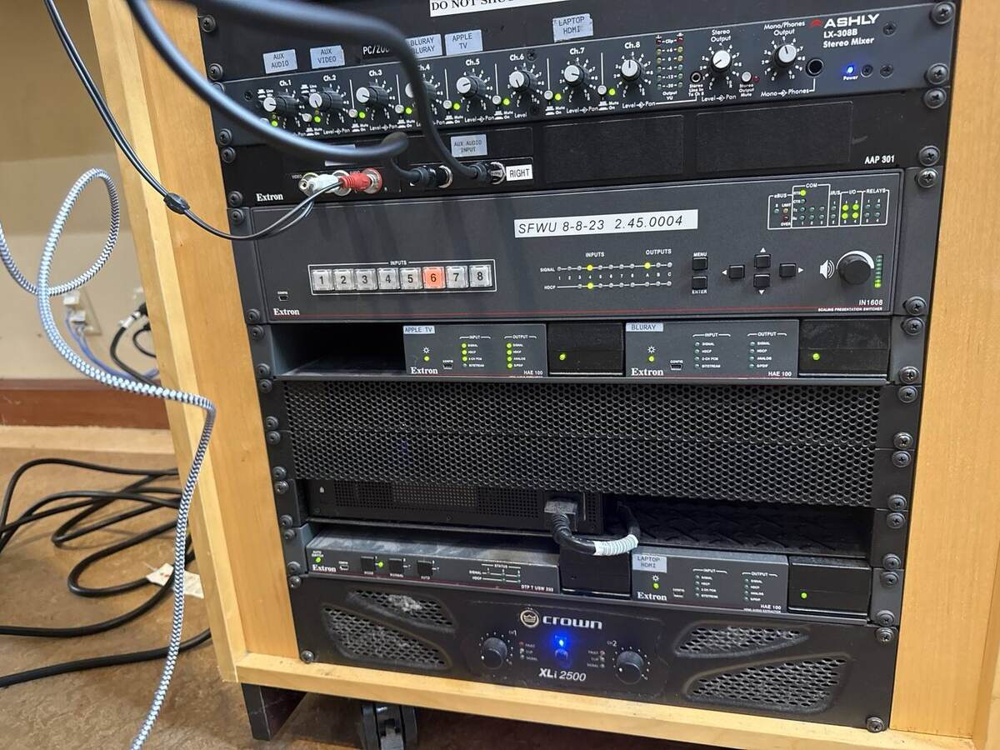

**Q4 (multiple choice).** Someone presses **MIC** on the Ashly's Ch.1. What happens?

- a) Nothing: the Xenyx is already mic level.
- b) The singers get quieter.
- ✅ c) About 30 dB too much gain on a line-level signal: distortion and feedback through the wall speakers.
- d) The Xenyx's phantom power switches on.

## 🔊 Sound check

- 🚩 Start the laptop playing. Bring channel 5/6 up until the track sounds right in the room.
- 🚩 Each singer, one at a time, singing as loud as they will in the show: watch the channel's red
  **CLIP** light. If it flashes, back the **GAIN** off. Then set the fader.
- 🚩 The V3 singer: try **ENHANCE** and one effect, then set channel 7/8's fader.
- 🚩 Walk the room. The track and every singer should be clear from the back, with no feedback near
  the wall speakers.

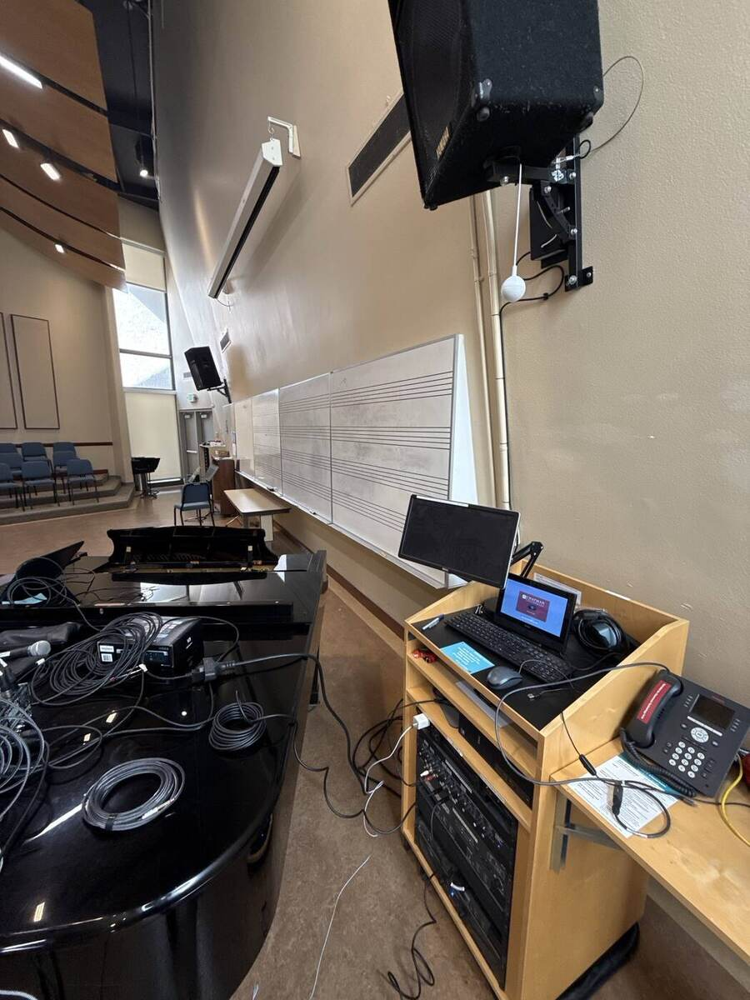

## 🧰 If something's wrong

- 🚩 **Nothing from the wall speakers:** the XLR-to-TRS cables in **AUX AUDIO INPUT**, the Ashly
  Ch.1 green light on, the Xenyx **MAIN MIX** faders up.
- 🚩 **Feedback or harsh distortion right away:** the Ashly Ch.1 button is on **MIC**. Put it back
  to **LINE**.
- 🚩 **One singer missing:** that channel's **MUTE / ALT 3-4** pressed, fader down, or the mic's
  XLR in the wrong channel.
- 🚩 **Track or V3 too quiet:** the **LEVEL** switch at **+4**; set it to **−10**. Then the laptop's
  volume, and the V3's output level.
- 🚩 **No V3 at all:** its power (USB brick, switch), its cable in **7/8 L**, not R.
- 🚩 **No reverb:** see Q3.

**Q5 (short answer).** Why is a TS cable into 7/8 L (MONO) alone fine for the V3, but not for the
karaoke track?

✅ **Answer.** The V3's voice is mono, and the L (MONO) jack alone feeds both sides of the channel.
The karaoke track is stereo: plugged into L only, you'd lose its right side.

## 🔁 Full reset

The known-good state. Set every item, even ones that look right.

- 🚩 **Xenyx, rear:** POWER on, **PHANTOM off**.
- 🚩 **Xenyx, CH 1–4:** LOW CUT on · GAIN 3 o'clock · COMP 3 o'clock · EQ flat · FX up · PAN center ·
  MUTE / ALT 3-4 up · fader about −10.
- 🚩 **Xenyx, 5/6 and 7/8:** LEVEL **−10** · EQ flat · BAL center · MUTE / ALT 3-4 up.
- 🚩 **Xenyx, effects:** DLY + REV · AUX SENDS 2 at unity · STEREO AUX RETURN 2 at unity, to MAIN
  MIX.
- 🚩 **Xenyx, master:** USB/2-TR TO MAIN up · ALT 3-4 faders down · MODE on PFL · MAIN MIX faders
  down for packing (about 0 in use).
- 🚩 **Zoom V3:** PHANTOM off · mic gain 3 o'clock · output level all the way up · ENHANCE on.
- 🚩 **Ashly:** Ch.1 on LINE, level 3 o'clock, pan straight up, on · every other channel on ·
  Stereo Output untouched.

## 🏁 Strike

- 🚩 Xenyx **MAIN MIX faders down first**, before you unplug anything from the rack.
- 🚩 Pull the two XLR-to-TRS cables out of **AUX AUDIO INPUT**. The Ashly stays exactly as the
  reset says.
- 🚩 Power off the Xenyx and the V3. Take the V3's USB brick **out of the Furman** if you used it.
- 🚩 Coil every cable and put it back in its own bin (XLR in **XLR**, power in **AC**).
- 🚩 Mics back in their pouches in the **Live Sound Mics** case. Count them: five out, five back.
- 🚩 Everything back to the closet it came from.

## ✅ Definition of done

- 🚩 Every singer, the track and the V3 were clear in the room with no feedback.
- 🚩 The Xenyx and the V3 match the **Full reset** before they're packed.
- 🚩 The room's rack is exactly as you found it, with nothing left plugged into AUX AUDIO INPUT.

## 💭 Before you leave

- 🚩 Tell Borecki anything that didn't match this page: a knob that needed a different setting, a
  cable that was missing, a closet that had moved.

## ⚙️ Technical verification

**Confirmed (the instructor's walkthrough and photos, October 2026):**

- Signal flow: Xenyx MAIN OUTPUTS → XLR-to-TRS → AUX AUDIO INPUT L/R → Ashly Ch.1 → Crown XLi 2500
  → passive wall speakers. The Extron isn't in the path unless the room PC plays audio.
- Ashly Ch.1 on LINE, level about 3 o'clock, pan straight up; every channel on; Stereo Output low.
  MIC on Ch.1 caused feedback during the test.
- Xenyx mic channels: LOW CUT on, GAIN and COMP about 3 o'clock, EQ flat, faders about −10. LINE IN
  5/6 and 7/8 at −10. MODE on PFL.
- Effects: DLY + REV, balance +25, reverb decay 1 s; AUX SENDS 2 and STEREO AUX RETURN 2 at unity,
  return 2 to MAIN MIX.
- Zoom V3: phantom off, mic gain about 3 o'clock, output all the way up, OUTPUT L into 7/8 L,
  powered by a USB brick (Furman or the AC strip). ENHANCE on.
- Xenyx phantom off.

**Still open:**

- **The DLY + REV preset number** (27, 28 or 29) and how to show its balance and decay on the
  display (the PARAMETER buttons).
- **The V3's USB connector.** It was described as USB to micro-USB; in the photo the plug in the V3
  looks like USB-C. Check before packing a spare cable.
- **The exact labels of the V3's mic gain and output level knobs** on its back panel.
- **Whether channels 5/6 and 7/8's FX knobs should be down**, so only the mics get the reverb.
- **The starting fader positions** for 5/6, 7/8, and the MAIN MIX (the photo shows MAIN MIX near the
  top).
- **How Ashly Ch.1 takes L and R.** It has a single pan control, so the room may effectively be
  mono. That doesn't change any step.
- **The V3's KEY dial:** from the panel's layout, the blue-outlined effects (PITCH CORRECT KEY,
  VOCODER, TALK BOX, HARMONY) follow it. Not tested.
- **The piano:** whether it's OK to set the rig on the grand piano's lid, as in the photos, or a
  table should be brought.
- **Where the gear lives**: BH 102 or BH 208/209, and which bins and cases.

## 🤖 AI use disclosure

Drafted by AI (Claude, via Claude Code) from the instructor's spoken walkthrough of a karaoke setup
in BH 109 (October 22, 2026), with a student engineer setting it up, and from the photos taken that
day. The settings are theirs; the AI arranged them into the site's checklist format, wrote the
questions and the standard safety lines, and listed what isn't confirmed. Not yet run step by step
from this page.
