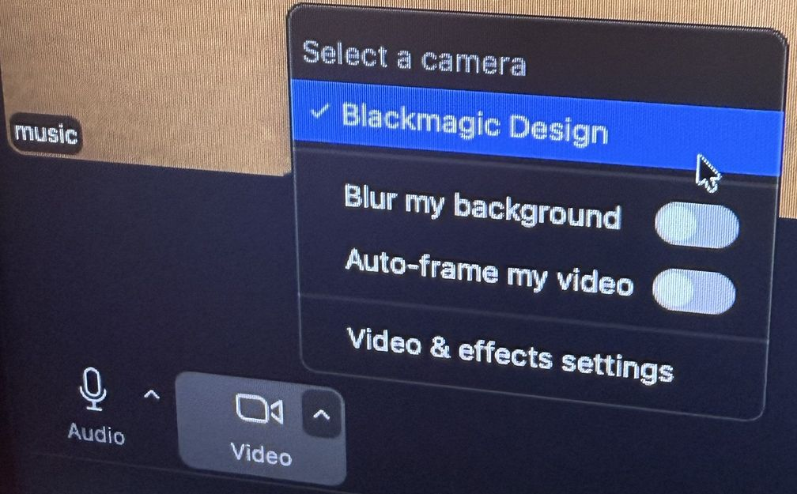
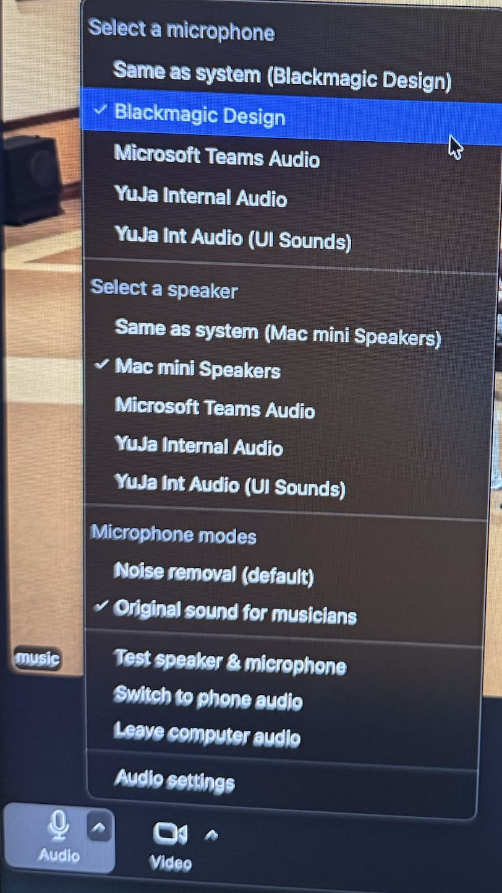
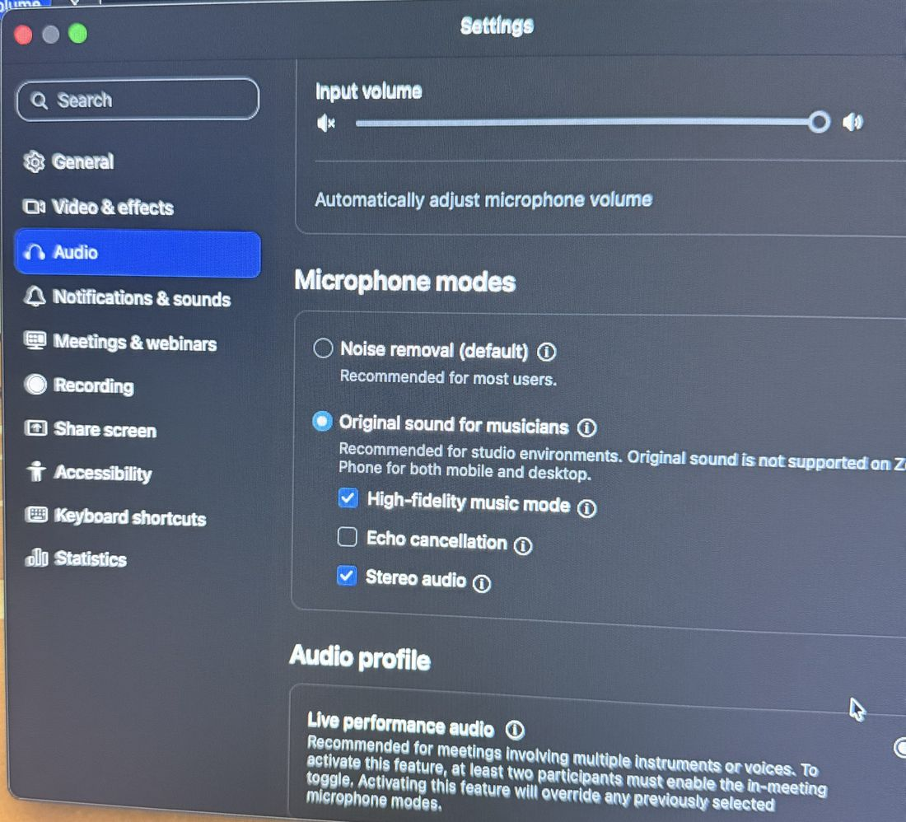
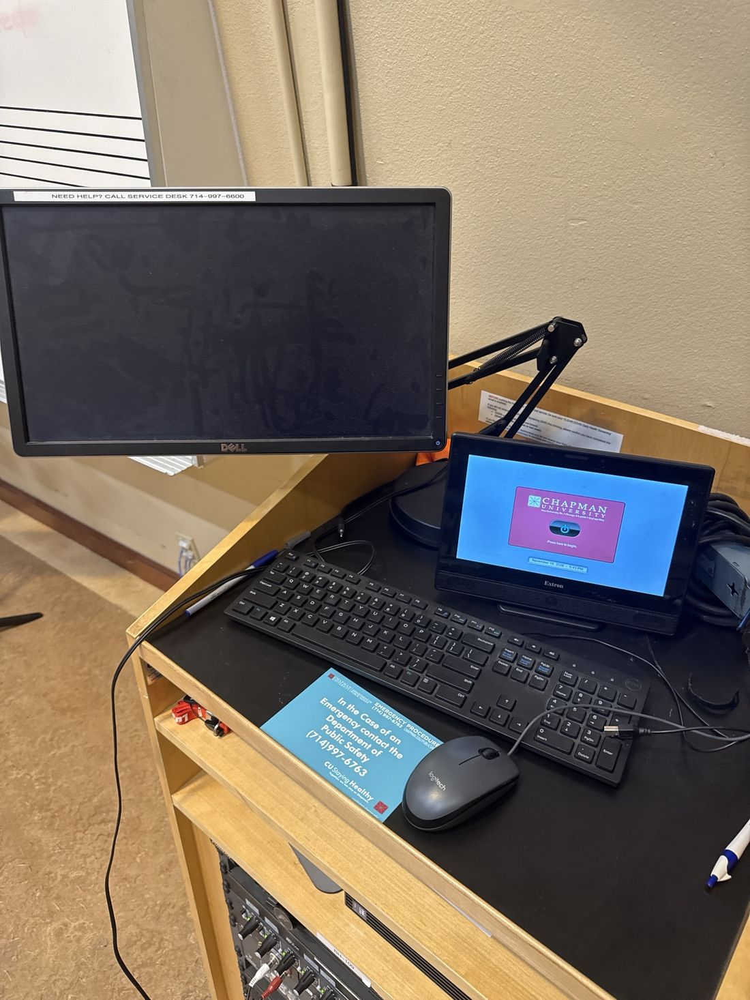
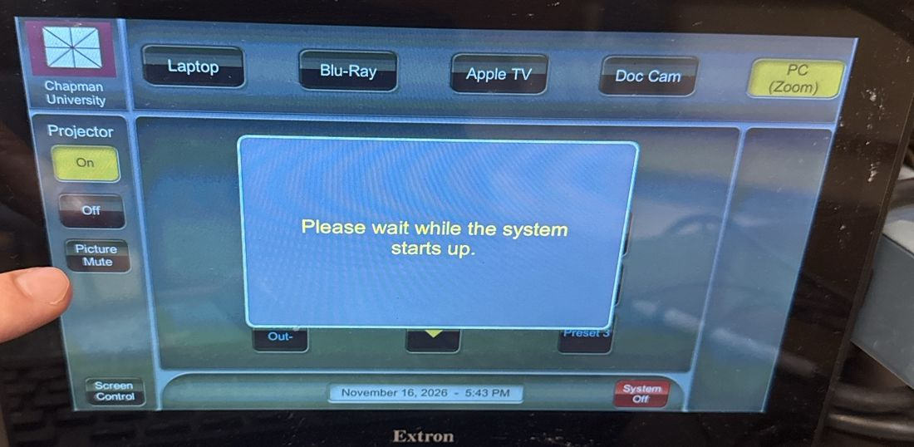
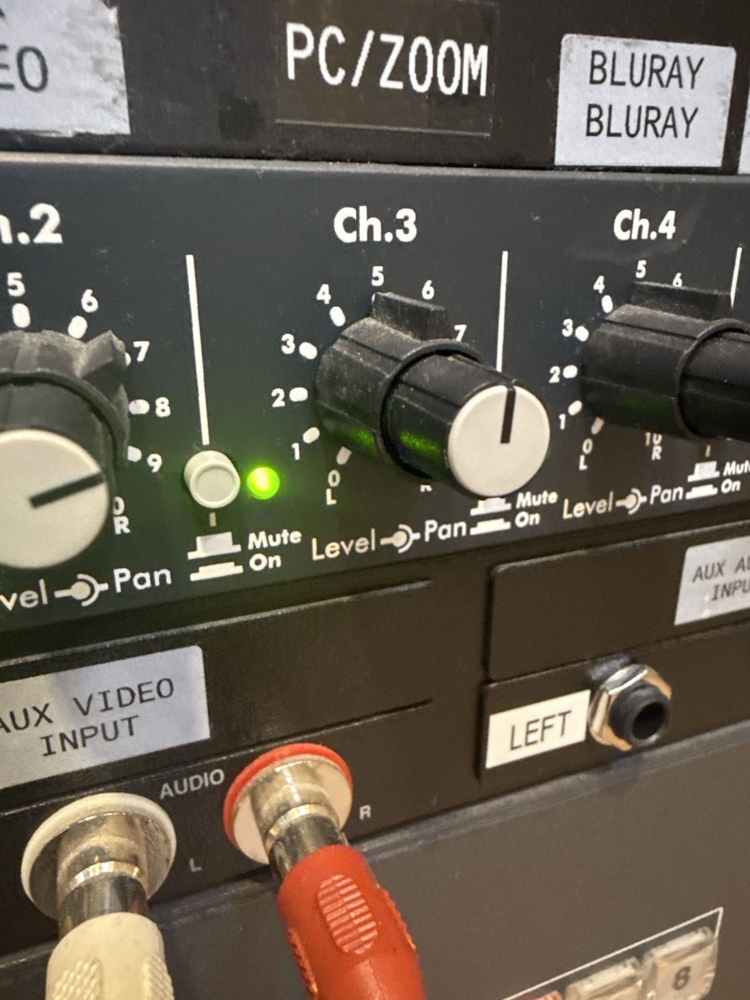

> 🧪 **Status: In Development.** Written November 2026 from the instructor's photos of BH 109's
> lectern and rack and of Zoom on the livestream computer, plus his answers to follow-up questions.
> It hasn't been run step by step from this page yet. Open items are in **Technical verification**.

## 📺 What this is

Some Salmon gigs sell out (Mariachi is the usual one). When that happens, **BH 109, the choir
room, becomes overflow seating**. The audience there watches the show on the room's projector and
hears it through the room's wall speakers.

The feed travels over a **Zoom meeting**:

- **Sender:** the **livestream computer in BH 209**. It joins the meeting with the **ATEM** as its
  camera *and* its microphone. Zoom calls that device **Blackmagic Design**.
- **Receiver:** the **room PC in BH 109**. It joins the same meeting and plays it through the
  room's projector and speakers.

**Borecki starts the meeting.** You join it on both computers.

## 🗝️ Key terms

**overflow** · **program** · **program audio** · **USB webcam output** · **Original sound for
musicians** · **echo cancellation** · **line mixer** · **source select**

## 🔀 Signal flow

```
Salmon cameras ──► ATEM ─────────────┐
Salmon room mics ──► ATEM (program audio)
                                     ▼
              ATEM USB webcam out ──► BH 209 livestream computer
                                       Zoom: camera + mic = "Blackmagic Design"
                                     ▼
                            the Zoom meeting (Borecki starts it)
                                     ▼
                         BH 109 room PC, in the same meeting
                         ├─► Extron panel: PC (Zoom) ──► projector
                         └─► Ashly LX-308B Ch.3 "PC/ZOOM" ──► Crown XLi 2500 ──► wall speakers
```

**What BH 109 hears is the ATEM's program audio: the room mics in Salmon.** Whatever the ATEM
gets, the overflow room gets.

## ⚠️ Before you touch anything

- 🛑 **BH 109's rack stays on.** It's labeled **DO NOT SHUT DOWN THIS RACK**. You turn one knob on
  it at most.
- 🛑 **On the Ashly, only Ch.3 (PC/ZOOM) is yours.** Every other channel stays as you found it.
- 🔇 **The BH 109 PC's microphone stays muted and its camera off.** The meeting should carry one
  thing: the hall.
- 🙋 **Ask Borecki ahead of time** to start the meeting. Without it there's nothing to join.

## 📞 Ahead of time

- 🚩 Text Borecki that tonight needs choir room overflow, so he can start the Zoom meeting.
- 🚩 Make sure you know how to join it on both computers before you split up.

## 🎬 BH 209: the sender

The livestream computer, in the control room above Salmon.

- 🚩 The **ATEM** is running, with the cameras up, as in the
  [Salmon Gig Checklist](../../salmon-gig-checklist/). The overflow feed is the ATEM's program.
- 🚩 Join the meeting in **Zoom**.
- 🚩 **Video** (the ^ next to it) → **Select a camera** → **Blackmagic Design**.



- 🚩 **Audio** (the ^ next to it) → **Select a microphone** → **Blackmagic Design**. This is the
  ATEM's program audio, carried along with the video.
- 🚩 Same menu, **Microphone modes** → **Original sound for musicians**.



- 🚩 **Audio settings** (bottom of the same menu), under Original sound for musicians:
  **High-fidelity music mode** on, **Echo cancellation** off, **Stereo audio** on. **Input
  volume** all the way up.



- 🚩 Back in the meeting, the top of the window says **Original sound for musicians: on**.


**Q1 (multiple choice).** In Zoom on the livestream computer, what is "Blackmagic Design"?

- a) A virtual background
- b) The room PC in BH 109
- ✅ c) The ATEM, through its USB webcam output: the program video and the program audio
- d) A USB microphone on the control room desk

✅ **Answer.** The **ATEM**. It shows up as both the camera and the microphone, so Zoom sends the
ATEM's program picture and its program audio (the Salmon room mics).

**Q2 (fill in the blank).** Zoom's default microphone mode is Noise removal. For overflow, set it
to ______ ______ for musicians, with echo cancellation ______.

✅ **Answer.** **Original sound** for musicians, with echo cancellation **off**. Noise removal and
echo cancellation are built for speech: on music, they can squash quiet passages and chop off
sustained notes.

## 🎤 BH 109: the receiver

The lectern at the front of the choir room.



- 🚩 Touch panel: **Press here to begin**.
- 🚩 Source: **PC (Zoom)** (top right).
- 🚩 Projector: **On**. Wait through **Please wait while the system starts up**. The screen comes
  down on its own.



- 🚩 On the room PC, join the same meeting in **Zoom**.
- 🚩 **Mute the microphone** and **stop video**.
- 🚩 Make the **music** tile (the BH 209 feed) fill the screen.

## 🎚️ BH 109: the rack (Ashly LX-308B)

Overflow audio comes in on **Ch.3, PC/ZOOM**.


- 🚩 **Ch.3 Mute / On:** its green light is **on**. That's unmuted.
- 🚩 **Ch.3 Level:** leave it where it is (about 12 o'clock in the photo). If the room needs more
  or less, this is the knob.
- 🚩 Every other channel: leave it as you found it.



**Q3 (multiple choice).** The overflow audience can see the show but hears nothing. Which rack
channel do you check first?

- a) Ch.1, AUX AUDIO
- ✅ b) Ch.3, PC/ZOOM
- c) Ch.4, BLURAY
- d) The Ashly's Stereo Output

✅ **Answer.** **Ch.3, PC/ZOOM**: its green light on and its level up. The room PC's audio arrives
there.

## 🔊 Check it

- 🚩 Before doors, during the warmup, sit in BH 109: you can **see** the stage and **hear** it.
- 🚩 Picture and sound line up. Zoom adds a little delay to both, but they shouldn't drift apart.
- 🚩 Nothing from BH 109 comes back: its mic is muted.

**Q4 (short answer).** Why does the BH 109 PC keep its microphone muted for the whole show?

✅ **Answer.** The meeting should carry one thing, the hall. A live mic in BH 109 sends that room's
noise (and the wall speakers playing the show) back into the meeting.

## 🧰 If something's wrong

- 🚩 **No picture in BH 109:** the panel's source is **PC (Zoom)** and the projector is **On**; the
  sender's camera is **Blackmagic Design**; the ATEM is running.
- 🚩 **Picture, no sound:** Ashly **Ch.3** green light on and level up; the sender's microphone is
  **Blackmagic Design**; the room PC's Zoom isn't muted on its speaker side.
- 🚩 **Sound pumps, cuts out, or quiet notes vanish:** the sender isn't on **Original sound for
  musicians**. Check the banner.
- 🚩 **Echo, or BH 109's room noise in the feed:** the BH 109 PC's microphone is live. Mute it.

## 🏁 Strike

- 🚩 BH 109: leave the meeting on the room PC, then **System Off** on the touch panel.
- 🚩 **The rack stays on.** Ch.3 stays where it was.
- 🚩 BH 209: leave the meeting on the livestream computer.

## ✅ Definition of done

- 🚩 The overflow audience could see and hear the show for the whole performance.
- 🚩 BH 109: system off, rack on, nothing changed except what this page names.
- 🚩 Both computers have left the meeting.

## 💭 Before you leave

- 🚩 Tell Borecki anything that didn't match this page: a menu that was named differently, a level
  that needed changing, a step that's missing.

## ⚙️ Technical verification

**Confirmed (the instructor's photos and answers, November 16, 2026):**

- Sender: the **livestream computer in BH 209**. "Blackmagic Design" is the ATEM's USB webcam
  output; its audio is the ATEM's program audio, which is the Salmon room mics.
- Zoom on the sender: camera and microphone **Blackmagic Design**; **Original sound for musicians**,
  High-fidelity music mode on, Echo cancellation off, Stereo audio on; input volume all the way up.
- Borecki starts the meeting; the student joins it.
- BH 109: **Press here to begin** → **PC (Zoom)** → Projector **On**; the screen comes down on its
  own. Overflow audio is on Ashly **Ch.3, PC/ZOOM**, left where it is, green light on (unmuted).
  The room level is set on the Ashly. Shutdown is **System Off**, rack left on.
- The BH 109 PC's mic is muted and its camera off.
- Used for very popular Salmon gigs, for example Mariachi.

**Still open:**

- **How each computer joins the meeting:** which Zoom account (the sender's tile is named
  **music**; a **tech** account also exists), and whether the BH 109 PC needs a personal login.
- **How far ahead to ask Borecki** to start the meeting.
- **Whether someone stays in BH 109** during the show.
- **The room PC's audio path** to Ashly Ch.3: directly, or through the Extron. It doesn't change a
  step.
- **Two knobs on the rack** the instructor pointed at (to the right of AUX AUDIO INPUT, under the
  Ashly's Stereo Output and Mono/Phones Output): one may be a master and one an input. Not
  identified; leave them alone.
- **"Automatically adjust microphone volume"** on the sender: on or off. The photo doesn't show its
  state.
- **Making the music tile fill the screen** (pin or spotlight in Zoom) was added by the AI as the
  obvious step. Not confirmed.
- **The speaker setting on the sender** is **Mac mini Speakers** in the photo; whether that matters
  (for example, muting the booth's copy) is untested.

## 🤖 AI use disclosure

Drafted by AI (Claude, via Claude Code) from the instructor's photos of BH 109 and of Zoom on the
livestream computer (November 16, 2026) and his answers to follow-up questions. The settings are
his; the AI arranged them into the site's checklist format, wrote the questions and the standard
safety lines, and listed what isn't confirmed. Photos showing performers were cropped to the
menus only. Not yet run step by step from this page.
