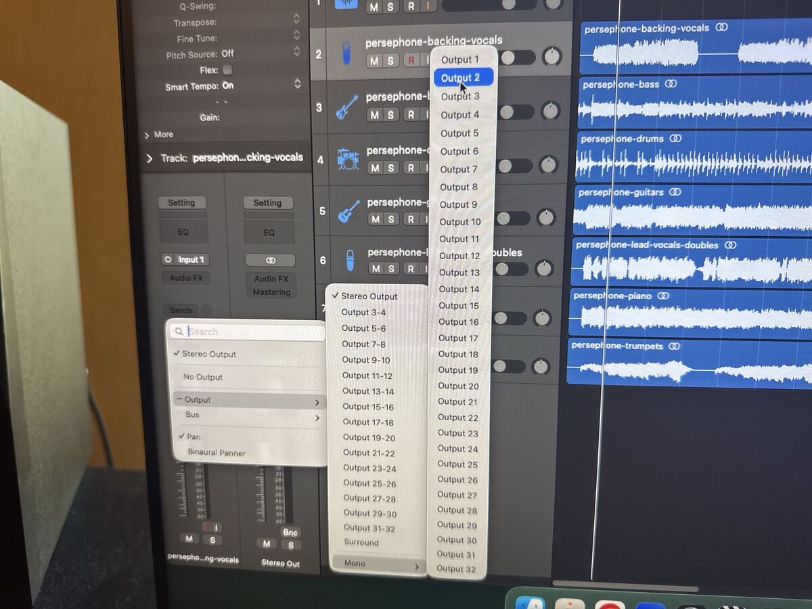
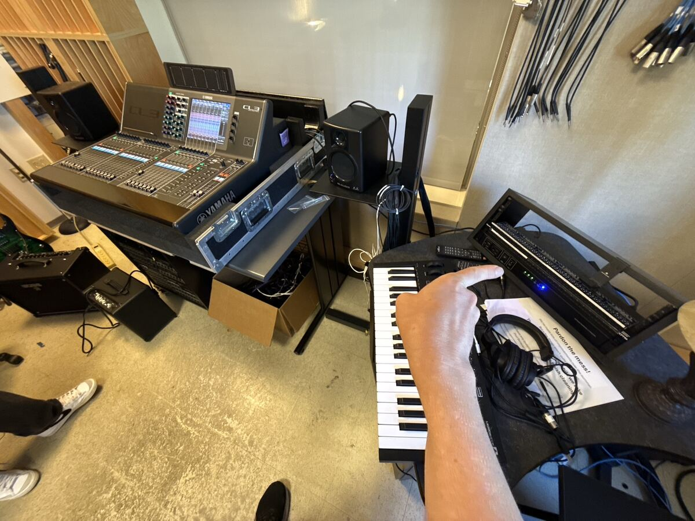
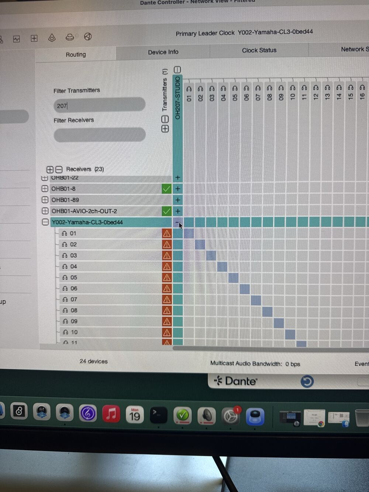
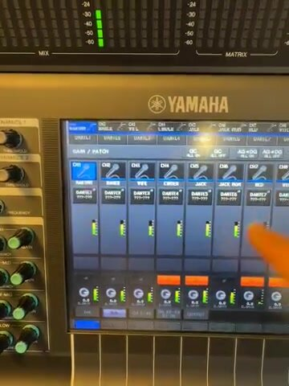
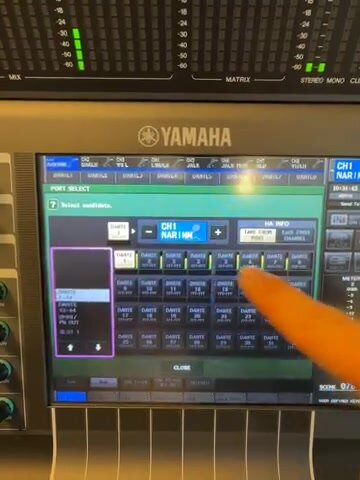
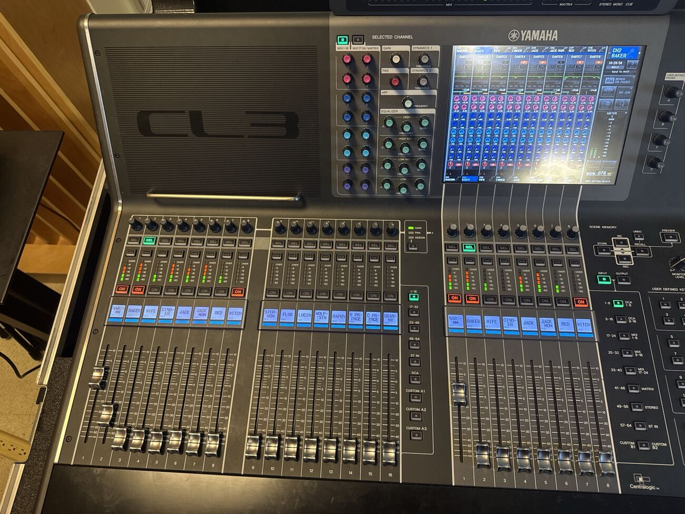

> 🧪 **Status: In Development.** Drafted 2026-10-19 from the instructor's dictated walkthrough
> while a student ran it on the OH 207 computer and CL3, plus the photos and a video taken during
> that session. The first run got Dante routed and the CL3 patched. Some steps were described
> rather than watched, so see **Technical verification**. Photos that showed the computer's
> account name and network addresses were left out.

## 🎚️ What this is

This is the setup checklist for playing **multitrack stems** from the OH 207 computer into the
**Yamaha CL3** over Dante, one stem per console channel, so you can practice mixing a band that
never gets tired.

Normally a DAW mixes all its tracks down to two channels (stereo). Here it does the opposite:
every track goes out on **its own** Dante channel, so each stem lands on its own CL3 channel,
just as each mic would at a gig.

It's prep for the **jazz combo and big band** gigs, which are mixed on the CL5. The CL3 is its
smaller sibling. The same procedure in OH B01 on the X32 is
[X32 Compact: Dante Stems](../../x32-dante-stems/). To rehearse it first in a browser, try
[Mixer Lab's CL3 Dante scenarios](https://adamborecki.github.io/mixer-lab/#/cl3-dante).

## 🗝️ Key terms

**stem** · **Dante Virtual Soundcard (DVS)** · **Dante Controller** · **transmitter / receiver**
· **subscription** · **mono channel strip** · **GAIN/PATCH** · **SEL** · **Centralogic** ·
**MIX bus** · **STEREO** · **Sends on Fader** · **power sequencer**

## 🧭 Signal flow

One stem = one Logic track = one Dante channel = one CL3 channel:

| Logic (mono) | Dante: OH207-STUDIO → CL3 | CL3 patch |
|---|---|---|
| Output 1 | 01 → 01 | DANTE1 → CH 1 |
| Output 2 | 02 → 02 | DANTE2 → CH 2 |
| … | … | … |
| Output 8 | 08 → 08 | DANTE8 → CH 8 |

## ⚠️ Before you touch anything

- 🌐 **The Dante network is shared.** Dante Controller also lists the **OH B01** devices
  (names starting **OHB01-**). Only touch **OH207-STUDIO** (transmitter) and the
  **Yamaha CL3** (receiver). A wrong click on another room's row can take its audio away mid-class.
- 💾 **Don't STORE a scene on the CL3.** Its current scene may belong to a show. Rename and
  adjust all you like, but don't save it.
- 🏷️ **Don't rename Dante devices.** If a name looks wrong, that's for **Troubleshooting** and
  Borecki, not a quick fix.
- ⚡ **Power order:** the CL3 on first, speakers last. Off in reverse. The power sequencer does
  this for you (see **Power up the CL3**).

## 🔑 Check this first

If Dante Virtual Soundcard isn't working, nothing else on this page will, so check it before
you set anything else up.

- 🚩 On the OH 207 computer, open **Dante Virtual Soundcard**.
- 🚩 It shows as **licensed** and **running**.
- 🚩 If it says it isn't licensed: **stop here** and tell Borecki or senior staff. Relicensing is
  their job, and it can take a while.

## 🎹 Set up Logic

- 🚩 Open **Logic Pro** and start a new, empty project.
- 🚩 Set Logic's audio **output device** to **Dante Virtual Soundcard** (see **Technical
  verification** for the menu path).
- 🚩 On the desktop, open the **OH207 desktop files** folder and pick one of the example songs.
- 🚩 Drag all of that song's stems into the Logic project at once. Each stem becomes its own
  audio track.
- 🚩 Write down the track order. It's about to become your channel list.
- 🚩 Select a track and look at its channel strip, on the left side of the Logic window.
- 🚩 Click the **format button** (two linked circles = stereo) so it shows **one circle**
  (mono).
- 🚩 Click the **output slot** (it says **Stereo Out**) → **Output** → **Mono** → **Output 1**
  for the first track.
- 🚩 Repeat for every track, one output each and in order: the second track on **Output 2**, the
  third on **Output 3**, and so on.
- 🚩 Turn on **Cycle** across the whole song and press **Play**. Leave it playing for the rest of
  the setup. You won't hear it yet, which is expected.

**Q1 (fill in the blank).** In Logic, every track starts on ______ Out, which mixes everything
down to two channels. For this setup, each track goes to its own ______ output instead.

✅ **Answer.** Stereo Out; Mono output (one numbered output per track: Output 1, Output 2, …).

## 🌐 Find the computer in Dante Controller

- 🚩 Open **Dante Controller**, on the **Routing** tab.
- 🚩 In **Filter Transmitters**, type **207**.
- 🚩 **OH207-STUDIO** shows in the transmitter list, along the top of the grid.
- 🚩 Not there? Go to **Troubleshooting**. Don't go on until it shows up.

## ⚡ Power up the CL3

- 🚩 Take the **cover** off the CL3. Set it somewhere it won't be stepped on. It goes back on at
  the end.
- 🚩 Turn on the **power sequencer** in the rack to the right of the CL3. It turns on the console
  first, then (after a delay) the speakers.
- 🚩 Wait for the CL3's touch screen to finish starting up.
- 🚩 In Dante Controller, the CL3 now appears as a receiver: **Y002-Yamaha-CL3-0bed44**. Clear
  the transmitter filter if you don't see it.

**Q2 (multiple choice).** Dante Controller shows OH207-STUDIO as a transmitter, but there's no
CL3 in the receiver list. What's the most likely reason?

- a) Logic isn't playing yet
- b) The Logic tracks are still on Stereo Out
- ✅ c) The CL3 isn't powered on
- d) The CL3's channels are patched to the wrong inputs

## 🔗 Route OH207-STUDIO → CL3, one to one

- 🚩 Find the square where the **OH207-STUDIO** column meets the **Y002-Yamaha-CL3-0bed44** row
  (the device-to-device square, before you expand either one).
- 🚩 **Control-click** that square. Dante Controller routes it one to one: OH207-STUDIO 01 → CL3
  01, 02 → 02, and so on. That's much faster than clicking each square.
- 🚩 Expand the CL3 row (**+**). The routes form one clean **diagonal**, with no gaps or offsets.
- 🚩 Look at the icon at the left of each CL3 channel row. Green ✓ means the route is working;
  orange ⚠ means it isn't yet (see **Technical verification**).

## 🎛️ Check the patch on the CL3

- 🚩 On the touch screen's overview, each channel shows its input patch under its name
  (**DANTE1**, **DANTE2**, …).
- 🚩 Tap a channel's patch field. The **GAIN/PATCH** screen opens, with CH 1–8 and the patch for
  each.
- 🚩 Each channel is patched to the matching Dante input: CH 1 to **DANTE1**, CH 2 to **DANTE2**,
  and so on. If one isn't, tap its patch button → **PORT SELECT** → the matching **DANTE** input →
  **CLOSE**.

**Q3 (short answer).** Every Logic track is on its own output and Dante Controller shows a clean
diagonal, but CL3 channel 3 shows nothing. Name the next place you'd look, and what you'd expect
to see there.

✅ **Answer.** The CL3's GAIN/PATCH screen: channel 3 should be patched to DANTE 3. (Before that,
confirm Logic's third track really has audio and is on Output 3.)

## 🎚️ Signal on the CL3

- 🚩 Logic is still playing. The meters move on channels 1 through however many stems you have.
- 🚩 Each channel is **ON** (lit) and its fader is up.
- 🚩 Rename the channels to match your stems: tap the channel **name** at the top of the touch
  screen, then type the new name.
- 🚩 Press a channel's **SEL**, then turn the **SELECTED CHANNEL** knobs (**PAN**, **EQUALIZER**,
  **HPF**). The overview on the screen follows your changes.

## 🗂️ Find your way around the CL3

- 🚩 **Left side, input layers:** the keys between the fader banks (**1-16**, **17-32**,
  **33-48**, **49-64**, **ST IN**, **DCA**, **CUSTOM A1–A3**) choose which channels the faders
  control.
- 🚩 **Right side, Centralogic:** the 8 faders under the screen. Press **INPUT** or **OUTPUT**,
  then a bank key. INPUT shows channels; OUTPUT shows **DCA**, **MIX**, **MATRIX**, and
  **STEREO**.
- 🚩 Press **OUTPUT** → **STEREO**. Centralogic now shows the stereo master (**ST L**, **ST R**).
- 🚩 Find **MIX 1–8**. The **MIX** buses are where you build monitor mixes (bus sends). **STEREO**
  is the main output.

**Q4 (fill in the blank).** On the CL3, a monitor mix is built on a ______ bus. The main output is
called ______.

✅ **Answer.** MIX (MIX 1, for example); STEREO.

## 🔈 Monitor mix on MIX 1 (coming soon)

The plan is for **MIX 1** to feed a second monitor in OH 207. That connection isn't set up yet,
so you can build the mix now, but it won't play anywhere until then.

- 🚩 Turn on **SENDS ON FADER** (on the touch screen, at the right) and choose **MIX 1**. The
  input faders are now each channel's send to MIX 1, not its level in STEREO.
- 🚩 Build a monitor mix that's clearly different from the main mix (for example, drums and bass
  loud, everything else low).
- 🚩 Turn **SENDS ON FADER** off. The faders are back to the main mix, and it hasn't changed.

## 🛠️ Troubleshooting

Check one hop at a time, in signal order:

1. **Is Logic playing**, and does each track show audio?
2. **Is Logic's output device Dante Virtual Soundcard**, with every track on its own mono output?
3. **Does Dante Controller show OH207-STUDIO as a transmitter?** If not:
   - Open **Dante Virtual Soundcard** and check it's licensed and running.
   - Turning DVS off and on again makes its transmitter disappear and come back in Dante
     Controller. Watch which one comes back. That's how a wrongly named device was caught on
     2026-10-19.
   - If the computer shows up under a different name, that's for Borecki. Don't rename it
     yourself.
4. **Does the CL3 show as a receiver?** If not, it's off or still starting up.
5. **Is the routing one clean diagonal?** If every channel is shifted by one, re-route one to
   one.
6. **On the CL3, is each channel patched to its matching DANTE input, ON, with its fader up?**

## 🏁 Strike

- 🚩 Stop Logic. Ask before saving the project anywhere.
- 🚩 Pull the CL3's faders down.
- 🚩 Don't **STORE** the scene.
- 🚩 Turn off the **power sequencer** (speakers off first, the console last).
- 🚩 Put the **cover** back on the CL3.

## ✅ Definition of done

- 🚩 Dante Virtual Soundcard was checked before anything else.
- 🚩 Each stem plays on its own CL3 channel, in track order, and you can show the meters.
- 🚩 Dante Controller shows OH207-STUDIO → CL3 one to one, and no other room's routing was
  touched.
- 🚩 At least one channel is renamed, panned, and EQ'd using SEL.
- 🚩 The CL3 is powered off through the sequencer, with its cover on.

## 💭 Before you leave

- Which hop would you check first if only one CL3 channel were silent? And if *every* channel
  were silent?

## ⚙️ Technical verification

- **Logic's output device menu path.** The walkthrough says the output must be Dante Virtual
  Soundcard. The exact path in the OH 207 Logic version (likely **Logic Pro → Settings → Audio →
  Devices → Output Device**) wasn't checked.
- **Stereo stems on a mono track.** The example stems are stereo files. What a mono channel strip
  plays from a stereo file (the left side, or a sum) isn't confirmed. The walkthrough mentions a
  different way to send a stereo stem as a pair; that isn't written up yet.
- **What counts as "licensed" in DVS.** What the Dante Virtual Soundcard window shows when it's
  licensed (or not) hasn't been described. On 2026-10-19, Dante Controller and DVS were both
  behind on updates.
- **DVS network interface.** The walkthrough says DVS may need its network interface switched to
  a different one. Which one, and when, is unknown.
- **The transmitter's name.** On 2026-10-19, this computer showed up in Dante Controller as
  **OHB01-17** and was renamed **OH207-STUDIO** after its IP address (Device View → **Status**)
  was matched against **System Settings → Network → Ethernet**. Whether that was the only
  mislabeled device isn't confirmed.
- **Orange ⚠ next to the CL3's channels.** Right after the one-to-one routing, the photo shows
  an orange ⚠ on each CL3 receive row. Whether they turned to a green ✓ once audio flowed wasn't
  captured.
- **Control-click for one-to-one** was shown on this Mac. Whether it's Control or Command on
  other versions isn't checked.
- **The power sequencer.** Which unit and which switch, and what its stages power, isn't
  labeled here yet. The CL3's own power switch is on the back, dead center, above the IEC power
  cable, but the sequencer is the normal way to turn it on.
- **How you hear the CL3 in OH 207.** Which CL3 output feeds the OH 207 speakers (and
  headphones) isn't documented. Until it is, the meters are the proof.
- **The CL3's scene.** The console was on scene **076**, with a show's channel names. Should
  practice start from a particular scene, and should the names be put back afterward? Not
  stated.
- **SENDS ON FADER** on the CL3: its touch-screen button is visible in the photos, but choosing
  MIX 1 with it wasn't walked through. MIX 1's destination (a second monitor) is still being set
  up.
- **Dante routing at strike.** Should the OH207-STUDIO → CL3 routes stay for the next person, or
  be removed? Not stated.
- **Where the stems are.** The folder is named here as dictated (**OH207 desktop files**).
  Real jazz combo and big band multitracks are planned for it.

## 🤖 AI use disclosure

Written by AI (Claude, via Claude Code) from the instructor's dictated walkthrough, five photos,
and a short video from the first run in OH 207. Steps follow the order the instructor gave.
Control names come from what's visible in the photos and video. The four questions were added.
Nothing was tested by the AI on the gear.
