> 🧪 **Status: In Development.** Drafted November 2026 from the instructor's walkthrough of the
> Commercial Music Ensemble (CME) rehearsal in Salmon, the instructor's answers to follow-up
> questions, and photos of the gear, the FOH wireless rack and the X32's routing pages. Students in the photos are
> pixelated. The default patch below (the band on S32 IN 25–32, the wireless on CH 17–21) is the
> plan from now on: at the first rehearsal the sub snake was on S32 IN 11–14. A few details are still
> open. See **Technical verification**.

## 🎚️ What this is

The gig checklist for the **Commercial Music Ensemble (CME)** in Salmon Recital Hall: a band with
lead and backing vocals on **wireless handhelds**, a **Nord**, the **grand piano**, bass, guitars,
drums, and sometimes a horn. The lineup changes from song to song.

Two things make CME different from other Salmon gigs:

- **Feedback is the big risk**, so CME brings its **own mains**: two passive Yamaha speakers on stands,
  **downstage of the band**, so every open mic is behind them. The hall's installed speakers are
  turned down at the **Mix5** in the hall's mains rack.
- **Three wedges, three mixes.** Each wedge has its own mix and its own amp channel. No daisy
  chain.

Everything most Salmon gigs share still applies: the wireless rack's **Furman** goes on at the start
and off at the end, and the X32 routing is the hall's default.

**What matters most, in order:** (1) the **vocals in the mains and in the wedges**, (2) the piano
mics and the Nord's DI, (3) the bass DI and a mic on the guitar amp. If time is short, (1) is the
gig. The amps on stage are loud enough on their own.

## 🗝️ Key terms

**downstage** · **feedback** · **wedge** · **mix bus** · **passive speaker** · **active speaker** ·
**IEC cable** · **speaker cable** · **TS** · **TRS** · **sub snake** · **S32** · **AES50** ·
**DI box** · **48V** · **gain** · **level sheet**

## 🕹️ Practice first

- [Mixer Lab: CME in Salmon: Essentials](https://adamborecki.github.io/mixer-lab/#/x32-cme-tour): fourteen scenarios on a virtual X32 with this gig's rig, wireless rack included. The first is the whole rig working, nothing broken; the rest each break one piece, in the order this checklist runs: the wireless rack's power, the downstage mains, the Mix5, the three wedges and the music test, the mics, the band on the sub snake, the levels, a bad cable, and the end of the night.
- [Mixer Lab: CME in Salmon: Advanced](https://adamborecki.github.io/mixer-lab/#/x32-cme-adv-antenna): twelve scenarios, the troubleshooting tier, due the week after Essentials. Odd faults on the same rig (a dead antenna splitter, a receiver's VOL knob, a guest on a headset, the S32 losing power, a wedge on the wrong cable or the wrong mix), ending with several at once ten minutes before downbeat.

The simulator is still being built: where it and this checklist disagree, the checklist wins. Tell
your supervisor what you found.

## 🧰 Equipment and materials

All of it lives in the Salmon storage closet, **BH 102**, unless it says otherwise.

- [ ] **Two Yamaha passive speakers** and **two speaker stands** (the downstage mains)
- [ ] **Three wedges**: two passive (1/4" only) and one active
- [ ] **1/4" speaker cables**: a short one, and the **very long one in its own box** (amp rack to the
  far side of the stage)
- [ ] The **Hosa sub snake** (8 channels, "Little Bro")
- [ ] **DI boxes** (the Nord, the bass)
- [ ] An **SM57** and a short stand for the guitar amp; **two pencil condensers** for the piano
- [ ] **Amps** if the band isn't bringing its own: they're on the **School of Rock band cart**, off to
  the side, with the **amp stands**
- [ ] **AC extension cords** (in the **black milk crates**) and **IEC cables** (in the box labeled
  **IEC**)
- [ ] **Headphones** for the X32. Test music comes from the **FOH Mac mini**, already at FOH (through
  its **SSL 2+** into the X32's **AUX IN 1/2**)
- [ ] A printed copy of the **level sheet** (on the worksheet)

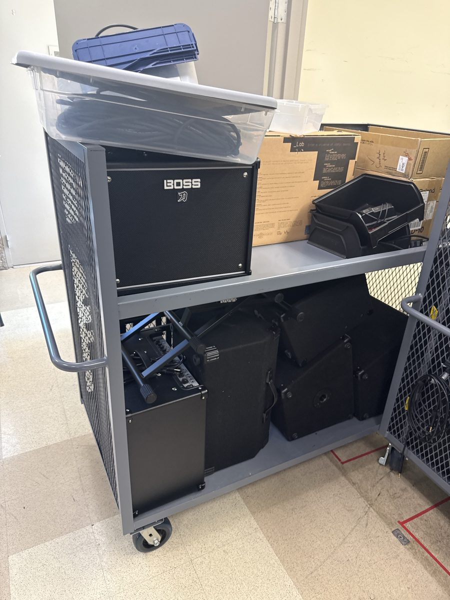

## ⚠️ Before you touch anything

- ⏰ **Arrive early.** At the dress rehearsal one passive wedge never worked and there wasn't time
  to find out why. Don't assume the gear works.
- 🔌 **Power order:** mixer and sources first, **amps last**. At the end of the gig, amps off
  **first**.
- 🔈 **Speaker cable is not instrument cable.** Same 1/4" plug, different job: a speaker cable is
  thick, an instrument or patch cable is thin. There are enough speaker cables: never use anything
  else between an amp and a passive speaker.
- 🎤 **The handheld's one button:** a **tap** mutes or unmutes it, **press and hold** switches it
  on or off.
- 🙋 **Ask when you're not sure.** The director and your supervisor know things this checklist
  can't.

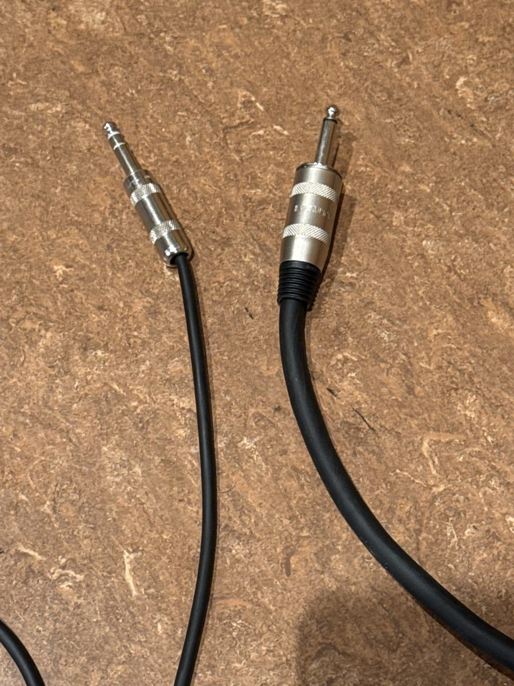

## 🗺️ The plan: inputs and outputs

Everyone sits on **one layer, CH 17–32**. The X32's input routing stays at **Salmon's default**
(CH 1–24 **Local**, CH 25–32 **AES50 A25-32**): nothing to change.

| CH | Source | How it gets there |
|---|---|---|
| 17 | Red handheld: the mic over the piano | Receiver 3, CH 1 → LOCAL 17 |
| 18 | Orange handheld: lead vocal | Receiver 3, CH 2 → LOCAL 18 |
| 19, 20 | Yellow, green handhelds: backing vocals | Receiver 3, CH 3, 4 → LOCAL 19, 20 |
| 21 | Blue handheld: horn (when there is one) | Receiver 3, CH 5 → LOCAL 21 |
| 25 | Nord, through a DI | Sub snake 1 → S32 IN 25 |
| 26 | Spare (the Nord, if it's ever in stereo) | Sub snake 2 → S32 IN 26 |
| 27, 28 | Grand piano: two pencil condensers, **48V** | Sub snake 3, 4 → S32 IN 27, 28 |
| 29 | Bass, through a DI | Sub snake 5 → S32 IN 29 |
| 30 | Guitar amp: SM57 | Sub snake 6 → S32 IN 30 |
| 31 | Second guitar amp, if there is one | Sub snake 7 → S32 IN 31 |
| 32 | Spare: a drum overhead, if wanted | Sub snake 8 → S32 IN 32 |

The handhelds for CH 17–24 are the ones with **no windscreen**, ring colors left to right across the
stage: red, orange, yellow, green, blue, purple, then black and gray.

| X32 output | Carries | Goes to |
|---|---|---|
| OUT 9 | MIX 9 | S32 OUT 9 → KM750 → wedge 1 (house left, passive) |
| OUT 10 | MIX 10 | S32 OUT 10 → KM750 → wedge 2 (center, passive) |
| OUT 11 | MIX 11 | S32 OUT 11 → wedge 3 (house right, active) |
| OUT 13, 14 | MAIN L, R | S32 OUT 13, 14 → the Crown in the amp rack → the two Yamaha speakers downstage |
| OUT 15, 16 | MAIN L, R | S32 OUT 15, 16 → the Mix5 in the hall's mains rack → the hall's installed speakers |

Wedges on **MIX 9–11** leave the mixes Vocal Jazz and the a cappella groups use (1 and up) alone.
The X32's own **XLR OUT 9–12** carry the same outputs, and the **IEM transmitters** in the wireless
rack are plugged into them. CME doesn't use in-ears; leave those cables where they are.

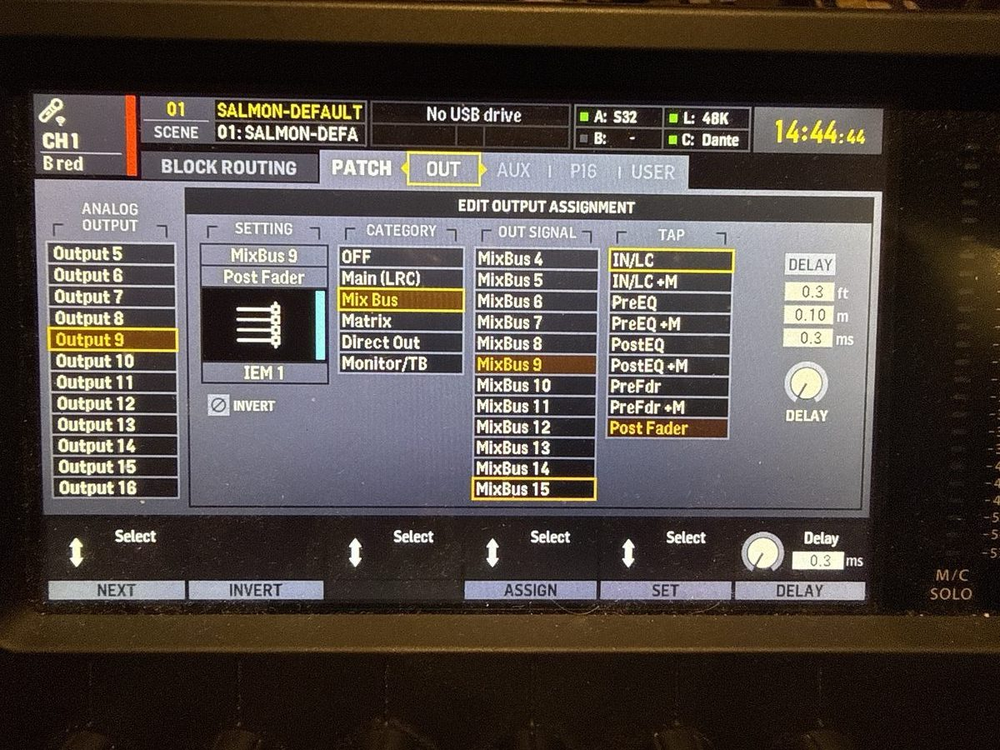

## 📡 The wireless rack at FOH

The wireless lives in its own rack at **FOH, next to the X32**, with its own power. Top to bottom:

| Unit | What it does | Into the X32 |
|---|---|---|
| **Furman** | The rack's power switch. Off, and every receiver is dark. | — |
| **PTU-6000** receiver 1 | 8 handhelds with **black** windscreens | LOCAL 1–8 |
| **PTU-6000** receiver 2 | 8 handhelds with **gray** windscreens | LOCAL 9–16 |
| **PTU-6000** receiver 3 | 8 handhelds with **no windscreen**: CME's | LOCAL 17–24 |
| **PTU-7000** | Lav and headset mics. CME can't use it: with Salmon's default routing, CH 25–32 come from the S32, where the sub snake is. | LOCAL 25–28 |
| **PAS-225**, **PAS-225X** | Antenna distribution. The two **antennas** sit outside the rack and plug into the PAS-225, which feeds some receivers and the PAS-225X; the PAS-225X feeds the rest. Every receiver gets **both** antenna signals (A and B). | — |
| Drawer | **IEMs** and **body packs** | — |

Every receiver is Phenyx Pro, with one XLR output per channel at **line level**.

Each receiver channel has a **VOL** knob. They all sit at **9 o'clock**, which is right with the
channel's GAIN at about 30 dB. Leave them there: set levels at the X32's GAIN.

Behind the rack, a network cable runs from the X32's **CARD** slot (an **X-DANTE** card) to the
**FOH Mac mini**, for multitrack recording. Leave it plugged in.

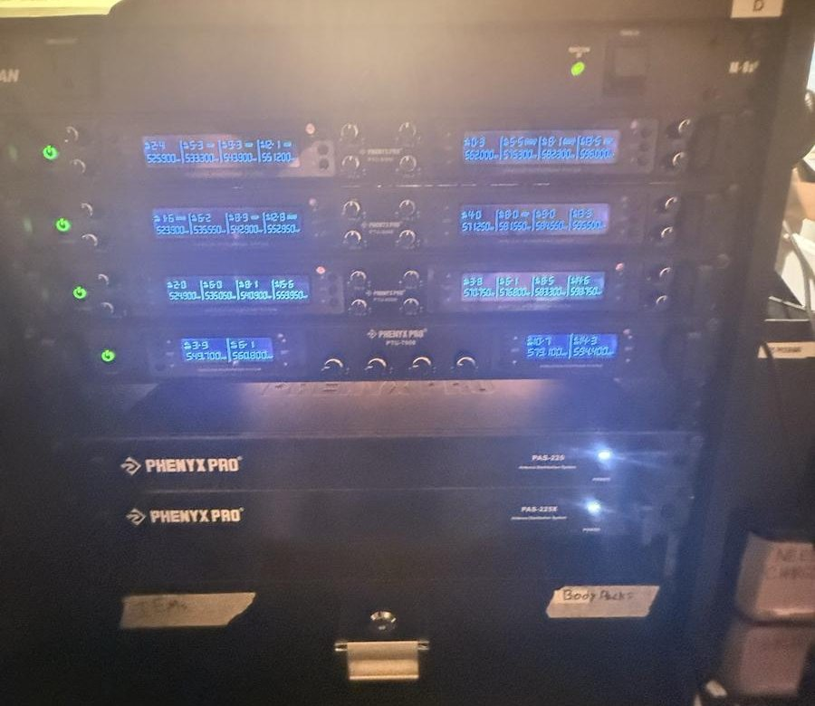

**Q1 (multiple choice).** All five handhelds are on, but CH 17–21 are dead and the receivers'
displays are dark. What do you check first?

- a) The batteries in each handheld.
- ✅ b) The wireless rack's Furman.
- c) The X32's input routing.
- d) The VOL knobs on receiver 3.

🕹️ In Mixer Lab: [Five mics, all silent](https://adamborecki.github.io/mixer-lab/#/x32-cme-rack).

🕹️ In Mixer Lab (Advanced): [Furman on, receivers lit, still nothing](https://adamborecki.github.io/mixer-lab/#/x32-cme-adv-antenna),
[The lead vocal distorts at any GAIN](https://adamborecki.github.io/mixer-lab/#/x32-cme-adv-vol) and
[A guest singer on a headset](https://adamborecki.github.io/mixer-lab/#/x32-cme-adv-headset).

## 🚗 Arrival — early

- 🚩 Arrive early, with time to spare for something that doesn't work the first time.
- 🚩 Split the jobs. One engineer at **FOH** (the X32), one **on stage and at the amp racks**. You'll
  talk to each other a lot: the amps' knobs are a long way from the console.
- 🚩 Switch the **wireless rack** on at the **Furman** on top. Receiver 3's display should light up.

**Q2 (short answer).** Arrival time: ______ · Band in at: ______ · Downbeat: ______

✅ **Answer.** There's no fixed answer. Write in tonight's times: it's a log entry, not a test.

## 🔊 The mains, downstage

- 🚩 Bring the two **Yamaha speakers** and their **stands** out of BH 102 first: they're the heavy part.
- 🚩 Set them up at the **front corners of the stage, downstage of the band**, so every mic on stage
  is behind them.
- 🚩 Run S32 **OUT 13** and **OUT 14** into the **Crown in the amp rack**: its inputs and outputs
  are **1/4"**.
- 🚩 Crown **CH 1** output → the near Yamaha speaker on the **short** 1/4" speaker cable; **CH 2** output →
  the far Yamaha speaker on the **very long** one.
- 🚩 Play test music from the FOH Mac mini (SSL 2+ → AUX IN 1/2) and confirm **both** Yamaha speakers play it.

🕹️ In Mixer Lab: [Put the mains downstage](https://adamborecki.github.io/mixer-lab/#/x32-cme-mains).

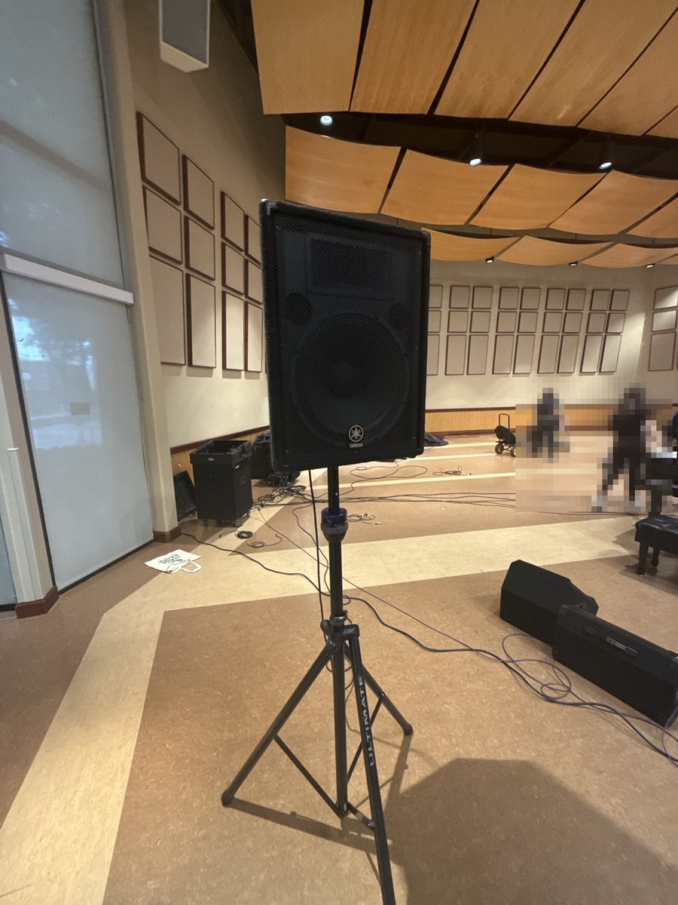

**Q3 (multiple choice).** Why does CME bring its own mains and put them downstage of the band?

- a) The hall's installed speakers are broken.
- ✅ b) With the speakers in front of the band, the open mics are behind them, so feedback is much less likely.
- c) Passive speakers are louder than the hall's speakers.
- d) The X32 can't send MAIN to the hall's speakers.

## 🏠 The hall's speakers down

The hall's own mains rack is permanent: the small **Mackie Mix5** on top, the rack's power below
it, and a **Crown** inside that drives the hall's installed speakers. Leave the cables inside the
rack alone; only the Mix5's knobs change for CME.

- 🚩 In the hall's **mains rack**, find the small **Mackie Mix5**. S32 OUT 15/16 come in on two of
  its inputs (**LINE IN 4/5** in the photo).
- 🚩 Turn **that channel's LEVEL** knob all the way down. **Not MAIN MIX**: that way someone who plugs
  a phone into the rack's 3.5 mm input still gets sound.
- 🚩 Check that the hall's installed speakers are silent and the Yamaha speakers still play.
- 🚩 Check the two 1/4" cables from the S32 into the Mix5 are still there. People sometimes borrow
  them.

🕹️ In Mixer Lab: [The hall's speakers are on too](https://adamborecki.github.io/mixer-lab/#/x32-cme-house).

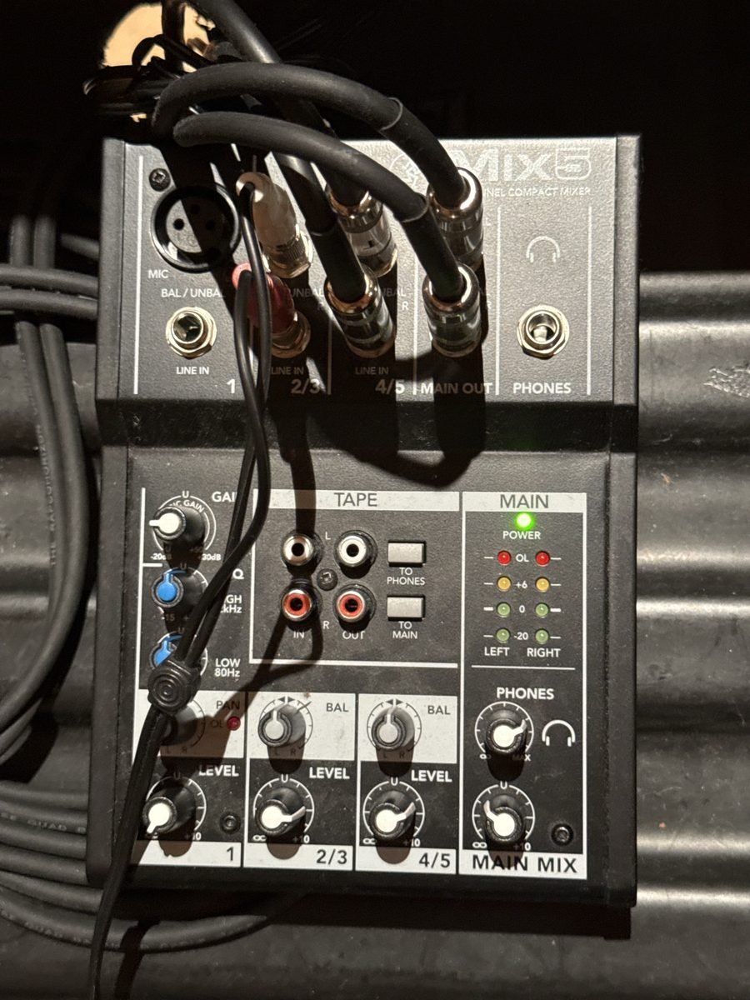

**Q4 (multiple choice).** Which knob turns the hall's installed speakers down for CME?

- a) The Mix5's MAIN MIX.
- ✅ b) The LEVEL of the Mix5 channel that S32 OUT 15/16 come in on.
- c) The X32's MAIN LR fader.
- d) The Crown's power switch.

## 🎧 The wedges: three mixes

- 🚩 Bring out the **three wedges**: two **passive** (1/4" only) and one **active**.
- 🚩 Each wedge gets its **own mix** and its **own amp channel**. Never daisy-chain two different mixes.
- 🚩 Passive wedges: S32 **OUT 9** → KM750 **CH A** input; S32 **OUT 10** → KM750 **CH B** input. From
  each channel's output, a **1/4" speaker cable** to its wedge. Which KM750 you use doesn't matter;
  the music test proves it.
- 🚩 Active wedge: an **XLR** from S32 **OUT 11**, and plug in its **IEC power cable**. It has its
  own **VOLUME** knob.
- 🚩 Wedge 1 (MIX 9) house left, wedge 2 (MIX 10) center, wedge 3 (MIX 11) house right.

🕹️ In Mixer Lab: [Three wedges, three mixes](https://adamborecki.github.io/mixer-lab/#/x32-cme-wedges).

🕹️ In Mixer Lab (Advanced): [Wedge 2 on the wrong cable](https://adamborecki.github.io/mixer-lab/#/x32-cme-adv-inst),
[The active wedge on an amp](https://adamborecki.github.io/mixer-lab/#/x32-cme-adv-active-amp) and
[Wedge 3 plays the house mix](https://adamborecki.github.io/mixer-lab/#/x32-cme-adv-route).

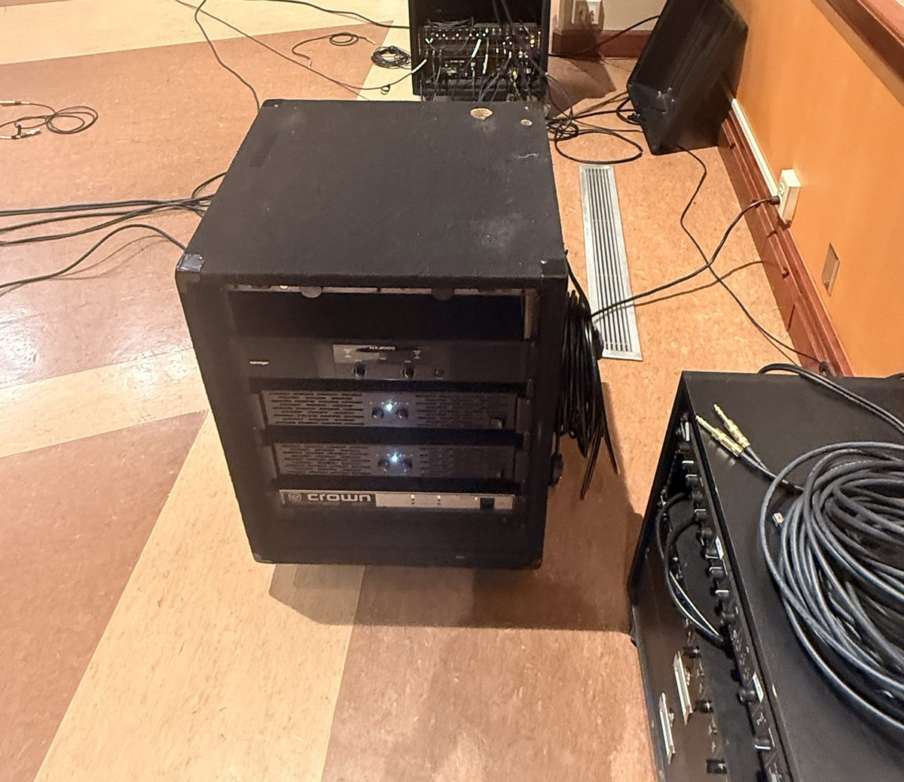

**Q5 (multiple choice).** What goes between a KM750's output and a 1/4" passive wedge?

- a) An XLR cable.
- b) A thin 1/4" instrument cable.
- ✅ c) A thick 1/4" speaker cable.
- d) A TRS patch cable.

## 🎵 The music test, before any mic

- 🚩 Test music into **MIX 9**, **10** and **11**, one at a time, with the house down, and **listen to
  each wedge**.
- 🚩 A silent wedge: follow its path out from the S32. Is the active wedge powered, and its
  **VOLUME** up?
- 🚩 Set the **amps' level knobs**, about the same on every channel, while the music plays. The
  engineer on stage turns the amp knobs; the one at FOH watches the X32. After this, mix at the console.

🕹️ In Mixer Lab: [Test each wedge with music](https://adamborecki.github.io/mixer-lab/#/x32-cme-wedge-test) and
[The center wedge is barely there](https://adamborecki.github.io/mixer-lab/#/x32-cme-amp-knob).

**Q6 (short answer).** Why does every wedge get the test music before anyone talks into a mic?

✅ **Answer.** Music you know proves the whole path (the mix, the output, the cable, the amp and the
speaker) and sets a rough level, before a mic can feed back or a singer gets blasted.

## 🎤 The wireless mics

- 🚩 Batteries in, the right way round; **press and hold** to switch each handheld on.
- 🚩 Talk into each one and watch **its own channel** (CH 17–21) at the X32. Receiver 3 shows each
  handheld's signal too: no signal there, and the problem is the mic, the rack's power or the antennas,
  not the X32.
- 🚩 Leave the receivers' **VOL** knobs at **9 o'clock**.
- 🚩 Each vocal mic goes in the **mains** and **all three wedges** (MIX 9, 10, 11). Use **SENDS ON
  FADERS** on the **BUS 9-16** layer.

🕹️ In Mixer Lab: [Two backing singers are silent](https://adamborecki.github.io/mixer-lab/#/x32-cme-mics) and
[The singers in every wedge](https://adamborecki.github.io/mixer-lab/#/x32-cme-vox).

**Q7 (multiple choice).** A handheld's receiver shows signal, but its channel's meter doesn't move.
What's most likely?

- a) The battery is dead.
- ✅ b) The mic is muted: someone tapped its button.
- c) The receiver is unplugged from the X32.
- d) The channel needs 48V.

## 🎸 The band

- 🚩 Put the **Hosa sub snake** by the piano; its tails go into **S32 IN 25–32**, in order.
- 🚩 Plug in left to right across the stage, by the input list: the **Nord DI** on 1, the **piano's
  pencil condensers** on 3 and 4, the **bass DI** on 5, the **SM57** on the guitar amp on 6.
- 🚩 **48V** on CH 27 and 28 (the condensers).
- 🚩 Set up the guitar amp on its **amp stand**. Power cables stay with their amp.
- 🚩 Check every channel's meter while that player plays. A dead mic on an amp: check the **amp's own
  volume** before the console. Ask before you touch anyone's amp.

🕹️ In Mixer Lab: [Plug in the band](https://adamborecki.github.io/mixer-lab/#/x32-cme-band) and
[No guitar anywhere](https://adamborecki.github.io/mixer-lab/#/x32-cme-gtr).

🕹️ In Mixer Lab (Advanced): [The guitar amp is dead, no lights](https://adamborecki.github.io/mixer-lab/#/x32-cme-adv-katana) and
[The pianist sings lead tonight](https://adamborecki.github.io/mixer-lab/#/x32-cme-adv-lead).

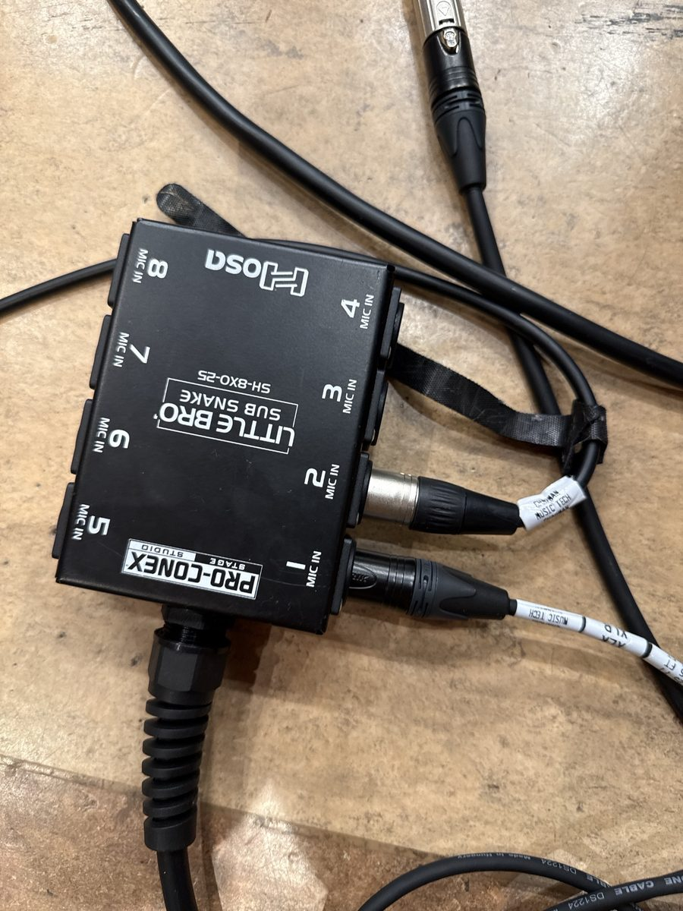

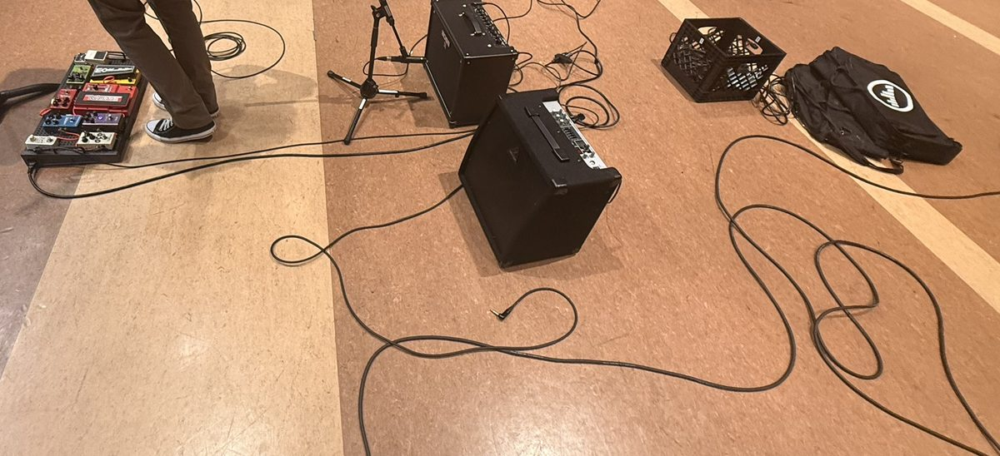

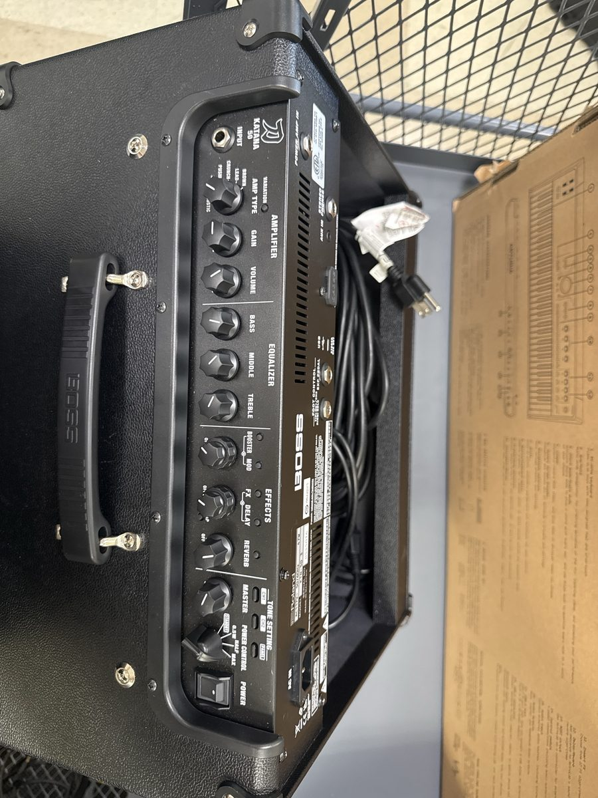

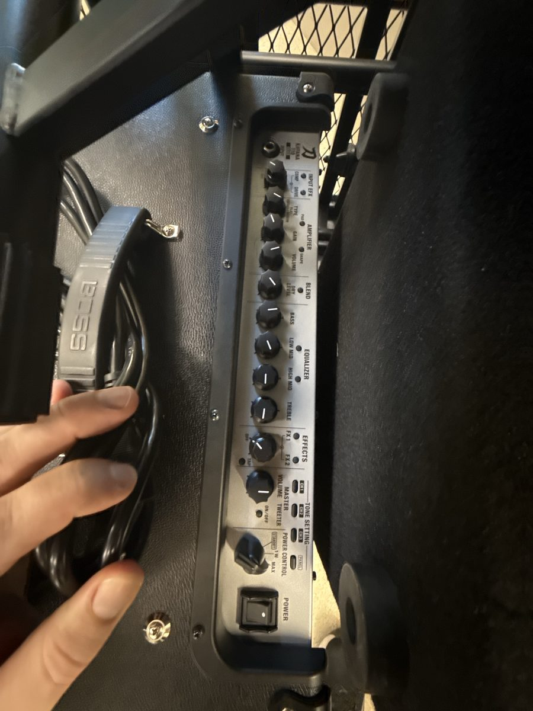

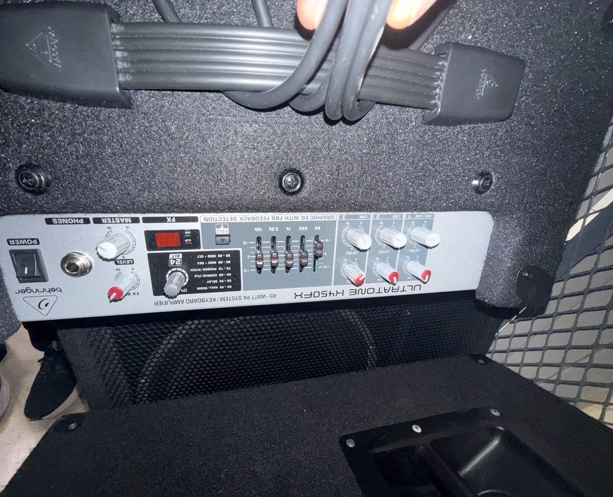

## 📝 Levels: write them down

The dress rehearsal is right before the show, so what you write down at soundcheck is what gets
the show back if anything gets bumped. There's no saved scene for CME yet.

- 🚩 Set each channel's **GAIN** so it peaks in the good range, about −18 to −6. GAIN first;
  faders are for the mix.
- 🚩 Write every GAIN, and every amp knob, on the level sheet. Keep it at FOH.

🕹️ In Mixer Lab: [Set the gains, then write them down](https://adamborecki.github.io/mixer-lab/#/x32-cme-gains).

**Q8 (short answer).** Level sheet, GAIN: 17 red ______ · 18 orange ______ · 19 yellow ______ ·
20 green ______ · 21 blue ______ · 25 Nord ______ · 27 piano L ______ · 28 piano R ______ ·
29 bass ______ · 30 guitar ______ · 31 guitar 2 ______ · 32 overhead ______

✅ **Answer.** There's no fixed answer: tonight's numbers, for getting back to them during the show.

**Q9 (short answer).** Level sheet, amps: KM750 CH A (wedge 1) ______ · KM750 CH B (wedge 2) ______ ·
wedge 3 VOLUME ______ · Crown CH 1 ______ · Crown CH 2 ______

✅ **Answer.** There's no fixed answer: where each knob was set during the music test.

## 🧰 If something doesn't work

Work down the list and stop when it's fixed.

- 🚩 **Signal at the mixer?** Watch the channel's meter.
- 🚩 **A handheld:** is it **muted** (a tap) or **off** (press and hold)? Check the battery.
- 🚩 **Every handheld:** is the wireless rack's **Furman** on? Are both antenna cables plugged in?
- 🚩 **Receivers lit but no signal:** check that the **antenna distribution** (PAS-225, PAS-225X) is
  on. A receiver with no antenna feed hears nothing.
- 🚩 **A vocal distorts with GAIN low:** check that receiver channel's **VOL** knob. Back to **9
  o'clock**, then set GAIN.
- 🚩 **A mic on an amp, or a DI:** is the **amp or instrument's own volume** up?
- 🚩 **An amp with no lights:** check its **power cable** first.
- 🚩 **The band, every wedge and the mains dead, but the wireless fine:** check the **S32's power**.
  The wireless comes into the X32 itself; the rest goes through the S32.
- 🚩 **In the mains but not a wedge:** the singer's send to that wedge's mix.
- 🚩 **A wedge dead:** the amp's level knob, the active wedge's power and VOLUME, then reseat every
  cable on its path.
- 🚩 **A wedge plays the wrong mix:** check the X32's **output routing**. Output 9 carries MixBus 9, 10
  carries 10, 11 carries 11.
- 🚩 **Never** connect the **active wedge** to an amp's speaker output. Speaker level can damage a
  powered speaker. It gets an **XLR** straight from S32 OUT 11.
- 🚩 **Everything is plugged in the right place and still nothing:** swap the cable. Cables fail
  inside. Tag the bad one with gaff tape and tell your supervisor.

🕹️ In Mixer Lab: [Wedge 1 died](https://adamborecki.github.io/mixer-lab/#/x32-cme-cable).

🕹️ In Mixer Lab (Advanced): [Half the stage went dead](https://adamborecki.github.io/mixer-lab/#/x32-cme-adv-s32) and
[Ten minutes to downbeat](https://adamborecki.github.io/mixer-lab/#/x32-cme-adv-stack).

## ➕ More than eight band inputs

If the band needs more than the sub snake's eight channels, plug the extra sources into the S32's
**IN 9–16** and set the X32's **ROUTING → INPUT**: **9–16 = AES50 A9-16**. That takes CH 9–16 off
receiver 2 (the gray-windscreen handhelds), which CME doesn't use. Put it back at the end of the gig.

🕹️ In Mixer Lab (Advanced): [Two more inputs than the sub snake has](https://adamborecki.github.io/mixer-lab/#/x32-cme-adv-inputs).

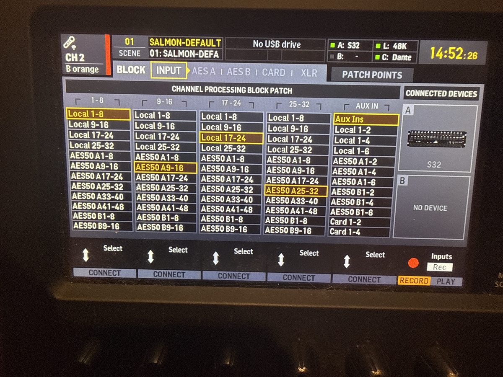

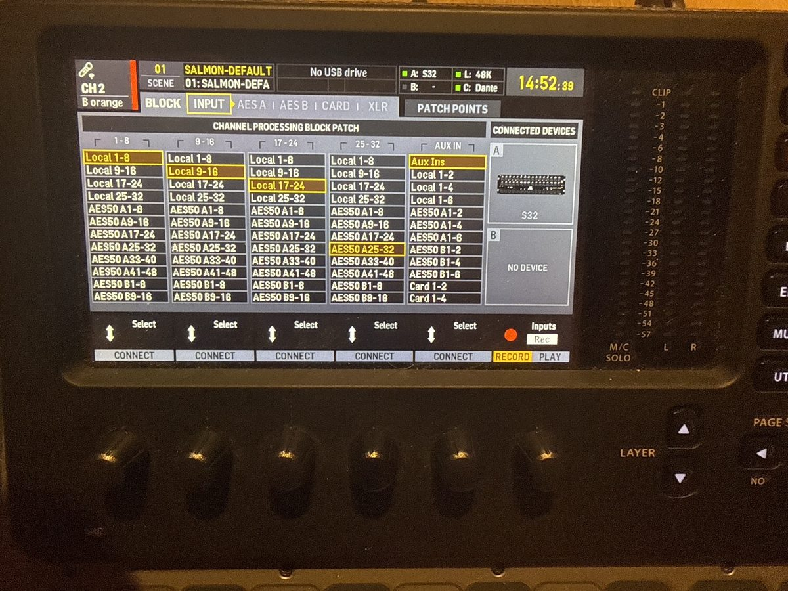

## 🏁 End of the gig

- 🚩 **First, the thing everyone forgets:** turn the Mix5's channel LEVEL back up to **U**. The
  next group (Vocal Jazz, say) uses the hall's speakers and won't think to check a rack.
- 🚩 Amps **off first**, before anything gets unplugged.
- 🚩 If you changed the X32's input routing, put it back to the default.
- 🚩 Handhelds off (press and hold), batteries out. Rechargeables go in the charger; alkalines never do.
- 🚩 Switch the **wireless rack off** at the **Furman**.
- 🚩 Back to BH 102, each in its place: the Yamaha speakers and stands, the wedges, the sub snake, the DIs,
  the amps and **amp stands** on the **School of Rock band cart**, the **long speaker cable in its own
  box**, **IEC cables** in the **IEC** box (or with the amp that needs one), **AC cords** in the
  **black milk crates**.
- 🚩 **Leave the closet better than you found it.** It's a mess right now. Put things where they go,
  coil cables properly, and if something has no home, tell your supervisor rather than leaving it
  on the floor.
- 🚩 Close BH 102 properly: the fixed half of the double door fully closed and its flush bolt over,
  then the other half.

🕹️ In Mixer Lab: [The end of the night](https://adamborecki.github.io/mixer-lab/#/x32-cme-end).

🕹️ In Mixer Lab (Advanced): [The hall's speakers won't come back](https://adamborecki.github.io/mixer-lab/#/x32-cme-adv-mix5).

**Q10 (short answer).** What's the first thing you do at the end of a CME gig, and why first?

✅ **Answer.** Turn the hall's speakers back on at the Mix5 (the channel LEVEL for S32 OUT 15/16,
back to U). It's the easiest thing to forget, and the next group expects the hall's speakers to work.

## ✅ Definition of done

- 🚩 The vocals were in the mains and every wedge before downbeat.
- 🚩 Every wedge passed the music test, and the amp knobs are on the level sheet.
- 🚩 Every channel's GAIN is on the level sheet.
- 🚩 The Mix5 is back at U and the hall's speakers work.
- 🚩 Everything is back in BH 102, in its place, and the closet is tidier than before.

## 💭 Before you leave

- 🚩 Did anything fail tonight (a cable, a wedge, a mic)? Tell your supervisor, and tag it.

## ⚙️ Technical verification

**Confirmed (instructor, November 2026, with photos):**

- The wireless handhelds 17–24 have no windscreen; ring colors red, orange, yellow, green, blue,
  purple, then black and gray. Red is the mic over the piano, orange the lead vocal, yellow and green
  the backing vocals. The horn comes in on a wireless.
- The Hosa sub snake carries the Nord DI, the bass, the guitar amp; the piano uses two pencil
  condensers (48V). The drums aren't mic'd.
- X32 **Output 9** carries **MixBus 9** (post fader); Outputs **13/14** and **15/16** carry
  **MAIN L/R**. S32 OUT 15/16 feed the Mix5 in the hall's mains rack, whose MAIN OUT feeds the Crown
  at the rack's bottom and the hall's installed speakers.
- The downstage Yamaha speakers: S32 OUT 13/14 into the Crown in the amp rack (1/4" in and out), 1/4"
  speaker cables to the speakers, one short, one very long (it has its own box).
- The amp rack: an NX3000, two KM750s and a Crown. Two of the wedges take 1/4" only.
- Amps and amp stands: the School of Rock band cart in BH 102. DI boxes: BH 102. IEC cables: the
  IEC box. AC cords: the black milk crates.
- The FOH wireless rack (instructor's photos and answers): the Furman, three Phenyx Pro PTU-6000
  receivers (receiver 1 → LOCAL 1–8, 2 → 9–16, 3 → 17–24), a PTU-7000 on LOCAL 25–28, a PAS-225
  fed by the two antennas outside the rack and daisy-chained to a PAS-225X for the third receiver.
  Receiver VOL knobs default to 9 o'clock (about 30 dB of GAIN is right). The IEMs are plugged into
  X32 XLR OUT 9–12. The X32's card is an X-DANTE, cabled to the FOH Mac mini. Test music: Mac mini →
  SSL 2+ → AUX IN.
- At the dress rehearsal one passive wedge never worked; the cause wasn't found (possibly a
  speakON cable). An instrument cable was briefly used as a speaker cable, and was replaced.

**Still open:**

- **Which Mix5 input S32 OUT 15/16 use.** The photo shows 1/4" cables in **LINE IN 4/5**; the
  instructor didn't remember which. Check before turning a knob.
- **The wireless receivers for 17–24.** Only the red mic has been tested.
- **Which PAS output feeds which receiver**, and how many outputs each PAS has. Mixer Lab guesses
  PAS-225 → receiver 1, receiver 2, the PTU-7000 and the PAS-225X; PAS-225X → receiver 3.
- **A headset or lav on the PTU-7000 with CME's routing.** The PTU-7000 is on LOCAL 25–28, and
  CME's CH 25–32 listen to the sub snake, so a headset can't be heard. Mixer Lab's workaround
  (ROUTING → INPUT, CH 9–16 ← Local 25-32, so the guest lands on CH 9; put it back after) has
  **not** been tried in the room. Ask your supervisor before using it.
- **Power switches on the PAS-225X and the receivers.** Mixer Lab assumes the PAS-225X has its own
  power switch (so it can be off while the Furman is on) and that each receiver lights up as soon
  as the Furman is on. Neither has been checked on the real rack.
- **The X32's output routing page, by its own labels.** The photo shows Output 9 ← MixBus 9, but
  not the menu path to that page; Mixer Lab calls it ROUTING → PATCH POINTS → OUT.
- **The IEM transmitters**: model, how many, and whether anything should be sent to them during a
  CME gig (they get whatever OUT 9–12 carry: the wedge mixes).
- **The Dante recording setup on the Mac mini** isn't written up yet; this checklist doesn't use it.
- **The KM750's outputs.** Whether they're 1/4", speakON, or both, and which amp drives which wedge:
  the music test settles it each time.
- **The model of the Yamaha speakers** and of the Crown in the amp rack.
- **The active wedge's model**, and where its IEC cable lives.
- **A saved X32 scene for CME** doesn't exist yet. Until it does, the level sheet is the record.

## 🤖 AI use disclosure

Drafted by AI (Claude, via Claude Code) from the instructor's dictated walkthrough of the CME
rehearsal, follow-up answers and photos (November 2026). The steps, priorities and gear facts are
the instructor's; the AI arranged them into the site's checklist format, chose the default patch
the instructor asked for, and listed what isn't confirmed yet. Not yet checked step by step at a
real gig.
