> 🧪 **Status: In Development.** Built October 2026 from the student crew's *COB Sound System
> Setup & X32 Compact Quick Reference* and the instructor's photos of the show. That document was
> written **before** the gig, and says its routing was not yet tested; the show is believed to
> have run as written. Students' names have been replaced with roles, and faces, a QR code, and a
> sticky note have been blurred out of the photos. Several gear details are still open — see
> **Technical verification**.

## 🎚️ What this is

The gig checklist for a **Chapman on Broadway (COB)** musical-theater show in Irvine: twelve
performers on **wireless headset mics**, singing to **backing tracks from a laptop**, in a
lecture-hall auditorium with a flat floor as the stage.

The console sits in the **booth at the top of the house**. The mics come in there too: their
receivers sit next to the console. The stage end of the system is all outputs, so a **Behringer
SD8 stage box** on the floor carries the console's outputs down one Cat5e cable:

- **SD8 OUT 1** → the performers' **wedges** (one mono monitor mix, Bus 1)
- **SD8 OUT 7 and 8** → a **Yamaha StagePas 600BT**, whose built-in amp drives the two
  **passive** main speakers

The crew is a **sound engineer** at the X32 and a **music director** who knows which songs need
which mics and tracks.

## 🗝️ Key terms

**AES50** · **stage box** · **input routing** · **LOCAL** · **output routing** · **Main L/R** ·
**mix bus** · **Sends on Faders** · **pre-fader** · **RF / AF lights** · **bodypack** ·
**powered mixer** · **passive speaker** · **daisy chain** · **scene**

## 🧰 Equipment and materials

**Mixing and stage box**

- [ ] **Behringer X32 Compact** + power cord, in its Gator road case
- [ ] **Behringer SD8** stage box + power cord
- [ ] **Shielded Cat5e** cable for AES50, long enough to run from the booth to the stage floor
  (etherCON ends preferred), **plus a spare**
- [ ] Headphones for the engineer

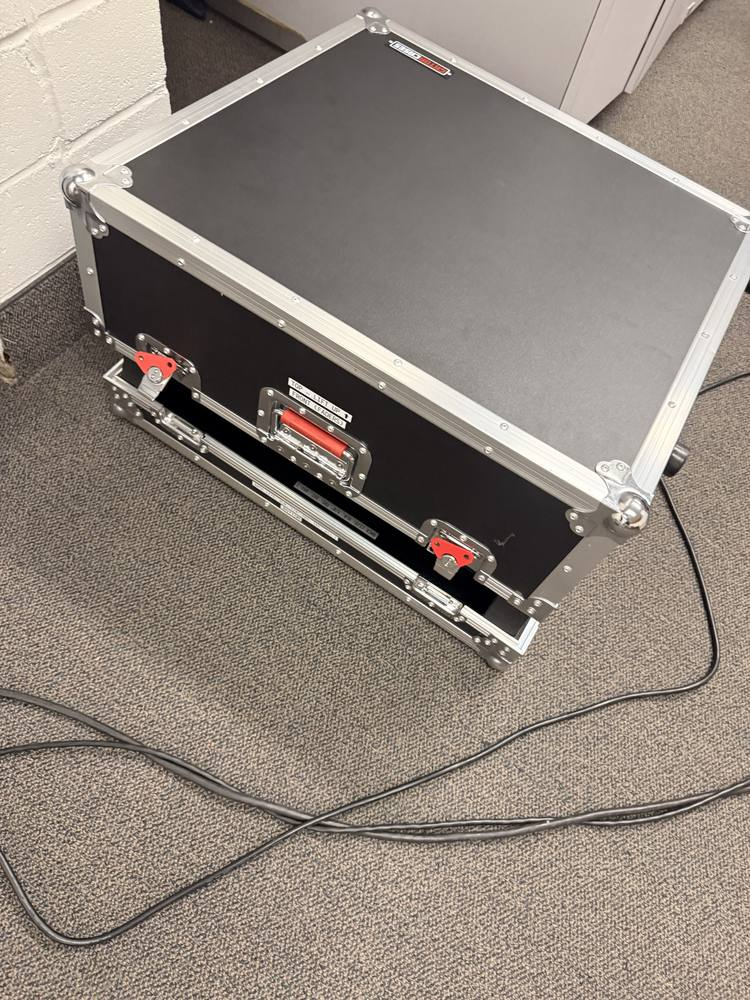

**Wireless mics**

- [ ] **Three VocoPro Digital-Quad receivers** (twelve channels, A–L), each with its antennas and
  its own power adapter
- [ ] **Twelve bodypack transmitters with headset mics**, lettered A–L to match the receiver
  channels
- [ ] **Twelve short XLR cables**, receiver → X32. At the gig these were color-coded: **white,
  blue, red, yellow** for the four outputs of each receiver
- [ ] **Spare batteries** for every bodypack (type — see **Technical verification**), and
  safety pins

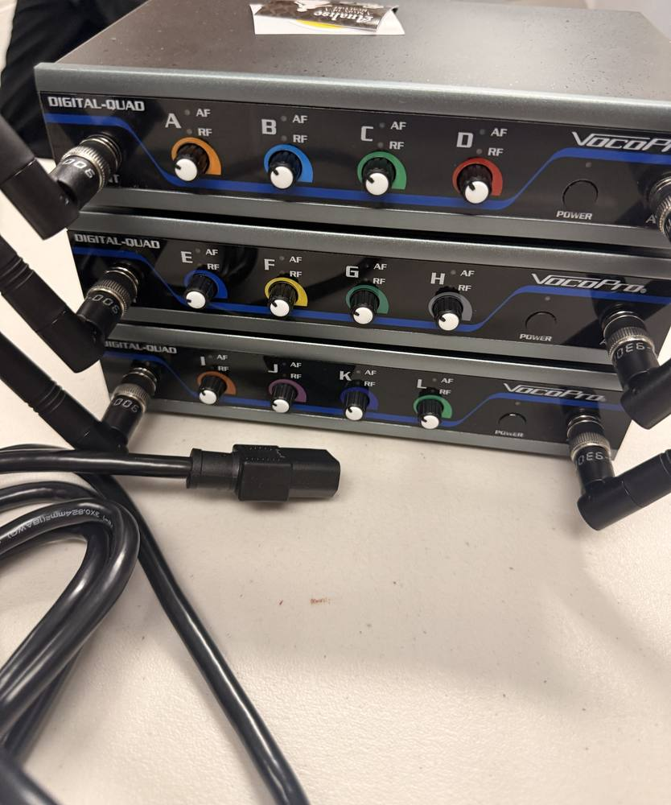

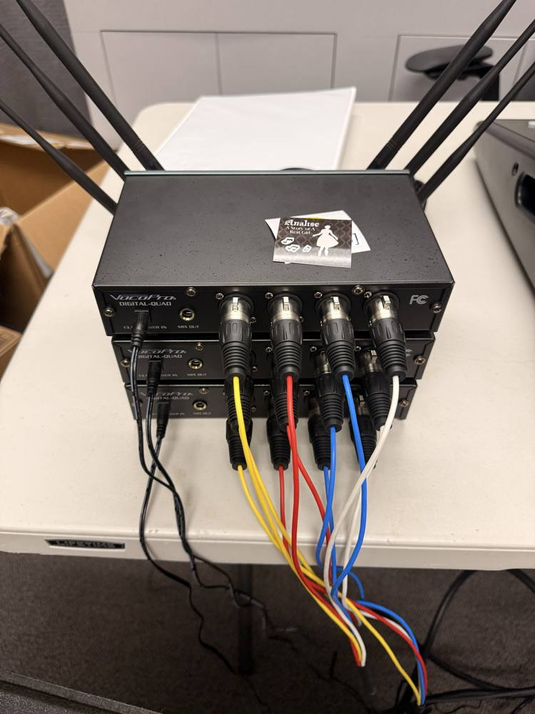

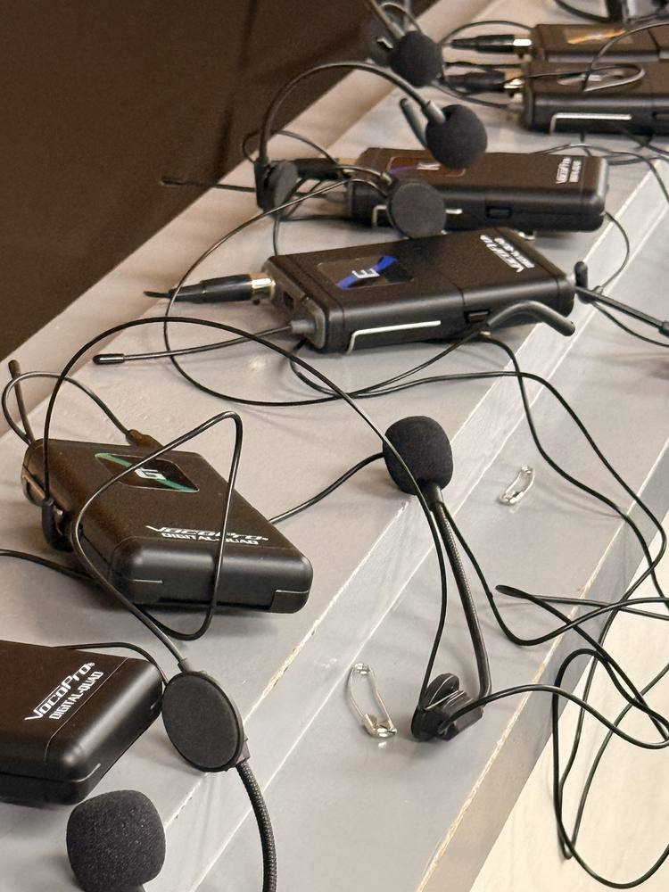

**Playback**

- [ ] **Laptop** with the show's tracks, and its charger
- [ ] **3.5 mm stereo → dual ¼-inch TS** cable (laptop → X32 AUX IN 1–2)
- [ ] Backup **3.5 mm → dual RCA** cable

**Mains**

- [ ] **Yamaha StagePas 600BT**: the powered mixer, its **two passive speakers**, and the **two
  Yamaha speaker cables** that come with it
- [ ] **Two speaker stands**
- [ ] **Two XLR female → ¼-inch TS** cables (SD8 OUT 7–8 → StagePas 5/6)

**Wedges**

- [ ] **Powered wedges** — Behringer Eurolive **B207MP3** at the gig (how many — see **Technical
  verification**) — and a power cord for each
- [ ] **One XLR** from SD8 OUT 1 to the first wedge, and **one more XLR per extra wedge** for the
  daisy chain

**Everything else**

- [ ] **3–4 spare XLR cables**
- [ ] Extension cords and power strips
- [ ] **Gaffer tape** and cable covers
- [ ] "Reserved" signs for any seat that will hold gear
- [ ] Spare adapters

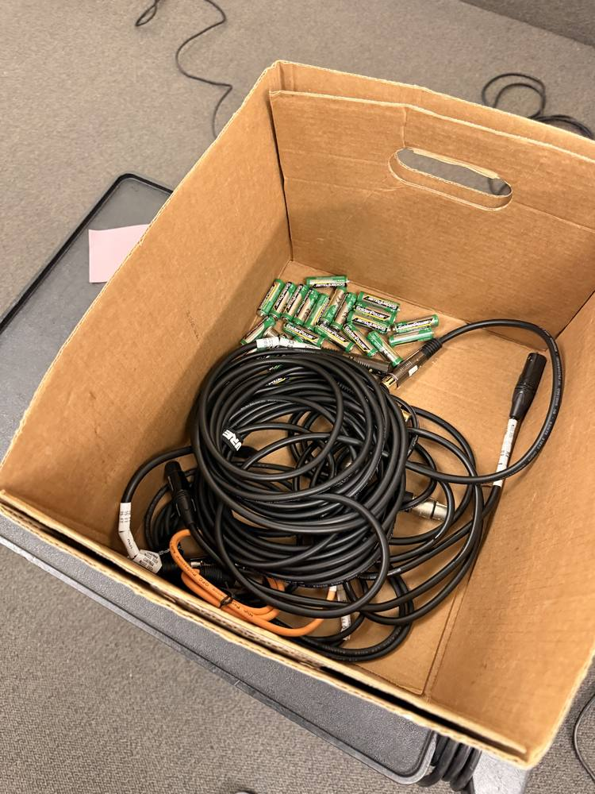

> ⚠️ The StagePas speakers are **passive**: their amplifier is inside the StagePas mixer. Connect
> them only with the **Yamaha speaker cables**. An instrument cable is not built to carry
> speaker-level power.

## 🚗 Phase 1 — Before load-in

- 🚩 Gather everything on the equipment list. Count the bodypacks (12), XLR cables, and both
  Cat5e cables before they leave the building.
- 🚩 Put **fresh batteries** in all twelve bodypacks, and pack spares.
- 🚩 Confirm with the music director: **how many mics** tonight, **which performer wears which
  letter**, and whether the performers need **tracks in their wedges**.
- 🚩 If someone else used the X32 last, expect its routing to be theirs — Phase 4 starts from that
  assumption.

**Q1 (short answer).** Call time: ______ · Show: ______ · Mics in use (letters): ______ · Wedges:
______ · Tracks in the wedges (yes / no): ______

✅ **Answer.** There's no fixed answer — write in tonight's details. It's a log entry, not a test.

## 🗺️ Phase 2 — Place the gear

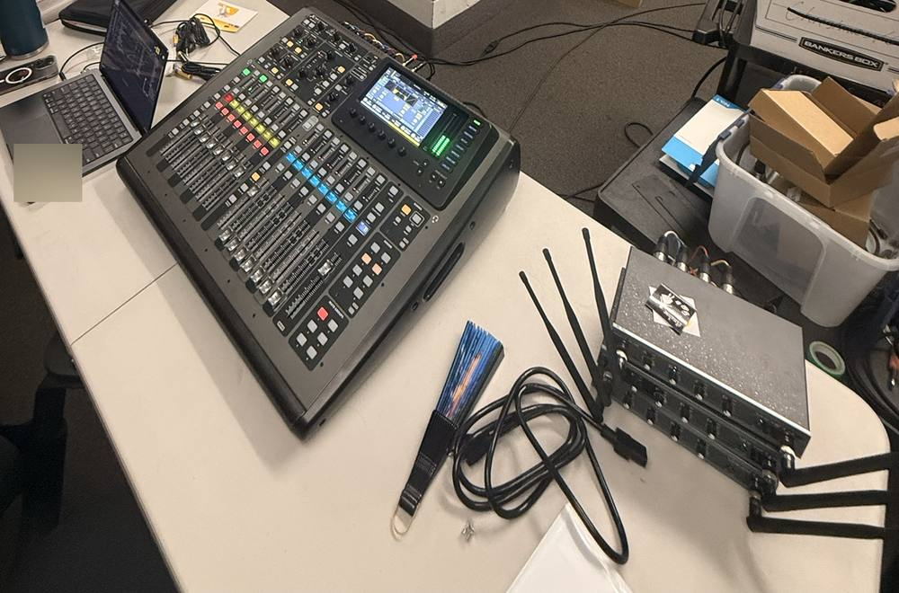

- 🚩 **Booth:** X32 Compact, laptop, and the three receivers together on the table. Stand the
  receivers' antennas up, clear of metal.
- 🚩 Lay the bodypacks out on the booth rail in letter order, so a missing one is obvious.

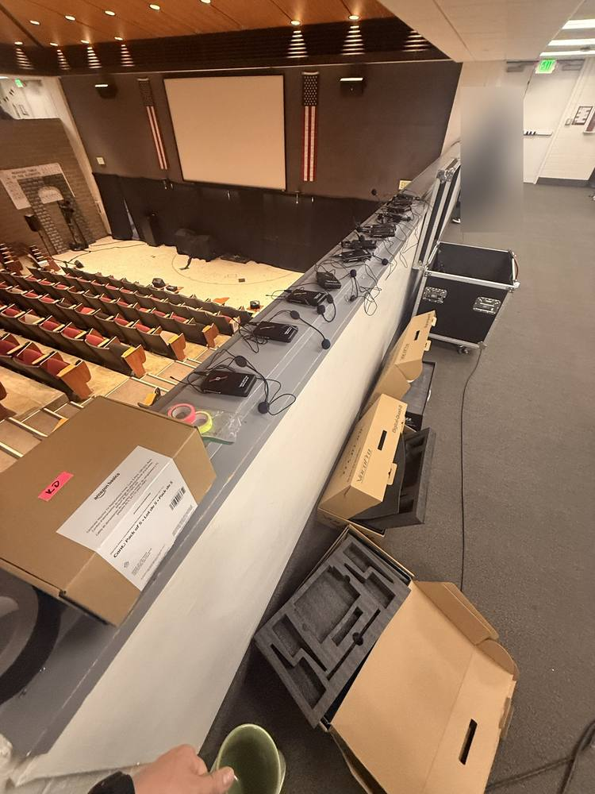

- 🚩 **Stage floor:** a main speaker on a stand at each front corner of the stage area.
- 🚩 **SD8** on a front-row seat's tablet arm near one main speaker, where the Cat5e from the booth
  can reach it.
- 🚩 **StagePas mixer** on a front-row tablet arm, within reach of both speaker cables.
- 🚩 **Wedges** on front-row tablet arms, angled up at the performers.
- 🚩 Tape a **Reserved** sign on every seat that holds gear.

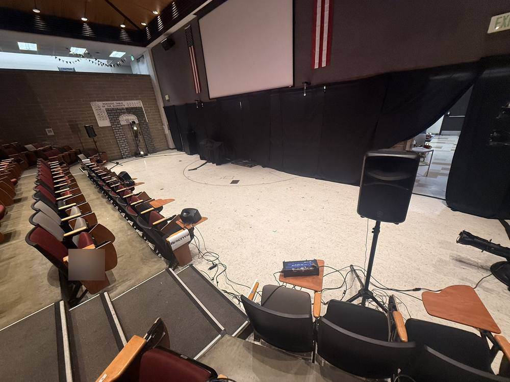

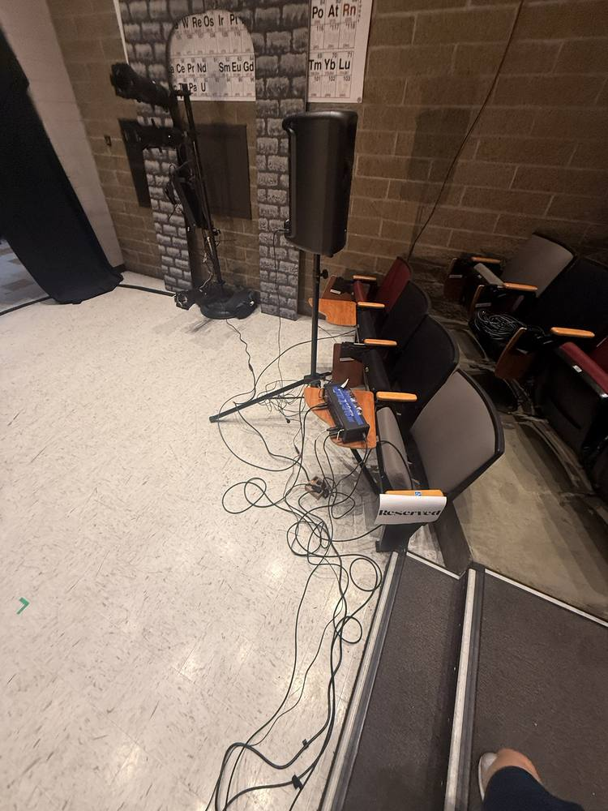

- 🚩 Run cables along the front of the seating, not across the stage, and **gaffer-tape every run**
  that crosses an aisle or the foot of the aisle stairs.

## 🔌 Phase 3 — Connect everything, power off

Everything is connected with power off. Power comes on in Phase 5.

**Wireless → X32 (in the booth)**

The bodypack's letter is its receiver channel, and its channel decides its X32 input: **A → 1
through L → 12**.

| Receiver | Channels | X32 inputs | Rear-panel row |
|---|---|---|---|
| Top | A B C D | 1 2 3 4 | IN 1–8 (top row) |
| Middle | E F G H | 5 6 7 8 | IN 1–8 (top row) |
| Bottom | I J K L | 9 10 11 12 | IN 9–16 (bottom row) |

- 🚩 Plug each receiver output into its X32 input with an XLR cable. Inputs 13–16 stay empty.
- 🚩 Plug in each receiver's power adapter.

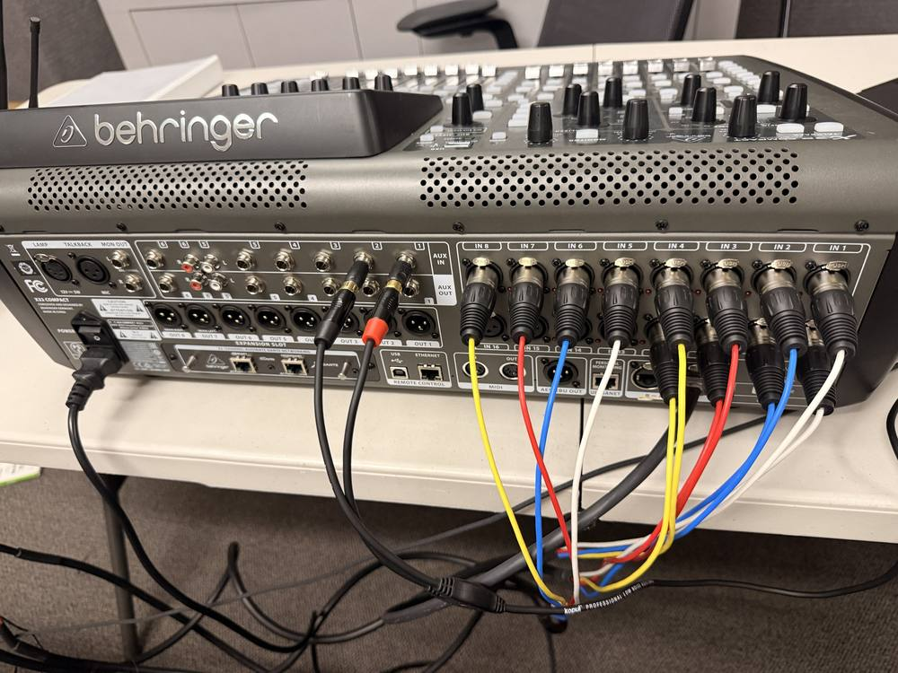

**Laptop → X32**

- 🚩 Laptop headphone output → the **3.5 mm → dual ¼-inch** cable → X32 **AUX IN 1** (left) and
  **AUX IN 2** (right).

**X32 → SD8 → speakers**

- 🚩 Cat5e from the X32's **AES50 A** to the SD8's **AES50 A**.
- 🚩 **SD8 OUT 7** → StagePas **5/6 L**; **SD8 OUT 8** → StagePas **5/6 R**, on the XLR → ¼-inch
  cables. Both, not just one.
- 🚩 StagePas **SPEAKERS L** and **R** → the two passive speakers, on the Yamaha speaker cables.

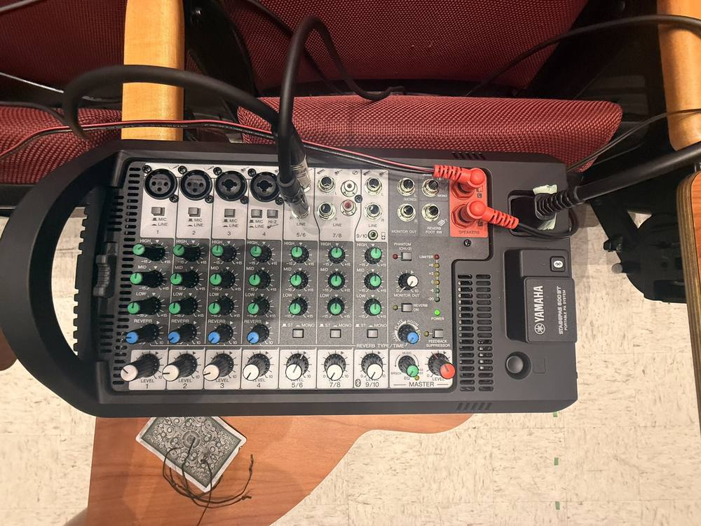

- 🚩 **SD8 OUT 1** → the first wedge's input. Then that wedge's **THRU** → the next wedge's input,
  and so on down the line.

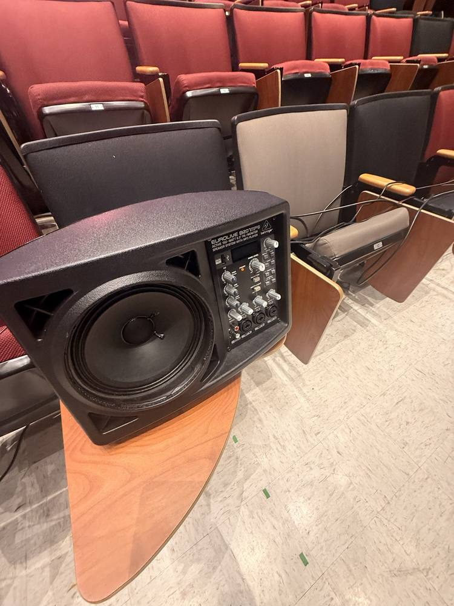

**Q2 (fill in the blank).** The performer wearing bodypack **G** is on receiver channel ______,
which goes to X32 input ______, on the ______ row of the rear panel.

✅ **Answer.** Channel **G** → X32 input **7**, on the **top** row (IN 1–8).

## 🎛️ Phase 4 — Set up the X32

**Input routing: check this first**

The X32 may have been used last with a recording computer, with its inputs listening to USB
instead of the jacks on its back.

- 🚩 Press **ROUTING**. On the input page, set **Inputs 1–8 → Local 1–8** and **Inputs 9–16 →
  Local 9–16**.
- 🚩 The mics are plugged in at the booth, so inputs stay on **LOCAL**. The SD8 carries outputs
  only.

**Output routing**

- 🚩 In **ROUTING**, on the output page (Out 1–16; the name varies by firmware), set **Out 1 →
  Mix Bus 1**, **Out 7 → Main L**, **Out 8 → Main R**, each with a **post-fader** tap.
- 🚩 On the **AES50 A** page, set **AES50 A outputs 1–8 → Out 1–8**. This is what puts outputs 1,
  7 and 8 onto the cable to the SD8.

**Mic channels 1–12**

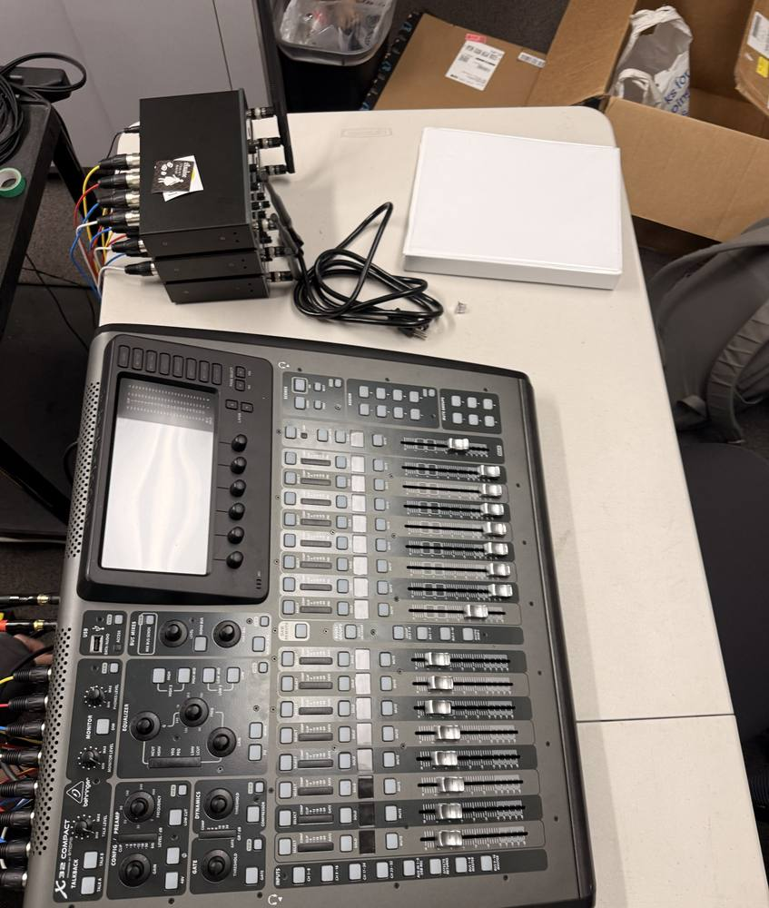

- 🚩 **48V off** on channels 1–12. The receivers don't need phantom power.
- 🚩 Every mic channel is assigned to **Main LR**.

**Tracks: AUX IN 1–2**

- 🚩 On the **AUX IN / USB** fader layer, Aux 1 is left and Aux 2 is right. Link them as a stereo
  pair, or pan them hard left and right.
- 🚩 Both are assigned to **Main LR**.

**Monitor mix: Bus 1**

- 🚩 Set the channels' sends to **Bus 1 to pre-fader**, so a change in the house mix doesn't
  change what the performers hear.
- 🚩 Bus 1's master is unmuted and up.

**Q3 (multiple choice).** Every receiver's RF and AF lights are on, but the X32's input meters
for channels 1–12 show nothing. What do you check first?

- a) The bodypack batteries
- ✅ b) ROUTING: inputs 1–8 and 9–16 are set to LOCAL, not USB
- c) That the SD8's AES50 link is up
- d) The StagePas master level

## ⚡ Phase 5 — Power on

- 🚩 Power on the **X32** and the **SD8**.
- 🚩 Check that the SD8 shows **AES50 sync**.
- 🚩 With every level down, power on the **StagePas** and the **wedges** last.
- 🚩 Turn on the bodypacks.

## 🔊 Phase 6 — Soundcheck

**Tracks first**

- 🚩 Play a track from the laptop. Watch the laptop's volume, Aux 1–2's meters, their faders, and
  Main LR.
- 🚩 Bring up the StagePas **5/6 level** and **MASTER** slowly. Mix on the X32; the StagePas only
  sets how loud the speakers are.
- 🚩 Hear the track from **both** main speakers.

**Mics**

For each mic, A to L:

- 🚩 Check that the receiver channel's **RF** light is on while the performer wears the pack.
- 🚩 Select the channel's layer (1–8 or 9–16) and press **SELECT** on it.
- 🚩 Have the performer sing at show volume, and set **GAIN** for a healthy level that never
  clips.
- 🚩 Bring up the channel fader.

**Wedges**

- 🚩 On the right fader bank, choose **BUS 1–8**, press **SELECT** on Bus 1, then press **SENDS ON
  FADERS**. The input faders now set each channel's level in the wedges, not in the house.
- 🚩 Build the wedge mix with the performers. If they need the tracks, bring up Aux 1–2 here
  too.
- 🚩 Turn **SENDS ON FADERS off** when you're done.
- 🚩 Walk the front row: every wedge works, and each one's own level suits the performer in front
  of it.

**Together**

- 🚩 Check for feedback with every mic live: walk the performers past the wedges and main
  speakers.
- 🚩 Run one full song with tracks and mics.
- 🚩 **Save a scene** — under a new name. Never overwrite someone else's scene without permission.

**Q4 (multiple choice).** In the first number you push a performer's fader up for a solo, but the
house doesn't get any louder — and the performers say their wedges keep changing. What is
happening?

- a) The channel is muted in Main LR
- b) The SD8 has lost sync
- ✅ c) SENDS ON FADERS is still on, so the faders are moving the wedge mix
- d) The StagePas master is too low

## 🎬 Show

- 🚩 **SENDS ON FADERS is off** before the house opens.
- 🚩 Keep spare batteries at the booth. Between scenes, glance at every receiver's **RF** light.
- 🚩 If a mic drops out, check its receiver light first: no **RF** means the pack (power,
  batteries, distance); **RF but no AF** means no sound from the mic (headset plugged in, pack
  muted).

## 🔧 Troubleshooting

**A mic has no sound**

- 🚩 Receiver channel: RF and AF lights?
- 🚩 Right channel on the X32 (A = 1 … L = 12)?
- 🚩 Input routing on **LOCAL**?
- 🚩 Channel muted? Gain enough? Assigned to Main LR?

**No sound from the main speakers**

- 🚩 Main LR unmuted and up?
- 🚩 Out 7–8 assigned to Main L/R, and AES50 A outputs set to Out 1–8?
- 🚩 SD8 synced, and outputs 7–8 patched to StagePas 5/6?
- 🚩 StagePas 5/6 level and MASTER up? Speaker cables in?

**No sound from the wedges**

- 🚩 Bus 1 master up and unmuted? Channels sending to Bus 1?
- 🚩 Out 1 assigned to Bus 1?
- 🚩 SD8 OUT 1 patched to the first wedge? Each wedge powered on, with its level up?
- 🚩 Only the wedges after one in the chain are dead? Check that wedge's THRU cable.

**Feedback**

- 🚩 Pull that mic down in **Bus 1** first.
- 🚩 Move the performer, or turn the wedge, so the mic isn't in front of a speaker.
- 🚩 Turn the wedges down to what the performers actually need. Use EQ only after that.

**Q5 (short answer).** Why do the StagePas's speakers need the Yamaha speaker cables, while the
wedges are happy with ordinary XLR cables?

✅ **Answer.** The StagePas speakers are passive: the amplifier is in the StagePas mixer, so the
cable carries amplified, speaker-level power, which needs a speaker cable. The wedges are
powered, with their own amplifiers inside, so their cables only carry a line-level signal, which
an XLR cable is built for.

## 🏁 Strike

- 🚩 Turn the StagePas and the wedges **off first**, then the X32 and SD8.
- 🚩 Collect all twelve bodypacks and count them before anyone leaves. Take the batteries out.
- 🚩 Pull up the tape, coil every cable, and count the Cat5e cables and XLRs back in.
- 🚩 Pack the X32 in its Gator case, faders to the side marked **FRONT (FADERS)**.

## ✅ Definition of done

- 🚩 All twelve mics come into X32 channels 1–12 on LOCAL, at a healthy gain, in Main LR.
- 🚩 The laptop tracks come in on AUX IN 1–2 and play from both main speakers.
- 🚩 The SD8 is synced over AES50, with Bus 1 on OUT 1 and Main L/R on OUT 7–8.
- 🚩 Every wedge plays the Bus 1 mix, with pre-fader sends, and SENDS ON FADERS was off for the
  show.
- 🚩 A working scene was saved under its own name.
- 🚩 Every bodypack, cable, and case came home.

**Q6 (fill in the blank).** At COB, the amplifier for the main speakers is inside the ______. The
amplifier for each wedge is inside ______.

✅ **Answer.** The mains' amplifier is inside the **StagePas 600BT mixer**; each wedge's is inside
**the wedge itself** (it's a powered speaker).

**Q7 (short answer).** The mics all plug in at the booth. So what is the SD8 stage box for?

✅ **Answer.** Outputs. It puts the console's outputs on the stage floor, so the wedge mix (OUT 1)
and the mains (OUT 7–8) travel down one Cat5e cable instead of three long XLR runs from the booth.

## ⚙️ Technical verification

**From the student crew's setup document (October 2026):** the equipment list, the signal flow
(mics → X32 local inputs 1–12; laptop → AUX IN 1–2; X32 AES50 A → SD8; SD8 OUT 1 = Bus 1 to the
wedges, OUT 7–8 = Main L/R to the StagePas 5/6), the X32 routing, gain, Sends on Faders and scene
steps, the soundcheck order, and the troubleshooting lists. The document says its routing was not
tested when it was written; the instructor believes the show ran as written.

**From the instructor's photos of the show:** the X32 Compact, laptop and receivers in the booth;
three VocoPro Digital-Quad receivers (A–L); bodypacks with headset mics; the StagePas **600BT**;
B207MP3 wedges on front-row tablet arms; the SD8 on a front-row tablet arm; two ¼-inch plugs in
AUX IN 1–2.

**Corrected from the document:** it says StagePas **400BT**; the photos show a **600BT**. It
names the Behringer **B205D** as the example wedge; the photos show **B207MP3**s.

**Still open:**

- **Mic patch A → 1 … L → 12.** Inferred from the photos (the white, blue, red, yellow cables
  line up that way on the receivers and the X32's inputs), not confirmed.
- **SD8 OUTPUT selector.** The document says to set the SD8's output selector to 1–8. Confirm the
  SD8 has one, and what it's called, before that becomes a step.
- **Wedge daisy chain.** Which B207MP3 input SD8 OUT 1 goes into (a channel input or MAIN IN), and
  that its **THRU** passes the signal on as the document describes. Also: how many wedges, and
  whether any were Mackies (the document says "Behringer/Mackie").
- **StagePas 5/6.** One photo shows only one cable at 5/6. Confirm both OUT 7 and OUT 8 were
  patched, to L and R.
- **Pre-fader sends to Bus 1.** Where the X32 Compact sets a send's tap (the menu path) isn't
  written down yet.
- **Receivers.** Their output level (mic or line), where their volume knobs should sit, and their
  frequency band. The meaning of the AF and RF lights here is the usual one, not checked against
  VocoPro's manual.
- **Bodypack batteries.** Type and count per pack. AA batteries were at the gig; confirm they're
  what the packs take.
- **RCA backup cable.** On the X32 Compact's rear panel, the RCA jacks appear to be on AUX IN 5–6
  only, so the 3.5 mm → RCA backup would land on Aux 5–6, not 1–2. Confirm before relying on it.
- **Who owns the gear,** where it's picked up and returned, and the venue's room and load-in
  details.
- **Group size** — set here as 1–3, ideally 2 (a sound engineer, plus help with the stage end).
  Confirm.

## 🤖 AI use disclosure

Drafted by AI from the student crew's setup document and the instructor's photos of the show
(October 2026). Seven questions added. Students' names removed and photos redacted. Pending
instructor review.
