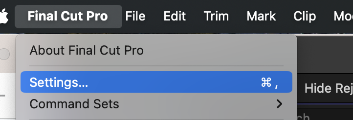
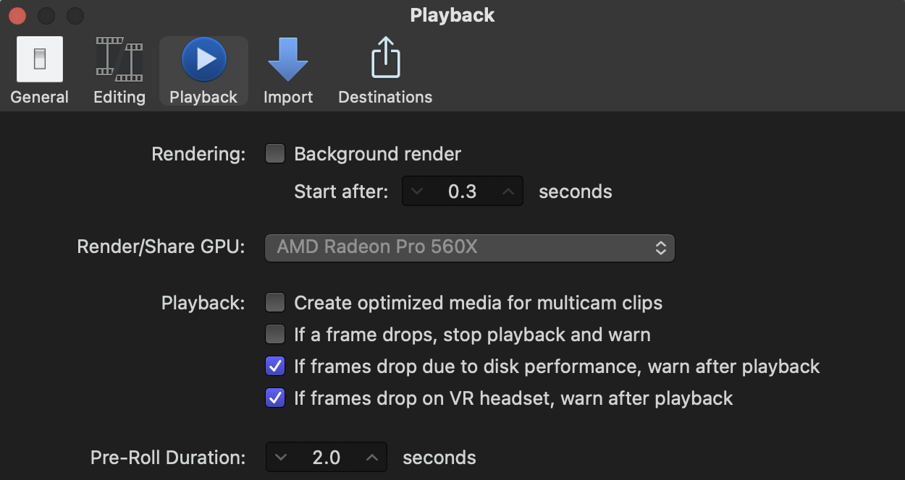
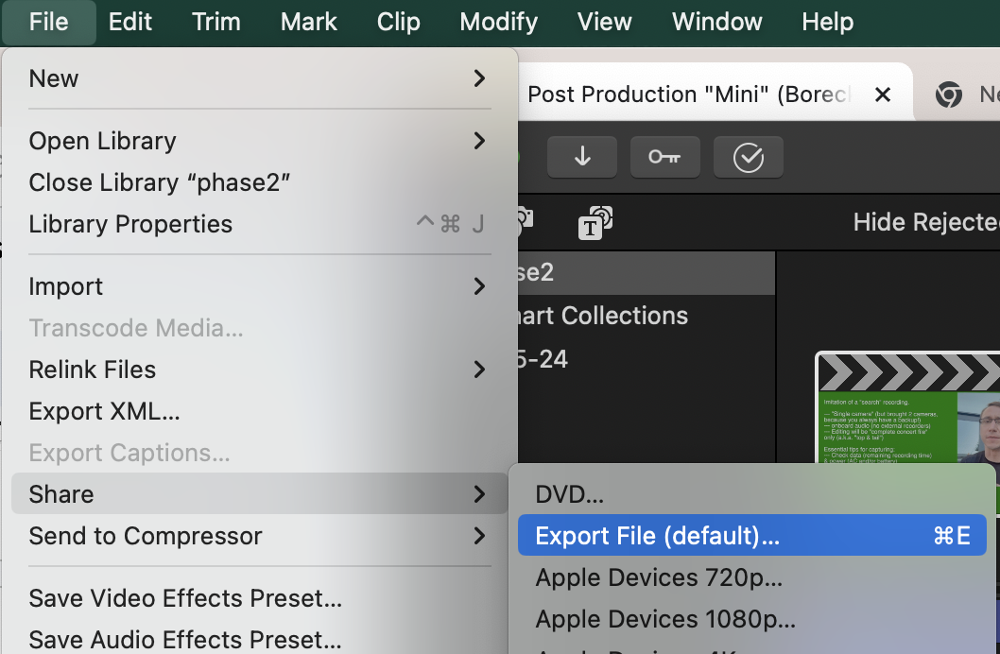
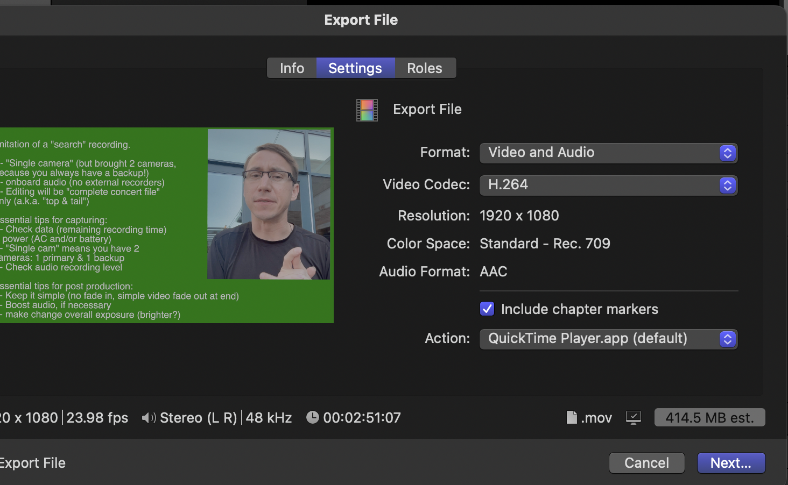

> 🧪 **Status: In Development.** Assembled 2026-11-06 from three sources: a **General Final Cut
> Pro Post-Production Guide** (PDF, November 2026), the instructor's **Post Production "Mini"**
> slides (2024, which the instructor says are a bit outdated but still very good), and
> **Lecture 04: Intro to Final Cut**. The screenshots are from the 2024 slides. Nothing here was
> re-tested in Final Cut for this page; open items are under **Technical verification**.

## 🎞️ What this is

The one page to read before you open Final Cut Pro for this course: the settings we always
change, the order the job goes in, and how to check your work before anyone else sees it. To
practice, do the **Post Mini** activities in order, starting with
[Post Mini 1: Sync, Trim & Export](../../post-mini-1/). For a real concert, use the
[Concert Post Checklist](../../concert-post-checklist/).

**The most important idea:** Final Cut usually does **not** change your original recording files.
You're writing instructions: "use this part of this file, starting here, ending here, at this
level." When you export, Final Cut builds a new, finished file from those instructions. That's why
the originals have to stay where they are, untouched (Lecture 04).

## 🗝️ Key terms

**library** · **event** · **project** · **browser** · **viewer** · **timeline** · **leave files
in place** · **background render** · **multicam clip** · **active angle** · **H.264** · **ProRes** ·
**QC** · **complete concert file** · **deliverable**

| Term | What it means |
|---|---|
| **Library** | The Final Cut file that holds your events and projects. One per job. |
| **Event** | A folder inside the library for one recording session's media. |
| **Project** | One edit: a timeline you export from. |
| **Browser · Viewer · Timeline** | Where your imported media lives · where you watch · where you edit. |
| **Leave files in place** | An import option: Final Cut points at the original files instead of copying them into the library. |
| **Background render** | Final Cut quietly making render files while you work. We turn it off. |
| **Multicam clip** | Several cameras and audio recordings synced into one clip you can switch between. |
| **Active video / audio angle** | Which camera you see, and which recording you hear, from a multicam clip. |
| **H.264** | The video codec we export with. Small files that play anywhere. |
| **ProRes** | Final Cut's default export codec. Excellent quality, files far too large for our concert work. |
| **QC** | Quality control: watching and listening to the finished file before it's delivered. |
| **Deliverable** | A finished file someone is waiting for. |

## 📍 Logistics

Read it anywhere. To do the work you need a Mac with **Final Cut Pro** and **Logic**, and the
raw files for the job. Which lab computers have both, and whether you can work at home, is
confirmed by the instructor (see **Technical verification**).

## 🧭 The house rules: set these every time

These are the settings the Post Mini videos assume. Most of them are about keeping the library
small and the originals untouched, so the Post drive doesn't fill up with copies.

### 1. Keep the files organized before Final Cut sees them

- The gig folder is `YYMMDD Full Event Name`. Inside it, **r** is raw source files, **e** is edit
  (post-production) files, **s** is saved final deliverables. Raw media sits in `r [abbr]`, in a
  subfolder named for its source, like `From F8_03`. The full rules are in
  [Lifespan of a Recording](../../recording-lifespan/).
- Your Final Cut library goes in the `e [abbr]` folder. ❓ (The slides say "e" and "r"
  subfolders; where exactly the library sits is in the videos.)
- **Never rename, move, or edit the original camera and audio files.** Keep them unchanged.

### 2. One library open at a time

Close any other Final Cut libraries before you start (**File → Close Library**), then make a new
library and a new project.

### 3. Turn off Background render and optimized multicam media

**Final Cut Pro → Settings…** (⌘ ,), then the **Playback** tab.

- **Background render:** unchecked.
- **Create optimized media for multicam clips:** unchecked.

Both settings make extra media files inside the library. With them on, a short concert can grow
the library by many gigabytes.

### 4. Import with File → Import, and leave files in place

- Use **File → Import**, not click-and-drag.
- Check **Leave files in place**.
- **Some camera folders block "leave files in place."** The slides' fix is to rename the folder
  with an `x` in front, in your copy on the Post drive, before importing: `DCIM` → `xDCIM`,
  `M4ROOT` → `xM4ROOT`, `CLIP` → `xCLIP`, `PRIVATE` → `xPRIVATE`. ❓ (See Technical verification.)

### 5. Set the project up the same way each time

- Resolution **1080p** (1920 × 1080). The one exception in the slides: the 4K **complete concert
  file** on a Salmon recital.
- Frame rate: the same as the source footage.
- Metadata: set the title to **Recording** and delete all other metadata.

### 6. Export as H.264, never ProRes

**File → Share → Export File (default)…** (⌘ E).

On the **Settings** tab: **Format** is **Video and Audio** and **Video Codec** is **H.264**. The
default, Apple ProRes, makes files that are far too large for live concert recordings.

For audio-only, export separately, usually as **WAV**.

## 🗂️ The whole job, start to finish

Every post-production job runs in this order. The first two stages are setup; most of the time
goes into 3 and 4; the last three are what keep a mistake from reaching the performer.

| Stage | What happens |
|---|---|
| **1. Organize and import** | Library, event, import with **leave files in place**, clear clip names. Confirm all media is online and plays. |
| **2. Set up the project** | New project in the right event, settings to match the source and the delivery. Sync cameras and audio (a **multicam clip** when there's more than one source). Spot-check sync at a few points. Save a clean starting version. |
| **3. Edit the picture** | Clips in order; trim long pauses, mistakes, and empty space; **Blade** (B) for precise cuts. Titles and transitions only where they help. |
| **4. Refine the audio** | Headphones or reliable speakers. The right tracks on and balanced; clip volume and keyframes; fades; a limiter. Listen for clipping, distortion, noise, and sync drift. |
| **5. Review (QC)** | Watch the whole thing, start to finish. Black frames, frozen images, gaps, stray clips, missing graphics, spelling in titles, sudden volume jumps. Fix, then re-check what you fixed. |
| **6. Export** | **Share** menu; H.264 at the delivery resolution and the source frame rate; a separate audio-only file if asked. A clear file name. Wait for it to finish. |
| **7. Verify, deliver, back up** | Open the exported file and play it from beginning to end. Right picture, sound, length, and format? In the right folder? Then deliver, and keep the originals, project, and exports backed up. |

**Do not rely only on the meters.** Listen to the exported file, since the export is what the
audience will hear.

**Keep an untouched copy.** Before a big change, like dividing a concert into separate pieces,
duplicate the project (**Duplicate Project As**) and make the edits in the copy. The original is
your clean master if an edit has to be redone.

## ⌨️ Shortcuts from the Post Mini videos

| Keys | What it does |
|---|---|
| **J · K · L** | Play backward · pause · play forward. Tap J or L twice to go faster. |
| **↑ · ↓** | Jump to the previous · next edit point. |
| **B** | Blade tool. |
| **⇧ ⌘ B** | Blade all: cut every clip at the playhead. |
| **A** | Select tool (the arrow). |
| **T** | Trim tool. To move the end of a fade: tap **T**, drag the dissolve, then tap **A**. |
| **V** | Disable (or re-enable) the selected clip. |
| **⌥ click** | Add an audio keyframe on the volume line. |
| **⌘ E** | Export File. |
| **⌘ ,** | Settings. |

## 🔁 Exporting names that sort themselves

From the Post Mini Phase 3 and 4 slides:

- One file per piece (or per stretch of talking), numbered with **two digits**: `01`, `02`, `03`.
- One more file for each **movement**, with a lowercase letter after the number: `02a`, `02b`,
  `02c` for the movements of piece `02`.
- Avoid vague names such as `final`, `finalfinal`, or `new`. A clear name says the project, the
  version, and what kind of export it is.

## ✅ Final checklist, before you hand anything over

- Media is organized and all files are online.
- Project settings match the delivery requirements.
- Video edits and transitions have been reviewed.
- Audio levels and synchronization have been checked.
- Titles, graphics, and visual details are correct.
- The full project has been watched from beginning to end.
- Export settings and file names are correct.
- The exported file has been opened and checked.
- Final files are saved in the correct folder.
- Original media and project are backed up.

**Q1 (multiple choice).** Why do we import with **Leave files in place** checked?

- a) It makes the export faster
- ✅ b) Final Cut points at the original files instead of copying them, so the library stays small and the originals stay where they are
- c) It's the only way to import audio
- d) It converts the files to H.264 on the way in

**Q2 (fill in the blank).** Export video with the ________ codec, not the default, Apple
________, which makes files far too large for concert recordings.

✅ **Answer.** H.264, not ProRes.

**Q3 (short answer).** Name the two settings on Final Cut's **Playback** tab that we turn off,
and say why.

✅ **Answer.** **Background render** and **Create optimized media for multicam clips.** Both make
extra media files inside the library, which makes it grow by gigabytes.

**Q4 (multiple choice).** The meters looked fine the whole time you were editing. What's left
before you deliver?

- a) Nothing, the meters were fine
- b) Re-export as ProRes to be safe
- ✅ c) Open the exported file and play it from beginning to end, listening as well as watching
- d) Delete the project to save space

## 💭 Before you leave

- Which house rule would you be most likely to forget on your own? Write it somewhere you'll see
  it the next time you open Final Cut.

## ⚙️ Technical verification

**From the 2024 Post Mini slides, not yet re-checked in the current Final Cut Pro:**

- ❓ The `x`-prefix folder renames (`DCIM`, `M4ROOT`, `CLIP`, `PRIVATE`). Is this still needed for
  **Leave files in place** with our current cameras, and is the rename always done on the Post
  drive copy, never the card?
- ❓ Which folder the Final Cut library itself lives in (`e [abbr]`?).
- The menu names in the screenshots (**Settings…** was **Preferences…** in older versions of
  Final Cut). Confirm they match the version on the lab computers.
- The limiter amounts ("find the peak, e.g. about −12 dB, apply about +12 dB of gain"), which are
  written up in the Post Mini activities.

**Not stated by any source yet:**

- Which computers have Final Cut Pro and Logic, and whether students can do post at home.
- The audio-only format on a real delivery: the slides say WAV; the general guide says "WAV,
  AIFF, or MP3, whichever is required."
- Where finished deliverables go (the `s` folder, then SharePoint, per Lifespan of a Recording).

## 🤖 AI use disclosure

Written by AI (Claude, via Claude Code) from a general Final Cut Pro post-production guide (PDF)
written for this course, the instructor's 2024 Post Production "Mini" slides and their
screenshots, and the Lecture 04 slides. The general guide's seven stages and final checklist are
kept close to its wording; the house rules are the slides' summaries, put in order. Nothing here
was tested in Final Cut for this page.
