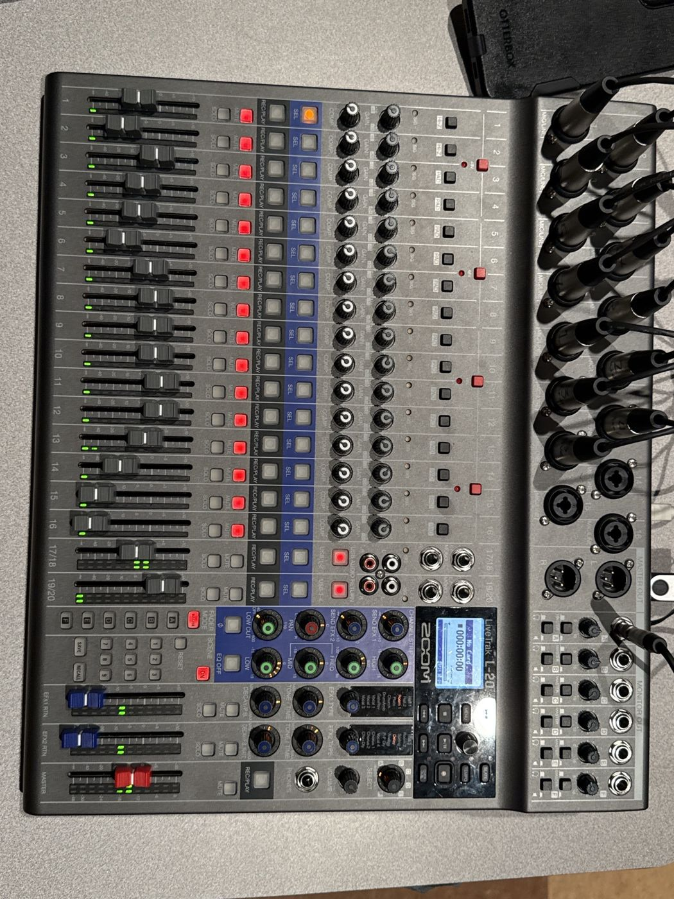
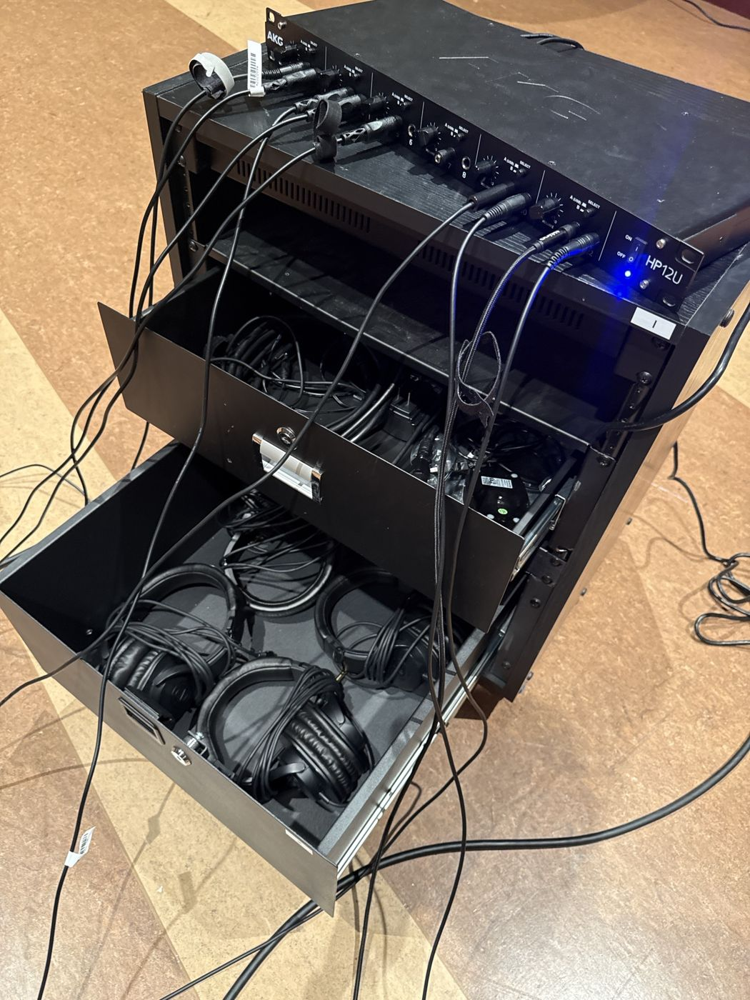
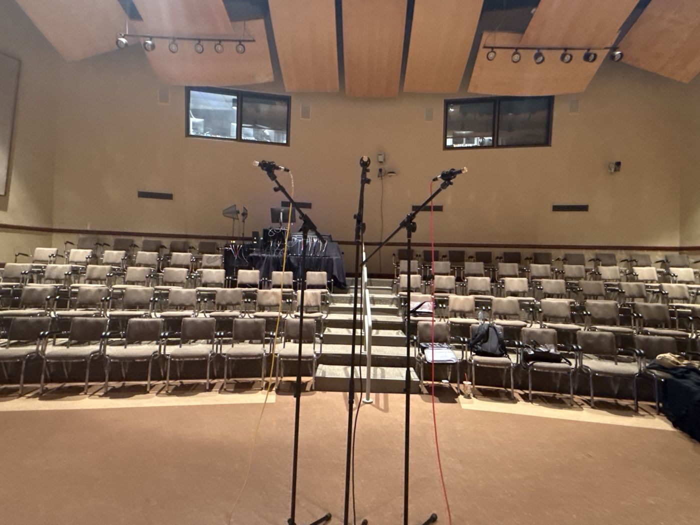
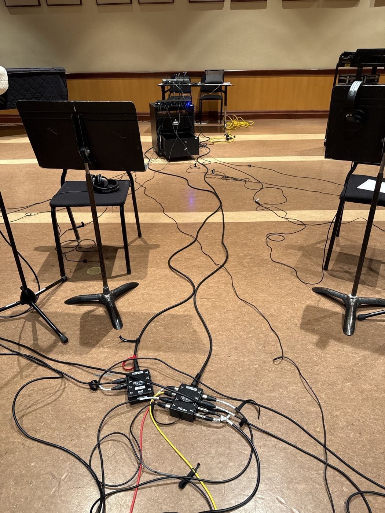
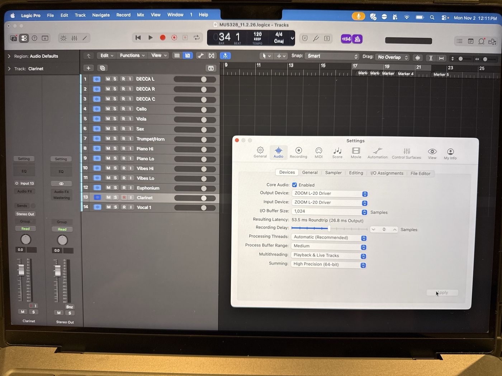
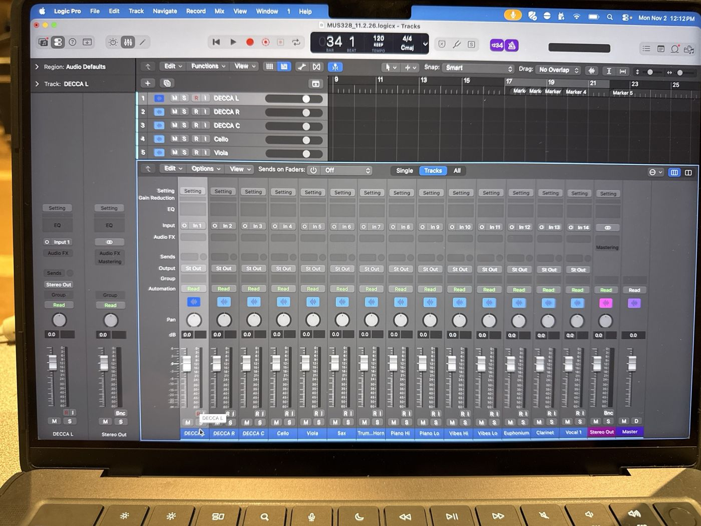
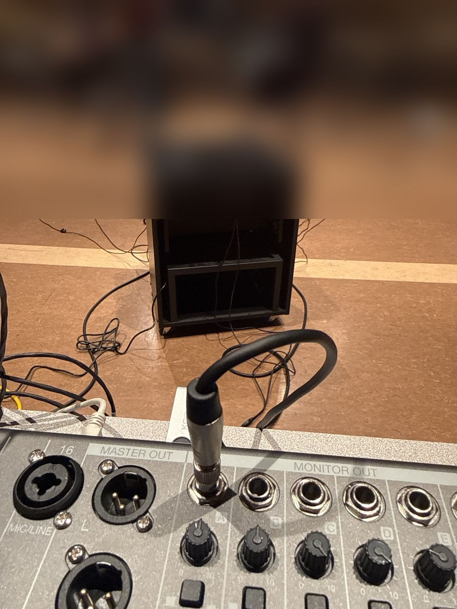
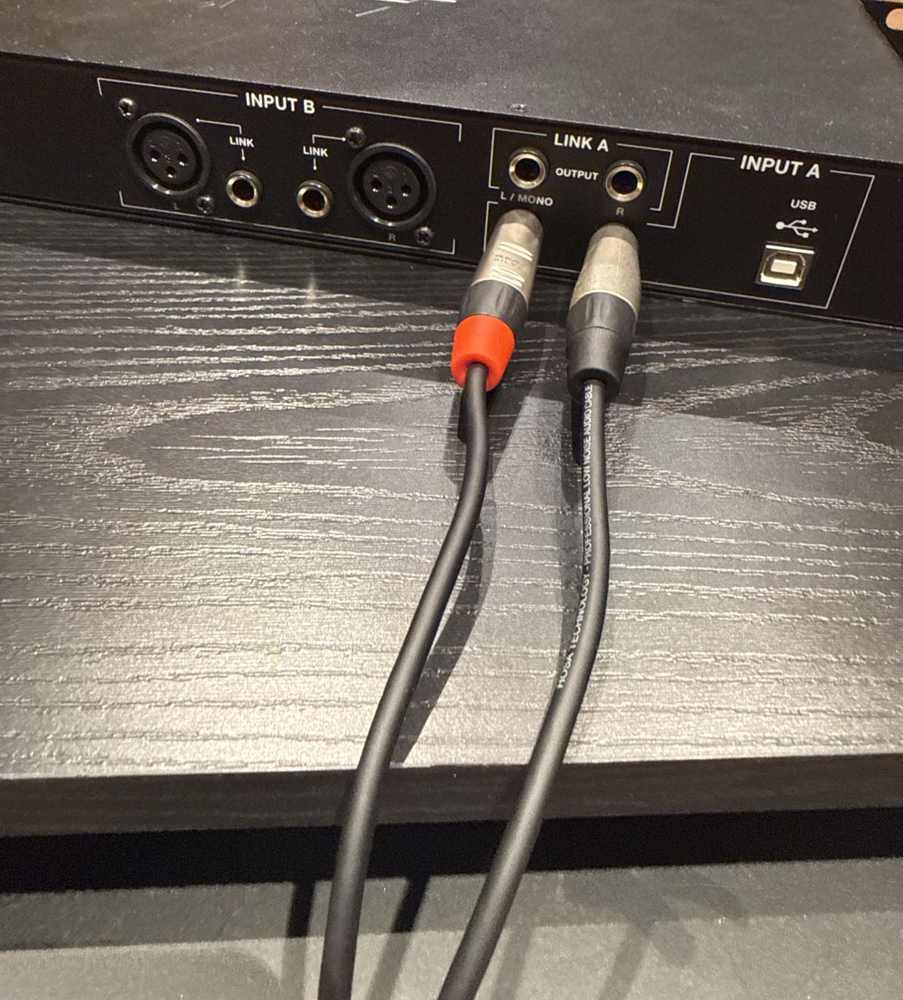
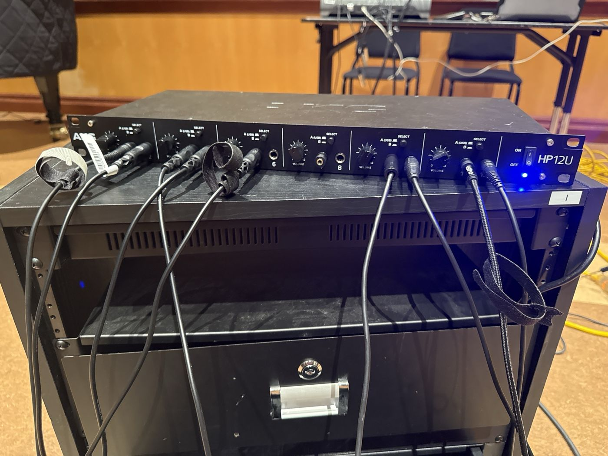
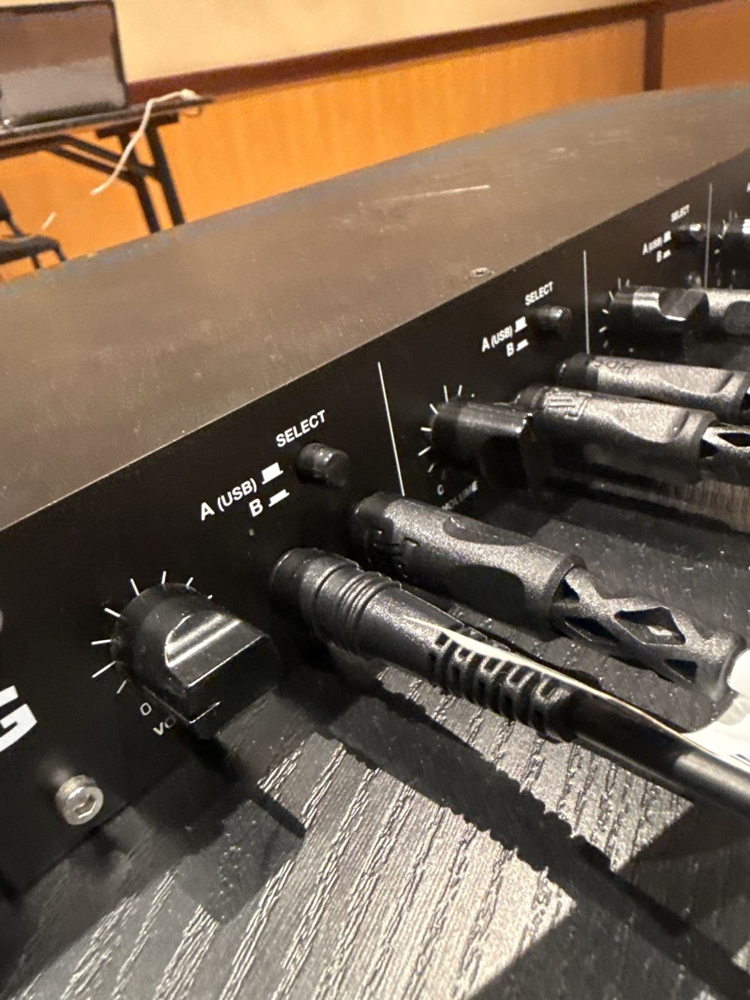

> 🧪 **Status: In Development.** Written November 2026 from the instructor's walkthrough of the
> Film Recording Workshop session on Nov 2, 2026, its photos, and the L-20 manual. A few details
> are still open. See **Technical verification** before trusting a step marked as open.

## 🎚️ What this is

A **multitrack recording** on a **Zoom LiveTrak L-20**: one mic per track, every track recorded
separately into **Logic Pro**, so the mix happens later. The L-20 is the preamps, the USB audio
interface, and the headphone mix, all in one.

The worked example is the **Film Recording Workshop**: a chamber group of studio musicians reading
film cues to a click. The same setup records a band, a choir section, a studio session: anything
that wants one track per mic. The input list here is this semester's; another session swaps the
list and keeps every other step.

Two things about the L-20 surprise people, and this page keeps coming back to them:

1. **The faders don't tell the truth.** They aren't motorized. The **green LED** beside each fader
   is the real level.
2. **What's recorded and what's heard are separate.** The recording comes from the inputs before
   the faders; the headphones get a mix. Know where the headphone mix comes from.



## 🗝️ Key terms

**multitrack** · **audio interface** · **driver** · **pre-fader** · **hardware monitoring** ·
**software monitoring** · **buffer size** · **latency** · **click track** · **FADER MODE** ·
**phantom power** · **Decca tree** · **test recording**

## 🔀 Signal flow

```
mics ──► sub-snakes ──► L-20 inputs 1–14 ──► USB ──► Logic tracks 1–14   (the recording)
                              │
                              └──► L-20 MASTER mix: channels 1–16 MUTED  (kept out of the headphones)

Logic Stereo Out (click + playback) ──► USB 1-2 ──► L-20 channel 17/18 ──► MASTER mix
L-20 MONITOR OUT A (MASTER, PHONES) ──► TRS → dual TS "Y" ──► AKG HP12U INPUT A ──► 12 headphones
```

**Who hears what:** the players hear **the click and playback of takes** in their headphones, and
each other **acoustically**, in the room. The live mics are muted in the L-20's mix on purpose,
and the mute doesn't touch the recording (see **Before you touch anything**).

## 🎤 Input list (Film Recording Workshop, fall 2026)

| L-20 input | Logic track | Source | Mic |
| --- | --- | --- | --- |
| 1 | 1 | DECCA L | Telefunken M61 |
| 2 | 2 | DECCA R | Telefunken M61 |
| 3 | 3 | DECCA C | Telefunken M61 |
| 4 | 4 | Cello | small-diaphragm condenser |
| 5 | 5 | Viola | small-diaphragm condenser |
| 6 | 6 | Sax | small-diaphragm condenser |
| 7 | 7 | Trumpet/Horn | small-diaphragm condenser |
| 8 | 8 | Piano Hi | small-diaphragm condenser |
| 9 | 9 | Piano Lo | small-diaphragm condenser |
| 10 | 10 | Vibes Hi | small-diaphragm condenser |
| 11 | 11 | Vibes Lo | small-diaphragm condenser |
| 12 | 12 | Euphonium | small-diaphragm condenser |
| 13 | 13 | Clarinet | small-diaphragm condenser |
| 14 | 14 | Vocal 1 | see **Technical verification** |

**Input n goes to track n.** Keep it that way even when the list changes: it's what lets anyone
read the session later.

## 🧰 Equipment and materials

- [ ] **Zoom LiveTrak L-20**, its **power supply**, and a **USB cable** to the Mac
- [ ] The **music department MacBook Pro** with **Logic Pro** and the **Zoom L-20 driver**
  installed, and its **charger** (from Borecki's office)
- [ ] **Three Telefunken M61s** for the Decca (from Borecki's office), on **three boom stands**
- [ ] **Spot mics**: one small-diaphragm condenser per spot in the input list, each on a stand
- [ ] **Sub-snakes**: two **Pro Co Little Bit** and one **Hosa**, plus **XLR cables** from each mic
  to a snake and from each snake to the L-20
- [ ] **Tape and a Sharpie** to number the XLR ends at the L-20
- [ ] The **headphone cart** with the **AKG HP12U** and the **headphones** in its drawer
- [ ] One **¼" TRS to dual ¼" TS "Y" cable**: L-20 MONITOR OUT A → HP12U INPUT A
- [ ] **Power strips** for the L-20, the Mac, and the headphone cart
- [ ] A **chair and stand per player**, and a table for the L-20 and the Mac



## ⚠️ Before you touch anything

- 🎚️ **Read the green LEDs, not the fader caps.** The L-20's faders aren't motorized. After a
  **FADER MODE** switch or a **scene** recall, each LED shows that mix's real level while the cap
  stays wherever it was. Zoom's manual: the volume won't change until you move the fader to the
  position the LED shows. So moving a fader does nothing until it reaches the LED, then it takes
  over.
- 🔇 **MUTE lit on channels 1–16 is on purpose.** It keeps the live mics out of the headphones.
  The L-20 records and sends to the computer from **before** the fader, so a mute or a fader
  doesn't change the recording. Don't "fix" those red buttons. (Muting and the USB feed to
  Logic: see **Technical verification**.)
- 🎧 **Each sound reaches the headphones one way only.** The L-20's own mix has no delay. Anything
  that goes through Logic and back is late by the buffer (about **27 ms** each way at 1024
  samples). The same mic by both paths sounds doubled or echoey. Here: the click comes from
  Logic, the live mics don't go to the headphones at all.
- ⚡ **48V is on all 16 inputs.** Phantom on the L-20 switches in banks of four (1–4, 5–8, 9–12,
  13–16), and every mic here is a condenser. Before a session with a different mic list, check
  that nothing on a bank minds phantom.
- 🧪 **No session starts without a test recording.** Fourteen tracks at once is real work for the
  Mac's disk. Find out before the musicians are waiting.
- 🙋 **Ask when you're not sure.** The players are paid studio musicians on a schedule.

## 🚚 Get the gear

- 🚩 **Days ahead:** arrange the **MacBook Pro** and the **Telefunken M61s** with Borecki. They live
  in his office. Agree when you pick them up and when they go back.
- 🚩 Find out **where the session is** and **when the room opens**. It moves.
- 🚩 Collect everything in **Equipment and materials**. Count the M61s: three out, three back.

## 🎤 Mics and stage

- 🚩 **The Decca: three M61s on three boom stands**, left, center, right, in front of the group,
  facing it, as in the photo.
- 🚩 **Spot mics**: one per source in the input list, close to the instrument. Piano and vibes get
  two each (Hi and Lo).
- 🚩 Run the mics to the **sub-snakes**, and the snakes to the L-20. Keep cables out of walkways and
  away from chair legs.
- 🚩 **Number the XLR ends at the L-20** with tape, matching the input list, before you plug in.





## 🔌 Power, USB and patch

- 🚩 L-20 **MASTER fader down**, then power on the L-20.
- 🚩 **USB** from the L-20 to the MacBook Pro. The Mac on its **charger**, not on battery.
- 🚩 Each numbered XLR into its **L-20 input**: 1 into 1, 2 into 2, through 14.
- 🚩 **48V on** for all four banks.

**Q1 (multiple choice).** Why does this rig turn on **48V** for every input on the L-20?

- a) The L-20 needs phantom power to send audio over USB.
- ✅ b) Every mic in the list is a condenser, and phantom switches in banks of four.
- c) Phantom makes the signal louder in the headphones.
- d) Phantom is what turns on the green fader LEDs.

## 💻 Logic Pro

- 🚩 Open **Logic** and the session's project (or a copy of last session's).
- 🚩 **Logic Pro › Settings › Audio › Devices:** **Output Device** and **Input Device** both
  **ZOOM L-20 Driver**. If it's missing, the driver isn't installed or the USB cable isn't
  connected.
- 🚩 **I/O Buffer Size: 1024 samples** is fine for this session, because nobody hears themselves
  through Logic. If anyone ever needs to, the buffer has to come down a lot (see **If something's
  wrong**).
- 🚩 Tracks 1–14 on **In 1–In 14**, named as in the input list.
- 🚩 Every track's **I** (input monitoring) button **off**, so the live mics don't come back through
  Logic late.
- 🚩 **Metronome** (the click) **on**, and **count-in** if the conductor wants it. The click comes
  out of Logic's Stereo Out.
- 🚩 **Save** the project with today's date in its name, the same pattern as before
  (e.g. `MUS328_11.2.26`).





**Q2 (fill in the blank).** At a buffer of 1024 samples, Logic's output is about ______ ms late,
and a round trip in and back out is about ______ ms.

✅ **Answer.** About **27 ms** out and **53.5 ms** round trip (as Logic reported it on Nov 2). A
player hearing their own mic through Logic would hear it about 50 ms late: a clear echo.

## 🎛️ L-20: inputs and gain

- 🚩 **FADER MODE** on **MASTER**, so the faders and LEDs show the main mix.
- 🚩 **MUTE on** (lit) for **channels 1–16**. Their **green LEDs at the bottom**.
- 🚩 **GAIN** for each input: have each player play their **loudest** passage and watch that track's
  meter in Logic. Leave room at the top: the loudest notes should stay well clear of red.
- 🚩 The Decca's three gains **the same**, so the left-center-right picture stays true.

**Q3 (multiple choice).** A player is too quiet **in the recording**. Which control fixes it?

- a) That channel's fader on the L-20
- b) That channel's MUTE
- ✅ c) That channel's GAIN on the L-20
- d) That track's fader in Logic

✅ **Answer.** **GAIN.** The L-20 sends the computer the signal **before** the fader, so only GAIN
changes what's recorded. Logic's track fader changes the playback, not the recording.

## 🎧 L-20: the headphone feed

- 🚩 **Channel 17/18: the USB button lit**, so it plays **USB 1-2**: Logic's Stereo Out, the click.
  Its **MUTE off** and its **green LED up**.
- 🚩 **MONITOR OUT A:** its source button on **MASTER**, its **PHONES/SPEAKER** switch on
  **PHONES**, its **VOL** knob up.
- 🚩 The **Y cable**: its TRS end into **MONITOR OUT A**, its two TS ends into the HP12U's
  **INPUT A, L/MONO and R**: the **lower** pair of ¼" jacks on the back. The upper pair, labeled
  **LINK A OUTPUT**, are outputs. A plug there gives you silence.
- 🚩 HP12U **ON**. On the front, every pair of headphone jacks with headphones in it: **SELECT on
  A**, and its **VOLUME** low to start.
- 🚩 A headphone at every player's chair, cable out of the way.









**Q4 (short answer).** Every player hears the click, but it's very quiet in one pair of headphones
on the HP12U and fine in the rest. Where do you look?

✅ **Answer.** That pair's **VOLUME** knob and its **SELECT** button on the HP12U front. The feed
is reaching the amp (everyone else hears it), so the problem is in that pair's own controls, or the
headphones themselves.

## 🧪 Test recording

- 🚩 Record-arm all 14 tracks and record about **30 seconds** with everyone playing.
- 🚩 Play it back. **Every track has signal**, at a sensible level, on the right track (the cello on
  Cello, not on Viola).
- 🚩 No dropouts, clicks, or a "disk too slow" message. If you get one, see **If something's
  wrong**.
- 🚩 Ask the players: **is the click loud enough?** Adjust per pair on the HP12U.

## 🎬 During the session

- 🚩 Hands off the L-20 fader caps. If you must change a level, find the **green LED** first.
- 🚩 Watch the meters on every take: anything near red, lower that **GAIN** between takes, not
  during one.
- 🚩 **Save** after every take.
- 🚩 Playback between takes goes to the headphones the same way the click does.

**Q5 (multiple choice).** Mid-session someone presses **FADER MODE A** to check something, then
back to **MASTER**. The fader caps for 1–16 are now up near 0. What's the actual level of those
channels in the MASTER mix?

- a) Near 0: the caps show it.
- ✅ b) Whatever the green LEDs show: still at the bottom, until someone moves a fader through its LED.
- c) Unity, because switching FADER MODE resets every fader.
- d) It doesn't matter, because MASTER isn't recorded.

## 🧰 If something's wrong

- 🚩 **Logic doesn't list ZOOM L-20 Driver:** the USB cable, the L-20's power, then whether the
  Zoom driver is installed on this Mac. Another Mac needs the driver downloaded and installed
  first, which needs admin rights.
- 🚩 **A track is silent in Logic:** the XLR in the right input number, 48V on for that bank, the
  GAIN up, the track's input in Logic.
- 🚩 **Nobody hears the click:** Logic's metronome on, channel 17/18 on **USB** and not muted with
  its LED up, MONITOR OUT A on **MASTER** with its VOL up, the Y cable in **INPUT A** (lower jacks)
  on the HP12U, SELECT on **A**.
- 🚩 **Players hear themselves doubled or with an echo:** something is sending a live mic to the
  headphones twice, or through Logic. Check every track's **I** button is off, and channels 1–16
  are still **muted** with their LEDs at the bottom.
- 🚩 **Disk errors or dropouts:** close every other app, record to the Mac's internal drive, raise
  the buffer, and try the test recording again.
- 🚩 **A fader "doesn't work":** it does. Its level is wherever the green LED is. Move the fader
  through the LED and it takes over.

## 🔁 Reset

- 🚩 **L-20:** FADER MODE **MASTER** · MUTE on for 1–16 · 17/18 on **USB** · MONITOR OUT A on
  **MASTER** and **PHONES** · MASTER fader down for packing.
- 🚩 **HP12U:** every SELECT on **A**, every VOLUME low, power off.
- 🚩 **Logic:** the project saved; the Mac's audio devices can stay on the L-20 driver.

## 🏁 Strike

- 🚩 **Before anything is unplugged:** the project saved, and **copied** to wherever the session's
  files go (see **Technical verification**). Two copies before the Mac leaves the room.
- 🚩 L-20 MASTER down, then power off the L-20 and the HP12U.
- 🚩 Mics off the stands first, into their cases. The **M61s back to Borecki's office**, all three.
- 🚩 Coil every cable; the snakes and the headphone cart back to their storage.
- 🚩 The MacBook Pro and its charger back to Borecki's office.

## ✅ Definition of done

- 🚩 Every track recorded at a sensible level on the right track, checked in a test recording
  before the first real take.
- 🚩 The players heard the click, and nobody heard themselves doubled or late.
- 🚩 The project is saved in two places before the Mac leaves the room.
- 🚩 The M61s and the MacBook Pro are back with Borecki.

## 💭 Before you leave

- 🚩 Tell Borecki anything that didn't match this page: a different input list, a cable in a
  different jack, a fader that behaved oddly.

## ⚙️ Technical verification

**Confirmed (the instructor's walkthrough and photos, Nov 2, 2026, and the L-20 manual):**

- The input list and its order (Logic tracks 1–14 on In 1–In 14). The Decca is three Telefunken
  M61s on three stands; the spots are inexpensive small-diaphragm condensers.
- Logic on the ZOOM L-20 Driver for input and output, buffer 1024 (26.8 ms output, 53.5 ms
  roundtrip as Logic reported it).
- On the L-20: 48V on all four banks, MUTE lit on 1–16 with their MASTER LEDs at the bottom, 17/18
  on USB 1-2 and 19/20 on USB 3-4, FADER MODE MASTER, only MONITOR OUT A in use.
- MONITOR OUT A set to MASTER and PHONES, into the HP12U through a TRS-to-dual-TS cable (the
  instructor's description; the photo shows the cable in jack A).
- On the HP12U, the cable's two plugs are in the lower ¼" pair, bracketed with **INPUT A**; the
  pair above is labeled **LINK A OUTPUT**.
- The L-20 manual: after a FADER MODE change or scene recall, "the volume will not change until the
  fader is moved to the same position" the LED shows. MUTE "has no effect on recording to the SD
  card."

**Still open:**

- **Muting a channel and the USB feed to Logic.** The instructor is confident a mute doesn't stop
  it, and the Nov 2 session recorded with 1–16 muted; the manual found so far only says so for the
  SD card. Test: mute channel 1, watch track 1's meter in Logic.
- **The fader pick-up behavior** on this unit: confirm by switching FADER MODE and moving a fader.
- **What the HP12U does with INPUT A** when a USB cable is also plugged in (it was not, on Nov 2).
- **Vocal 1's mic.**
- **Where the files go** after the session, and how they reach the composers. Also the session's
  sample rate and bit depth.
- **SD card backup.** The L-20 can record to SD by itself; B&H says it can also do it while
  streaming to a computer, and the instructor isn't sure it can do both. Test before relying on it.
- **Where the L-20, the sub-snakes, the headphone cart and the headphones are stored.**
- **Logic's click output:** confirmed to reach the headphones on Nov 2, through the Stereo Out as
  far as the photos show; not checked in the project's metronome settings.
- **The L-20's per-channel meters / LEDs** can also be set to show input level (a menu setting,
  per user reports). Not checked on this unit.

## 🤖 AI use disclosure

Drafted by AI (Claude, via Claude Code) from the instructor's walkthrough of the Nov 2, 2026 Film
Recording Workshop, the photos taken that day, his answers to follow-up questions, and the L-20
manual and spec listings. The intake notes, with sources, are in
`content/activities/_source/l20-multitrack-recording.md`. The AI arranged them into the site's
checklist format, wrote the questions and the standard safety lines, and listed what isn't
confirmed. Photos are gear only; students in the background are blurred or cropped out. Not yet run
step by step from this page.
