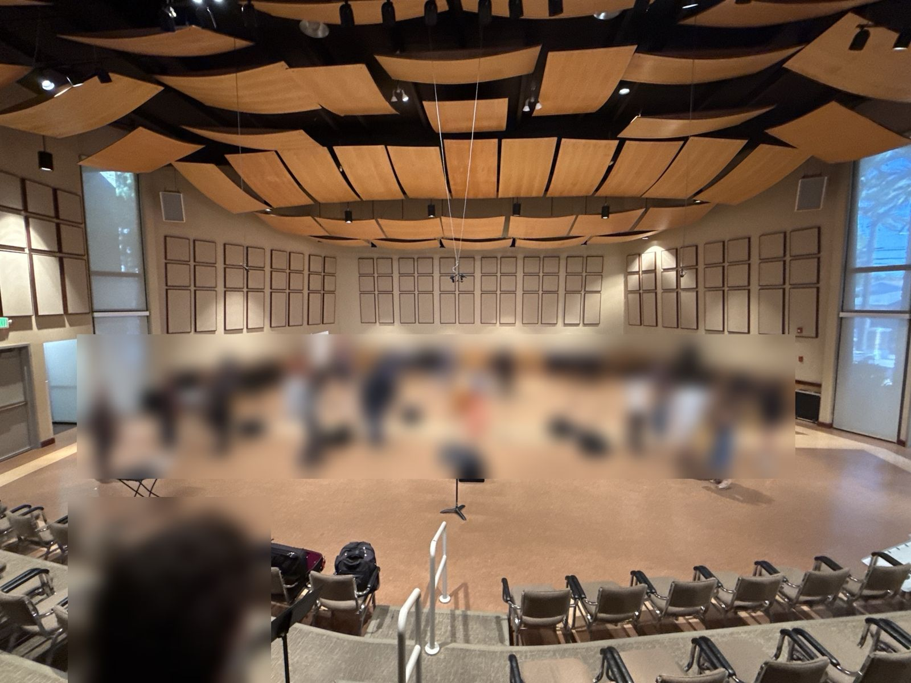
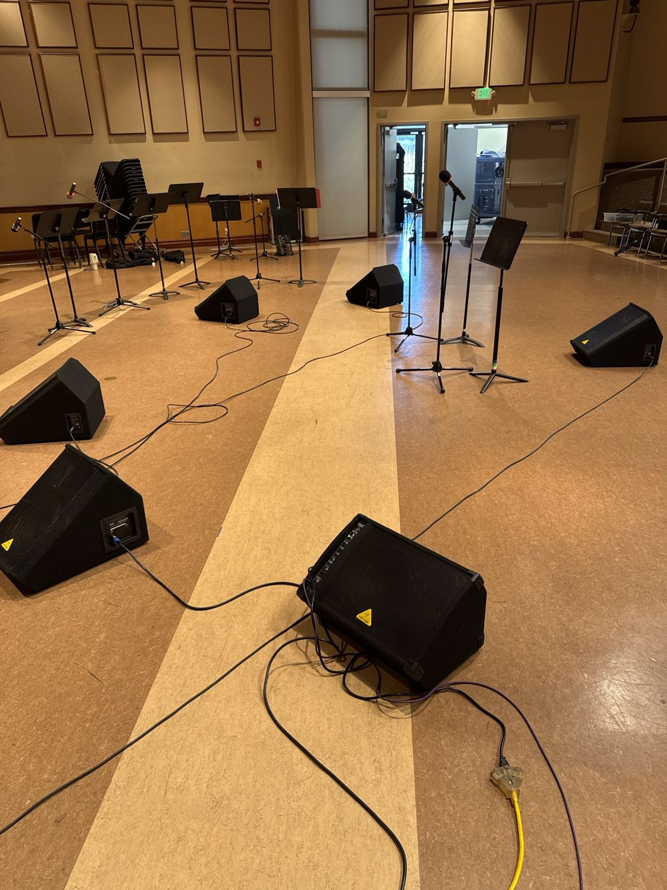
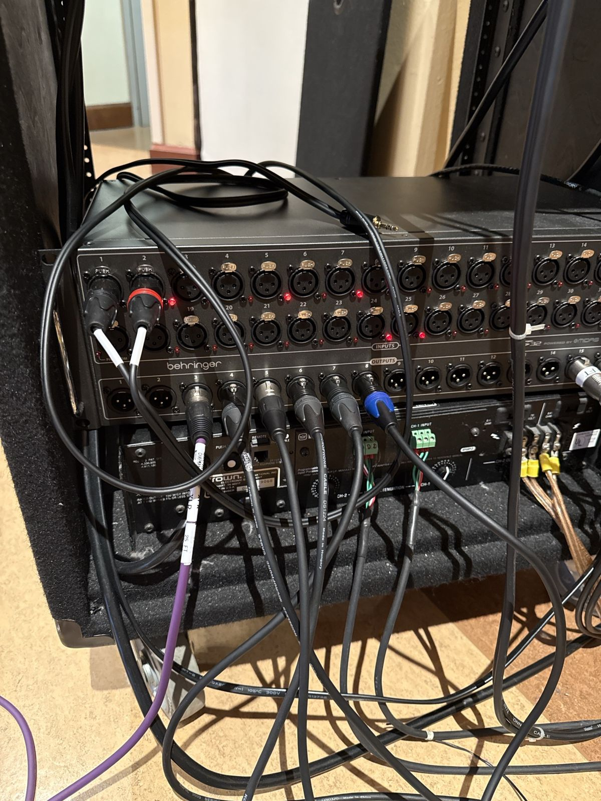
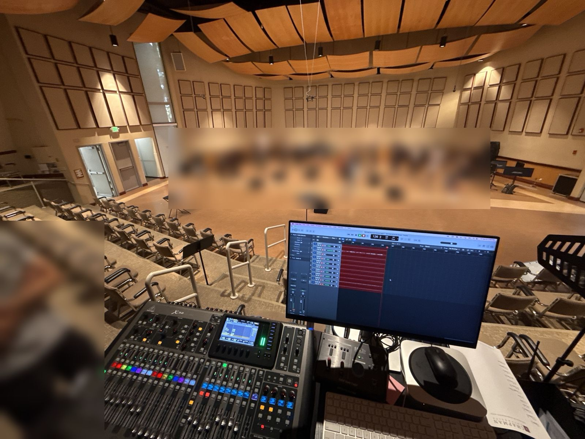
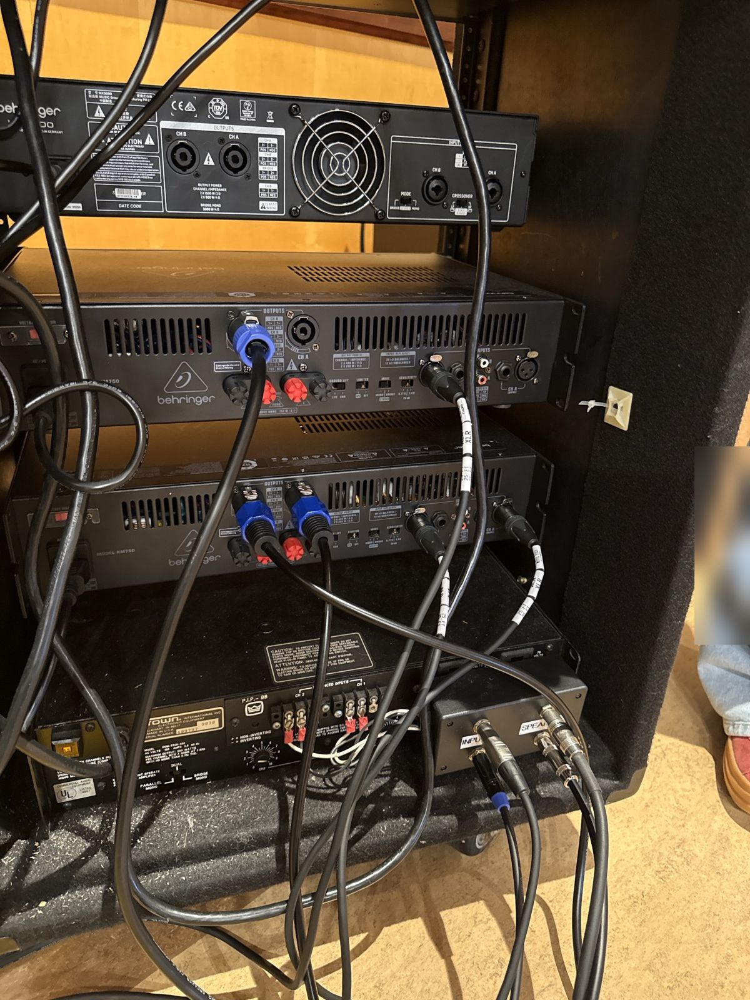
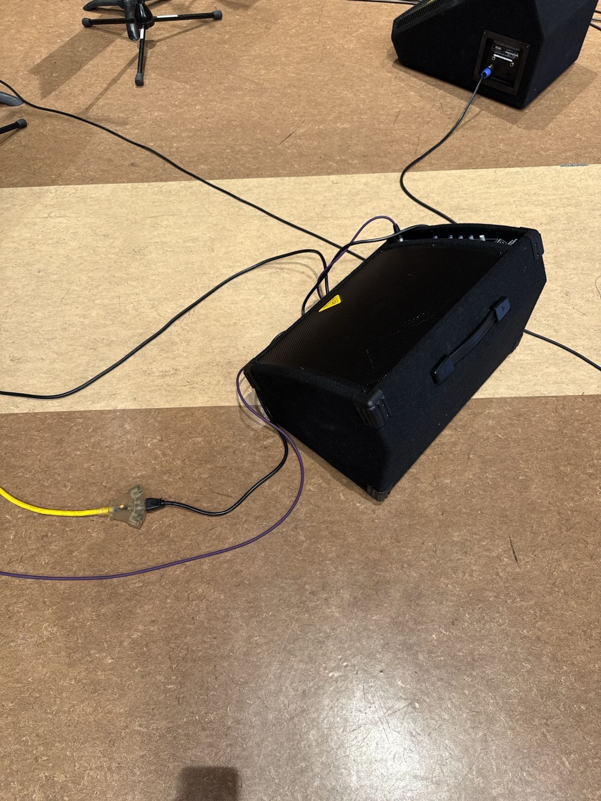
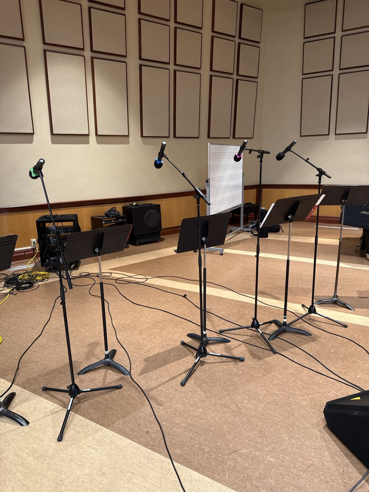

> 🧪 **Status: In Development.** Drafted November 2026 from the instructor's photos and answers
> after Mariachi Panteras' dress rehearsal in Salmon (2026-11-06). Students in the photos are
> blurred. The handheld ring colors per player, which wedge sits on which amp channel, and the
> starting monitor mixes are the plan, not confirmed at a gig yet. See **Technical verification**.

## 🎚️ What this is

The gig checklist for **Mariachi Panteras** (everyone just says "mariachi") in Salmon Recital Hall:
violins, trumpets, the guitarrón, a vihuela, a guitarra, and singers stepping up for solos.

Three things make the mariachi gig different from other Salmon gigs:

- **Everything is wireless.** Nine handhelds: four on the violins, one each on the guitarrón, the
  lead vihuela and the lead guitarra, and two up front for vocal solos. The **trumpets get no mic**:
  they don't need one.
- **Six wedges, six mixes.** One wedge per mix across the back of the stage, no daisy chain. This is
  the part that takes the longest: plan extra time to patch and check every monitor.
- **The hall's own speakers are the house.** No extra mains. If CME was in the hall before you, check
  that the hall's speakers were turned back on.

**What matters most, in order:** (1) the **two vocal mics in the house and in every wedge**, (2) the
**violins**, in the house and in the wedges in front of them, (3) the **guitarrón, vihuela and
guitarra**. If time is short, (1) is the gig.

## 🗝️ Key terms

**wedge** · **mix bus** · **passive speaker** · **active speaker** · **speakON** ·
**speaker cable** · **IEC cable** · **S32** · **AES50** · **output routing** · **pre-fader** ·
**feedback** · **gain** · **level sheet**

## 🕹️ Practice first

- [Mixer Lab: Mariachi in Salmon](https://adamborecki.github.io/mixer-lab/#/x32-mar-tour): eleven scenarios on a virtual X32 with this gig's rig and the band's own dress-rehearsal recording. The first is the whole rig working, nothing broken. The rest each break one piece, in the order this checklist runs: the hall's speakers left off, the wedges, the wedges that only take 1/4", the music test, a wedge on the wrong mix, a handheld that dies, vocals in every wedge, gains, feedback and a bad cable.

The simulator is still being built: where it and this checklist disagree, the checklist wins. Tell
your supervisor what you found.

## 🧰 Equipment and materials

The wedges and cables live in the Salmon storage closet, **BH 102**.

- [ ] **Six wedges**: **one active** (with its own **IEC power cable**) and **five passive**. Three of
  the passive wedges take a **speakON or a 1/4"** cable; two take **1/4" only**.
- [ ] **Three speakON speaker cables** (KM750s to wedges 2–4) and **two 1/4" speaker cables** (the
  Crown to wedges 5 and 6)
- [ ] The **purple 25 ft XLR** for the active wedge, and **XLRs** from the S32 to the amp rack
- [ ] An **AC extension cord** with a multi-tap for the active wedge (in the **black milk crates**)
- [ ] **Nine wireless handhelds** from receivers 1 and 2, plus **spares**, and fresh batteries
- [ ] **Mic stands with booms** for the violins and the guitarrón, vihuela and guitarra, and two
  **straight stands** for the vocal mics up front
- [ ] **Headphones** for the X32. Test music comes from the **FOH Mac mini**, already at FOH (through
  its **SSL 2+** into the X32's **AUX IN 1/2**)
- [ ] A printed copy of the **level sheet** (on the worksheet)

## ⚠️ Before you touch anything

- ⏰ **Arrive early.** At the dress rehearsal it took extra time to patch the monitors and check that
  every one was getting the right signal. Don't assume the gear works.
- 🔌 **Power order:** mixer and sources first, **amps last**. At the end of the gig, amps off
  **first**.
- 🔈 **Speaker cable is not instrument cable.** A 1/4" speaker cable and a guitar cable have the
  same plug; only the speaker cable belongs between an amp and a passive wedge.
- ⚡ **Never** put the **active wedge** on an amp's speaker output. It takes a line-level **XLR**
  straight from the S32.
- 🎤 **The handheld's one button:** a **tap** mutes or unmutes it, **press and hold** switches it on
  or off.
- 🙋 **Ask when you're not sure.** The director and your supervisor know things this checklist
  can't.

## 🗺️ The plan: inputs and outputs

The X32's input routing stays at **Salmon's default** (CH 1–24 **Local**, CH 25–32 **AES50 A25-32**):
nothing to change. The handhelds go out **left to right across the stage in rainbow order**.

| CH | Handheld | Player | How it gets there |
|---|---|---|---|
| 1 | Black windscreen, **red** | Violin 1 | Receiver 1, CH 1 → LOCAL 1 |
| 2 | Black, **orange** | Violin 2 | Receiver 1, CH 2 → LOCAL 2 |
| 3 | Black, yellow | Not used | |
| 4 | Black, **green** | Violin 3 | Receiver 1, CH 4 → LOCAL 4 |
| 5 | Black, **blue** | Violin 4 | Receiver 1, CH 5 → LOCAL 5 |
| 6 | Black, **purple** | Guitarrón | Receiver 1, CH 6 → LOCAL 6 |
| 7 | Black, **black** | Vihuela (lead) | Receiver 1, CH 7 → LOCAL 7 |
| 8 | Black, **gray** | Guitarra (lead) | Receiver 1, CH 8 → LOCAL 8 |
| 9 | Gray windscreen, **red** | Vocal mic 1 (up front) | Receiver 2, CH 1 → LOCAL 9 |
| 10 | Gray, **orange** | Vocal mic 2 (up front) | Receiver 2, CH 2 → LOCAL 10 |

Receiver 1's handhelds have **black** windscreens (CH 1–8), receiver 2's have **gray** ones
(CH 9–16). Spares come from receiver 2: each one lands on **its own channel** (green is CH 12, and
so on).

| X32 output | Carries | Goes to |
|---|---|---|
| OUT 3 | MIX 3 | S32 OUT 3 → wedge 1 (house left, **active**) on the purple 25 ft XLR |
| OUT 4, 5 | MIX 4, 5 | S32 OUT 4, 5 → KM750 #1 CH A, B → wedges 2, 3 (speakON) |
| OUT 6 | MIX 6 | S32 OUT 6 → KM750 #2 CH A → wedge 4 (speakON) |
| OUT 7, 8 | MIX 7, 8 | S32 OUT 7, 8 → the Crown in the amp rack → wedges 5, 6 (1/4" only) |
| OUT 15, 16 | MAIN L, R | S32 OUT 15, 16 → the Mix5 in the hall's mains rack → the hall's speakers |

**MIX n on output n:** wedge 1 is MIX 3, wedge 6 is MIX 8, and nobody has to guess which knob is
whose. The **NX3000** in the amp rack isn't used for this gig.

## 🚗 Arrival — early

- 🚩 Arrive early, with time for the monitors: six wedges take longer than you think.
- 🚩 Split the jobs. One engineer at **FOH** (the X32), one **on stage and at the amp rack**. With
  more people, one more on the wedges.
- 🚩 Switch the **wireless rack** on at the **Furman** on top. Receivers 1 and 2 should light up.

**Q1 (short answer).** Arrival time: ______ · Band in at: ______ · Downbeat: ______

✅ **Answer.** There's no fixed answer. Write in tonight's times: it's a log entry, not a test.

## 🏠 The house: the hall's speakers

The hall's own mains rack is permanent: the small **Mackie Mix5** on top, the rack's power, and a
**Crown** inside that drives the hall's installed speakers. Leave the cables in the rack alone.

- 🚩 Play test music from the FOH Mac mini (SSL 2+ → AUX IN 1/2) into MAIN and check that **both** of
  the hall's speakers play it.
- 🚩 Silent, with the X32's MAIN meters moving? Look at the **Mix5**: CME turns the hall's speakers
  down there, at the **LEVEL** of the channel S32 OUT 15/16 come in on, and sometimes it isn't turned
  back up. Put it at **U**. Leave **MAIN MIX** alone.

🕹️ In Mixer Lab: [The house is silent](https://adamborecki.github.io/mixer-lab/#/x32-mar-house).

**Q2 (multiple choice).** The X32's MAIN meters move, the wedges work, and the hall's speakers are
silent. CME had the hall last night. What do you check first?

- a) The X32's MAIN fader.
- ✅ b) The Mix5's LEVEL for S32 OUT 15/16, in the hall's mains rack.
- c) The wireless rack's Furman.
- d) Whether the S32 is powered.

## 🎧 The wedges: six mixes

- 🚩 Six wedges across the back, **left to right: wedge 1 to wedge 6**. Each one gets its **own mix**
  and its **own path**. Never daisy-chain two different mixes.
- 🚩 **Wedge 1 (house left) is active:** the **purple 25 ft XLR** from S32 **OUT 3**, its **IEC power
  cable**, and the extension cord. It has its own **VOLUME** knob.
- 🚩 **Wedges 2, 3 and 4** take speakON or 1/4": S32 **OUT 4** and **OUT 5** into **KM750 #1** CH A
  and B, **OUT 6** into **KM750 #2** CH A. A **speakON** cable from each amp channel to its wedge.
- 🚩 **Wedges 5 and 6 take 1/4" only**, so they go on the **Crown** in the amp rack, whose outputs
  are 1/4": S32 **OUT 7** and **OUT 8** into its **INPUT / SPEAKER** box, a **1/4" speaker cable**
  from each channel to its wedge.
- 🚩 Look at each wedge's jack before you carry a cable to it. If a 1/4"-only wedge ends up next to a
  speakON-only amp channel, **move a wedge that takes either kind** instead.

🕹️ In Mixer Lab: [Four wedges, four mixes](https://adamborecki.github.io/mixer-lab/#/x32-mar-wedges) and
[Wedge 5 only takes 1/4"](https://adamborecki.github.io/mixer-lab/#/x32-mar-quarter).

**Q3 (multiple choice).** A passive wedge has only a 1/4" jack. Which amp in the rack can drive it?

- a) Either KM750: their outputs are speakON.
- ✅ b) The Crown: its outputs are 1/4".
- c) None: it needs the active wedge's amp.
- d) The S32, straight from an output.

## 🎵 The music test, before any mic

- 🚩 Test music into **MIX 3** to **MIX 8**, one at a time, with the house down, and **listen to each
  wedge**.
- 🚩 A silent wedge: follow its path out from the S32. Is the amp channel's **level knob** up? Is the
  active wedge powered, and its **VOLUME** up?
- 🚩 Two wedges that sound the same: check the X32's **output routing**. Output n should carry
  MixBus n.
- 🚩 Set the **amps' level knobs**, about the same on every channel, while the music plays. Then mix at
  the console.

🕹️ In Mixer Lab: [Test every wedge with music](https://adamborecki.github.io/mixer-lab/#/x32-mar-wedge-test) and
[Two wedges, one mix](https://adamborecki.github.io/mixer-lab/#/x32-mar-route).

**Q4 (short answer).** Wedges 3 and 4 play exactly the same mix, and MIX 6 has the guitarra in it.
Where do you look, and why not at the sends?

✅ **Answer.** The X32's output routing (ROUTING → PATCH POINTS → OUT): output 6 probably carries
MixBus 5. The mix is fine, so changing sends would break the wedge that was right.

## 🎤 The wireless mics

- 🚩 Batteries in, the right way round; **press and hold** to switch each handheld on.
- 🚩 The instruments' handhelds go on **boom stands**, aimed at the instrument; the two vocal mics on
  stands up front.
- 🚩 Have each player play (and each singer talk) and watch **its own channel** at the X32. Receivers
  1 and 2 show each handheld's signal too: no signal there, and the problem is the mic, the rack's
  power or the antennas, not the X32.
- 🚩 Leave the receivers' **VOL** knobs at **9 o'clock**. Set level with **GAIN**: the violins need a
  lot more than the guitars.
- 🚩 **Both vocal mics** go in the **house** and **every wedge** (MIX 3–8). The violins go loudest
  in the wedges in front of them.

🕹️ In Mixer Lab: [No singer in wedges 5 and 6](https://adamborecki.github.io/mixer-lab/#/x32-mar-vox) and
[Set the gains](https://adamborecki.github.io/mixer-lab/#/x32-mar-gains).

## 🔁 When a handheld dies

It happens at most gigs: a handheld won't switch on, even with fresh batteries.

- 🚩 Give the player a **spare** from the wireless drawer. Receiver 2's spares have **gray**
  windscreens.
- 🚩 **Don't re-patch the receivers' XLRs.** The spare comes in on **its own channel** (green is
  CH 12). Set that channel up like the dead one: **GAIN**, **low cut**, **fader**, and a **send in
  every mix** the dead one was in, **pre-fader** like the others.
- 🚩 Name the new channel on the X32 (for example "VLN 1") and write it on the level sheet.
- 🚩 Tag the dead handheld with gaff tape and tell your supervisor. Don't put it back in the drawer.

🕹️ In Mixer Lab: [The red mic died](https://adamborecki.github.io/mixer-lab/#/x32-mar-swap).

**Q5 (multiple choice).** Violin 1's red handheld (CH 1) dies. She gets the gray-windscreen green
spare, which receiver 2 puts on CH 12. What's the right fix?

- a) Swap the two XLRs behind the receivers so the spare lands on CH 1.
- b) Turn up CH 1's GAIN.
- ✅ c) Set up CH 12 like CH 1: GAIN, low cut, fader, and sends to the same wedges.
- d) Turn up receiver 2's VOL knob for CH 4.

## 🔊 Feedback in a wedge

The hall's speakers are well in front of the players; the **wedges** are the feedback danger.

- 🚩 A wedge rings: find the mic that's **loudest in that wedge** and closest to it. Pull **that mic**
  down **in that wedge's mix** first.
- 🚩 Still ringing: aim the wedge away from the mic, or ask the player to step back from it.
- 🚩 Don't fix it by muting the whole wedge or pulling its master: the singer goes too.

🕹️ In Mixer Lab: [Wedge 1 rings](https://adamborecki.github.io/mixer-lab/#/x32-mar-feedback).

**Q6 (short answer).** Wedge 1 squeals whenever the violins dig in. What do you change, and where?

✅ **Answer.** Pull the violins down in wedge 1's own mix (MIX 3), not the whole wedge and not the
house: the loop is those mics, a foot from that wedge, pushed up in its mix.

## 📝 Levels: write them down

- 🚩 Set each channel's **GAIN** so it peaks in the good range, about −18 to −6. GAIN first;
  faders are for the mix.
- 🚩 Write every GAIN, and every amp knob, on the level sheet. Keep it at FOH.

**Q7 (short answer).** Level sheet, GAIN: 1 violin 1 ______ · 2 violin 2 ______ · 4 violin 3 ______ ·
5 violin 4 ______ · 6 guitarrón ______ · 7 vihuela ______ · 8 guitarra ______ · 9 vocal 1 ______ ·
10 vocal 2 ______

✅ **Answer.** There's no fixed answer: tonight's numbers, for getting back to them during the show.

**Q8 (short answer).** Level sheet, amps: wedge 1 VOLUME ______ · KM750 #1 CH A (wedge 2) ______ ·
CH B (wedge 3) ______ · KM750 #2 CH A (wedge 4) ______ · Crown CH 1 (wedge 5) ______ ·
Crown CH 2 (wedge 6) ______

✅ **Answer.** There's no fixed answer: where each knob was set during the music test.

## 🧰 If something doesn't work

Work down the list and stop when it's fixed.

- 🚩 **Signal at the mixer?** Watch the channel's meter.
- 🚩 **A handheld:** is it **muted** (a tap) or **off** (press and hold)? Check the battery. Dead
  anyway: give the player a spare, and set up the spare's channel.
- 🚩 **Every handheld:** is the wireless rack's **Furman** on? Are the antenna cables plugged in?
- 🚩 **The house silent, the X32's MAIN moving:** the **Mix5**'s LEVEL for S32 OUT 15/16.
- 🚩 **In the house but not a wedge:** the mic's send to that wedge's mix.
- 🚩 **A wedge dead:** the amp channel's level knob, the active wedge's power and VOLUME, then reseat
  every cable on its path.
- 🚩 **A wedge plays the wrong mix:** the X32's **output routing**. Output n carries MixBus n.
- 🚩 **Everything is plugged in the right place and still nothing:** swap the cable. Cables fail
  inside. Tag the bad one with gaff tape and tell your supervisor.

🕹️ In Mixer Lab: [Wedge 3 died](https://adamborecki.github.io/mixer-lab/#/x32-mar-cable).

## 🏁 End of the gig

- 🚩 Amps **off first**, before anything gets unplugged.
- 🚩 If you changed the X32's routing, put it back to the default.
- 🚩 Leave the **Mix5** at **U**: the next group uses the hall's speakers.
- 🚩 Handhelds off (press and hold), batteries out. Rechargeables go in the charger; alkalines never do.
  A dead handheld goes to your supervisor, tagged.
- 🚩 Switch the **wireless rack off** at the **Furman**.
- 🚩 Back to BH 102, each in its place: the wedges, the speakON and 1/4" speaker cables, the purple
  XLR, **IEC cables** in the **IEC** box, **AC cords** in the **black milk crates**, the mic stands.
- 🚩 **Leave the closet better than you found it.** Coil cables properly; if something has no home,
  tell your supervisor rather than leaving it on the floor.

**Q9 (short answer).** Why does every handheld channel's send to the wedges stay pre-fader, even on a
spare you set up halfway through soundcheck?

✅ **Answer.** So the house fader doesn't change what the players hear: a pre-fader send stays put
when FOH rides the fader, and a spare set up post-fader would come and go in the wedges.

## ✅ Definition of done

- 🚩 Both vocal mics were in the house and every wedge before downbeat.
- 🚩 Every wedge passed the music test, and the amp knobs are on the level sheet.
- 🚩 Every channel's GAIN is on the level sheet (and any spare's channel is named on the X32).
- 🚩 The hall's speakers work, the Mix5 at U.
- 🚩 Everything is back in BH 102, in its place.

## 💭 Before you leave

- 🚩 Did anything fail tonight (a handheld, a cable, a wedge)? Tell your supervisor, and tag it.

## ⚙️ Technical verification

**Confirmed (instructor, November 2026, with photos of the dress rehearsal):**

- Nine wireless handhelds, nothing wired: four on the violins, one each on the guitarrón, the lead
  vihuela and the lead guitarra, two up front for vocal solos. **No trumpet mics.** No harp this
  semester. No player had two mics (singing and playing on separate mics).
- The handhelds come from **receivers 1 and 2** (CH 1–16), handed out left to right in **rainbow
  order**. Yellow wasn't used. The **red** handheld died at soundcheck.
- **Six wedges:** one **active** (house left), then left to right across the back. Each got its own
  mix: no daisy chain. Of the five passive wedges, **three take speakON or 1/4"**, **two take 1/4"
  only**, and the two 1/4"-only wedges needed 1/4" speaker cables. Patching and checking the monitors
  took extra time.
- **S32 OUT 3–8** were patched (photo); OUT 3 is the **purple 25 ft XLR** to the active wedge. The
  **KM750s** have **speakON** outputs (photo). The two 1/4"-only wedges ran off the amp rack's
  **Crown** (its INPUT / SPEAKER box). The **NX3000** wasn't used.
- **MIX n on output n** (the instructor: "mix one through eight").
- The house is the **hall's built-in speakers**. No downstage mains.
- Crew: **at least two**; more is better.

**Still open:**

- **Which ring color goes to which player.** The input table is rainbow order applied to the lineup
  left to right; check it against the stage at the next gig.
- **Which wedge is on which amp channel**, and which two wedges are the 1/4"-only ones. The table is
  the plan (KM750 #1 CH A/B → wedges 2/3, KM750 #2 CH A → wedge 4, Crown → wedges 5/6); the music test
  settles it each time.
- **The Crown's INPUT / SPEAKER box:** which connectors its inputs and speaker outputs take (the photo
  shows XLRs in INPUT; CME's notes say 1/4" in and out).
- **The starting monitor mixes.** "Vocals in every wedge, violins loudest in front of them" is a
  starting point, not the band's request. Ask them at soundcheck.
- **CME's checklist says the KM750 outputs take 1/4" speaker cables.** The mariachi photo shows
  speakON on both KM750s. One of the two is wrong; check the back of the amps.
- **Where the mic stands, spare handhelds and batteries live.**
- **The Mix5 input for S32 OUT 15/16:** the CME photo shows **LINE IN 4/5**.

## 🤖 AI use disclosure

Drafted by AI (Claude, via Claude Code) from the instructor's photos of the dress rehearsal and
answers to follow-up questions (November 2026). The gear facts and priorities are the instructor's;
the AI arranged them into the site's checklist format, applied the rainbow-order rule to the lineup,
proposed the wedge-to-amp mapping and starting mixes, blurred the students in the photos, and listed
what isn't confirmed yet. Not yet checked step by step at a real gig.
