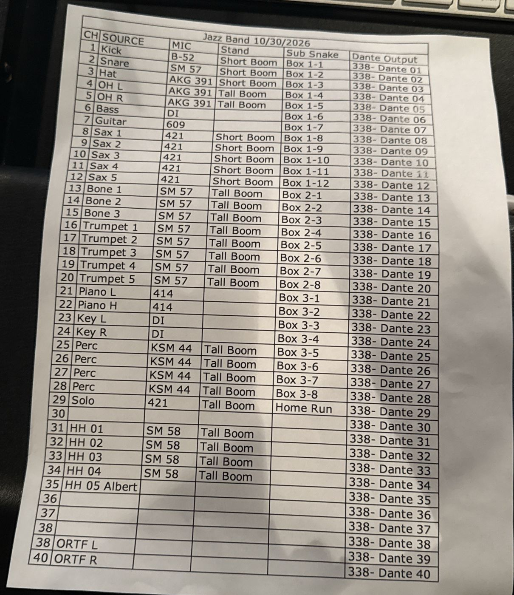
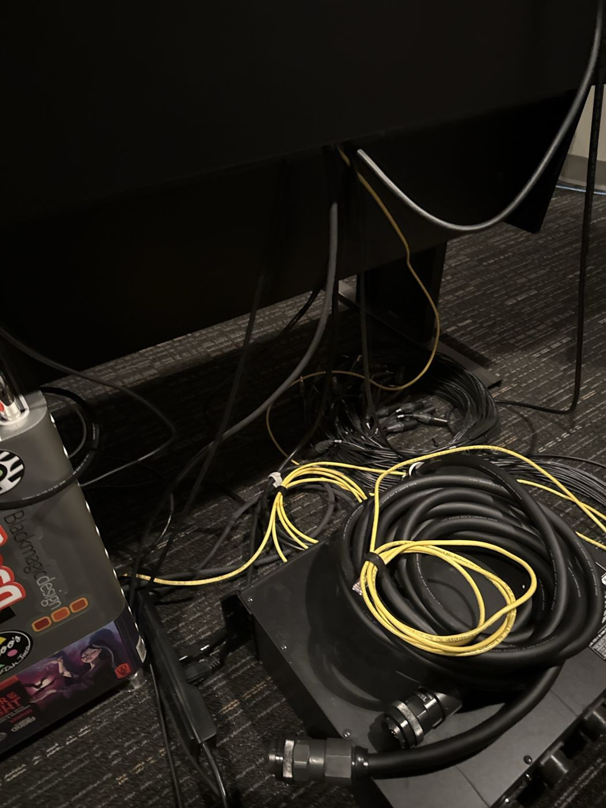
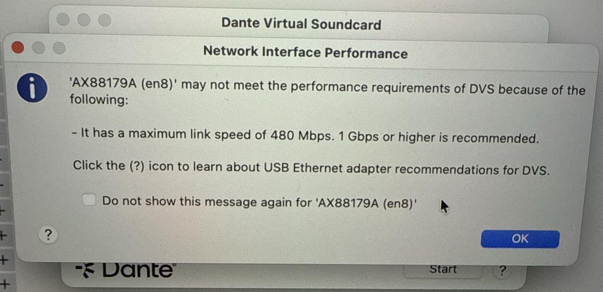
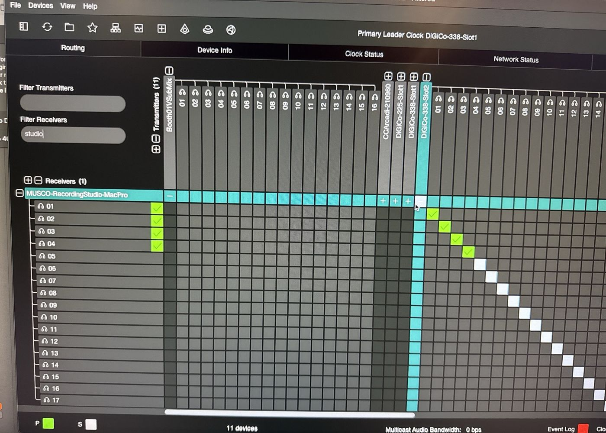
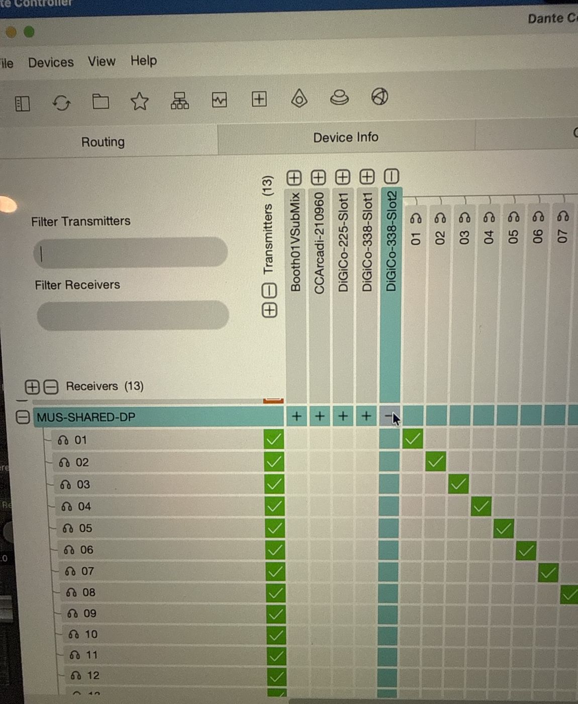
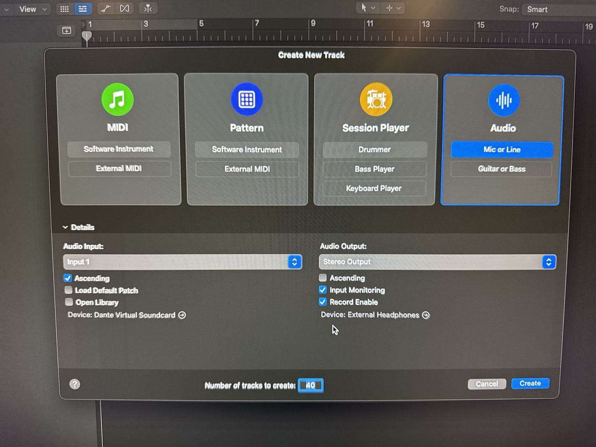
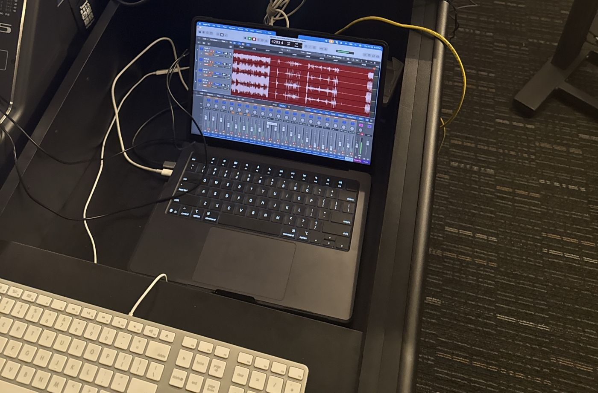

> 🧪 **Status: In Development.** Written November 2026 from the instructor's dictated walkthrough
> and photos of the Big Band / Jazz Combo setup at Musco (Oct 29–30, 2026). Several details are
> still open. See **Technical verification** before trusting a step that names a port or a menu.

## 🎚️ What this is

The audio half of a **Big Band** or **Jazz Combo** concert at **Musco Center for the Arts**: a live
**multitrack** recording, 40 tracks in Logic, captured in the **basement** recording room. The video
crew runs the normal [Musco Gig Checklist](../../musco-gig-checklist/) in the booth at the same time.

Three things make this gig different from anything in Salmon:

1. **The Dante network is the whole building.** The stage mics, the mains, and every monitor mix
   travel on it. Dante Controller on the recording computer can change the live show's routing.
   One click on the wrong receiver can wreck the concert.
2. **You don't patch anything on stage.** The mics come up the sub snakes to the **DiGiCo**
   upstairs, which puts all 40 channels on Dante. You **subscribe** to them.
3. **The CL5 writes the mix.** The CL5's fader moves go to Logic as **MIDI** and are recorded as
   **automation**, so the live mix in the basement is a real mix you can use later.

Big Band and Jazz Combo are about two concerts a year. Same input list, same steps.

## 🗝️ Key terms

**multitrack** · **Dante** · **transmitter** · **receiver** · **subscription** ·
**Dante Virtual Soundcard** · **Dante Controller** · **MIDI** · **control change** ·
**automation** · **Latch** · **Read** · **test recording**

## 🕹️ Practice first

- [CL3: Dante Stems from Logic](../../cl3-dante-stems/): the CL3 in OH 207 is the smaller version of the CL5
- [Mixer Lab: Virtual soundcheck over Dante](https://adamborecki.github.io/mixer-lab/#/cl3-dante): Dante routing in a browser

## 🔀 Signal flow

```
Stage mics ─► sub snakes (Box 1–3, home run)
           ─► DiGiCo (upstairs)
           ─► Dante: DiGiCo-338-Slot2 01–40
ORTF pair  ─► Dante: Booth01VSubMix 01–02
           ─► channels 39–40

Receivers (basement):
  CL5                ─► the basement mix
  Mac Pro (room's)   ─► DVS ─► Logic
  dept. MacBook Pro  ─► DVS ─► Logic

CL5 MIDI ─► USB MIDI interface ─► dongle
         ─► MacBook ─► Logic automation
```

## 🎤 Input list (fall 2026)

One input list for the whole show, set up for **Big Band**. Every channel's Dante output is the same
number as the channel ("338- Dante 01" through "40"), so **Logic track n = channel n**.

| CH | Source | Mic | Stand | Snake box |
| --- | --- | --- | --- | --- |
| 1 | Kick | B-52 | Short boom | 1-1 |
| 2 | Snare | SM57 | Short boom | 1-2 |
| 3 | Hat | AKG 391 | Short boom | 1-3 |
| 4 | OH L | AKG 391 | Tall boom | 1-4 |
| 5 | OH R | AKG 391 | Tall boom | 1-5 |
| 6 | Bass | DI | | 1-6 |
| 7 | Guitar | 609 | | 1-7 |
| 8–12 | Sax 1–5 | 421 | Short boom | 1-8 to 1-12 |
| 13–15 | Bone 1–3 | SM57 | Tall boom | 2-1 to 2-3 |
| 16–20 | Trumpet 1–5 | SM57 | Tall boom | 2-4 to 2-8 |
| 21 | Piano L | 414 | | 3-1 |
| 22 | Piano H | 414 | | 3-2 |
| 23 | Key L | DI | | 3-3 |
| 24 | Key R | DI | | 3-4 |
| 25–28 | Perc | KSM44 | Tall boom | 3-5 to 3-8 |
| 29 | Solo | 421 | Tall boom | Home run |
| 30 | (empty) | | | |
| 31–34 | HH 01–04 | SM58 | Tall boom | |
| 35 | HH 05 Albert (the director) | | | |
| 36–38 | (empty) | | | |
| 39 | ORTF L | | | Booth01VSubMix 01 |
| 40 | ORTF R | | | Booth01VSubMix 02 |

**Jazz Combo uses the same list.** The combo sits in different chairs but plays into the same mics.
Before the combo plays, find out which player is on which big band channel, and write it down.



## 🧰 Equipment and materials

- [ ] The **music department MacBook Pro** with **Logic Pro**, **Dante Virtual Soundcard (DVS)**,
  and **Dante Controller** installed, and its **charger**
- [ ] **One USB-C dongle with both Ethernet and USB-A.** Ethernet is the Dante connection; USB-A is
  for the MIDI interface. One dongle, both jobs.
- [ ] A **USB MIDI interface** with 5-pin DIN cables, for the CL5's MIDI port
- [ ] **Headphones** for checking tracks
- [ ] **This page's input list**, and paper for the Jazz Combo chair map

## ⚠️ Before you touch anything

- 🛑 **Dante Controller here controls the live show.** Every receiver in the building is on the same
  screen. Touch only the **receiver row with your own computer's name**. If you aren't sure whose row
  it is, stop and ask.
- 🔎 **Filter first.** Type part of your computer's name into **Filter Receivers**, so the CL5 and
  every other receiver aren't even on screen when you click.
- ⏰ **Arrive early.** A routing mistake found during soundcheck is a fix. Found during the concert,
  it's a disaster.
- 🧪 **No concert starts without a test recording.** 40 tracks, every one checked.
- 🎚️ **Latch during, Read after.** Logic records the CL5's fader moves only when every track's
  automation is on **Latch**. Afterward, put them back on **Read**.

**Q1 (multiple choice).** In Dante Controller on the recording computer, which rows may you click?

- a) Any receiver that's missing a channel
- ✅ b) Only the receiver row with your own computer's name on it
- c) The CL5's rows, so the basement mix matches the recording
- d) Any transmitter column, as long as you don't touch the receivers

✅ **Answer.** Only your own computer's receiver row. The same screen routes the mains and the monitor
mixes for the live show, so a click anywhere else can change what the audience and the band hear.

## 🚚 Days ahead

- 🚩 Arrange the **department MacBook Pro** with Borecki.
- 🚩 Update **Dante Virtual Soundcard** and **Dante Controller** on the MacBook. Do it days ahead, not
  on the day. Update on the day only if you have to.
- 🚩 Find the **USB-C dongle** (Ethernet + USB-A) and the **USB MIDI interface**, and test both on the
  MacBook.
- 🚩 Ask the ensemble for **this concert's input list**, and the **Jazz Combo's** chairs if they play.
- 🚩 Plan **extra time** for the CL5 MIDI setup and a practice run.

## 🔌 Connect the laptop



- 🚩 Find the **three yellow Ethernet cables** behind the desk: one goes to the **Mac Pro**, one to
  the **CL5**, and one is **spare**. Trace the spare one. **Never unplug the other two**.
- 🚩 Spare yellow cable → the dongle's **Ethernet** port → the MacBook. Click **Allow** when macOS
  asks about the accessory.
- 🚩 Start **Dante Virtual Soundcard**. The first time, choose the dongle's network interface, then
  **Start**.
- 🚩 If DVS warns that the interface has a **maximum link speed of 480 Mbps**, click **OK**. That's
  expected with this dongle, and it recorded 40 channels fine.
- 🚩 Open **Dante Controller**. If it asks you to **Configure Dante Interfaces**: **Use shared Dante
  interface** on, **Primary Interface** = the dongle (`en8` on that MacBook), **Secondary** = **None**.
- 🚩 Dante Controller lists the building's devices (about a dozen), including your MacBook.



**Q2 (multiple choice).** DVS warns that the dongle only links at 480 Mbps. What do you do?

- a) Stop: you can't record with a warning
- ✅ b) Click OK and carry on to the test recording, which tells you whether it's really a problem
- c) Plug the MacBook into the CL5's yellow cable instead
- d) Lower the Logic track count to 16

✅ **Answer.** Click OK and carry on. The warning is about a recommendation (1 Gbps), and this dongle
recorded 40 channels without trouble. The test recording is what proves it. Never take the CL5's or
the Mac Pro's cable.

## 🕸️ Dante Controller: subscribe your computer only

- 🚩 Press **⌘D** (Device View) and check the name in the device menu: that's your computer's name on
  the network.
- 🚩 Back in **Network View**, type part of that name into **Filter Receivers**. Exactly **one**
  receiver is left on screen: yours.
- 🚩 Expand your receiver and **DiGiCo-338-Slot2**. Subscribe **01 → 01, 02 → 02 …** one-to-one
  (clicking the cell where your device row meets the transmitter subscribes them all in order).
- 🚩 Subscribe **39 and 40** to **Booth01VSubMix 01 and 02** (the ORTF room pair).
- 🚩 Wait for **green checks**. White squares are subscriptions still being made.
- 🚩 Clear the filter only when you're done clicking.





## 💻 Logic Pro

- 🚩 **Logic Pro › Settings › Audio › Devices:** **Input Device** = **Dante Virtual Soundcard**;
  **Output Device** = the MacBook's speakers or your headphones; **I/O Buffer Size** = **1,024**.
  Nobody hears the band through Logic, so latency doesn't matter.
- 🚩 New empty project. **Audio › Mic or Line**, **Number of tracks to create: 40**.
- 🚩 **Audio Input: Input 1**, **Ascending** on (tracks 1–40 get inputs 1–40), **mono** inputs.
- 🚩 **Input Monitoring** on and **Record Enable** on. **Audio Output: Stereo Output**.
- 🚩 Name the tracks from the input list.
- 🚩 **Save before anything is recorded:** a name with the date and the ensemble (e.g.
  `261029 Jazz Combo Big Band`), **Organize my project as a: Folder** (not Package), **Copy audio
  files** on.



**Q3 (fill in the blank).** Save the Logic project organized as a ______, not a ______.

✅ **Answer.** A **Folder**, not a Package. A folder's audio files are visible in Finder, so they can be
copied, checked, and backed up like every other gig's files.

## 🎛️ CL5 → MIDI → Logic automation

New in fall 2026, and worth keeping. It took real time to get working: practice it before the
concert.

**Hardware**

- 🚩 CL5 **MIDI** 5-pin DIN port → the **USB MIDI interface** → the **USB-A** on the same dongle as the
  Ethernet.

**On the CL5**

- 🚩 Press **SETUP**, then **MIDI/GPI**.
- 🚩 The CL5 sends high-resolution faders by default: a **Fader H** and a **Fader L** for each channel.
  Turn **off every Fader L**. Use **Fader H** only.
- 🚩 Leave the MIDI channel at the default.
- 🚩 Expect the controller numbers to run **1–31 for channels 1–31**, then **start again at 64** for
  channels 32–40.

**In Logic (Learn)**

- 🚩 Move a fader in Logic, then press **⌘L** (Learn).
- 🚩 Move the matching fader on the **CL5**.
- 🚩 Check the assignment is **Fader Bank 1**, not **Selected** fader.
- 🚩 Go to fader **31** in Logic, move it, move CL5 fader 31, then turn Learn **off**. Logic fills in
  the faders in between on its own.
- 🚩 Repeat for the next block, channels **32–40** (the ones that start at 64).
- 🚩 Move a few CL5 faders: the same faders move in Logic.

**Automation**

- 🚩 Set **every track's automation mode to Latch** before recording. Without Latch, the CL5's moves
  aren't written.

**Q4 (fill in the blank).** During the concert every track's automation mode is ______. After the
concert, switch them back to ______.

✅ **Answer.** **Latch** during, **Read** after. Latch writes the CL5's fader moves into Logic; Read
plays them back without writing over them.

## 🧪 Test recording

- 🚩 Record-arm all 40 tracks and record at least **30 seconds** of the band (soundcheck or
  rehearsal).
- 🚩 Play it back. **Every track has signal**, on the right track (Trumpet 1 on track 16, not 17).
- 🚩 Move a CL5 fader during the test: the automation line appears on that Logic track.
- 🚩 No dropouts, clicks, or "disk too slow" messages.
- 🚩 Use Logic's **waveform zoom** to read the quiet tracks without changing their level.

## 🎬 During the concert

- 🚩 Start recording **before** the first downbeat.
- 🚩 Watch the meters, and keep hands off Dante Controller.
- 🚩 **Jazz Combo:** check the chair map. Each combo player is recorded on the channel of the chair
  they're in.
- 🚩 **Save** at intermission.

**Q5 (short answer).** The Jazz Combo plays on the same mics as the Big Band. What do
you need to know before they start, and why?

✅ **Answer.** Which combo player is on which big band channel. The input list only names big band
chairs, so without a chair map nobody can tell later which track is which player.

## 🏁 End of show

- 🚩 Stop recording, then **save**.
- 🚩 Switch every track's automation mode back to **Read**.
- 🚩 Copy the project folder to a second drive **before** the MacBook leaves the room.
- 🚩 In Dante Controller, change nothing on anyone else's receiver. Quit DVS, then unplug the MacBook
  from the **spare** yellow cable only.
- 🚩 MacBook, dongle, and MIDI interface back to Borecki.
- 🚩 Data transfer: same as the [Salmon Gig Checklist](../../salmon-gig-checklist/)'s **Data
  transfer**: `YYMMDD Full Event Name` folders, two drives, the Triple Triple Check.



## 🧰 If something's wrong

- 🚩 **Dante Controller shows 0 devices:** the yellow cable is the spare one and is in the dongle,
  and the **Primary Interface** is the dongle's interface.
- 🚩 **A Logic track is silent:** that channel's subscription in Dante Controller (a green check?),
  then the track's input in Logic.
- 🚩 **The room's Mac Pro won't talk to Dante** (as in October 2026: "Cannot retrieve Device
  Latency", no receivers): don't debug it during the gig. Record on the MacBook.
- 🚩 **CL5 faders don't move Logic:** the MIDI cable is in the CL5's MIDI port, the interface shows up
  on the Mac, and every **Fader L** is off on the CL5. Then re-learn.

## ✅ Definition of done

- 🚩 40 tracks recorded, every one checked in a test recording before the concert.
- 🚩 The CL5's fader moves are in the Logic project as automation, and every track is back on Read.
- 🚩 The project is saved as a folder, in two places, before the MacBook leaves the room.
- 🚩 Nothing on anyone else's Dante receiver was changed.

## 💭 Before you leave

- 🚩 Tell Borecki anything that didn't match this page: a different input list, a cable in a
  different place, a menu with a different name.

## ⚙️ Technical verification

**Confirmed (the instructor's walkthrough and photos, Oct 29–30, 2026):**

- The DiGiCo is upstairs; the CL5 and the room's Mac Pro are in the basement. One Dante network
  carries the live show, including the mains and monitor mixes.
- Stage channels come from DiGiCo-338-Slot2, one-to-one. The ORTF pair comes from Booth01VSubMix 01/02
  on channels 39/40 (the printed list's "second 38" is 39).
- The department MacBook Pro recorded the whole concert on DVS through a USB-C dongle (Ethernet +
  USB-A), despite the 480 Mbps warning. The room's Mac Pro wouldn't connect to Dante that night.
- Logic: 40 mono tracks, Ascending, Input Monitoring and Record Enable on, buffer 1024, saved as a
  Folder.
- CL5 MIDI: SETUP › MIDI/GPI; Fader L off, Fader H only; default MIDI channel; channels 1–31 then 64
  upward. Logic Learn worked with Fader Bank 1; automation on Latch; back to Read afterward.
- Jazz Combo uses the Big Band input list on the same mics.

**Still open:**

- **Why the controller numbers jump from 31 to 64.** Likely: MIDI reserves controller numbers 32–63
  as the fine (LSB) half of 0–31, which is what Fader L sends. Unverified: check the CL5's MIDI
  control change table.
- **Which CL5 MIDI port** (OUT, presumably, for faders → Logic) and **which MIDI interface** to bring.
- **Is the CL5's MIDI/GPI setup saved** on the console, and is there a **Logic template** with the
  controller assignments, so the next crew doesn't redo Learn?
- **The Learn step's exact wording** in Logic ("Fader Bank 1" vs "Selected") is from the dictation,
  not a screenshot.
- **Whether 0 dB on the CL5 lands at 0 dB in Logic.** Not checked. Treat the automation as a starting
  mix.
- **Which yellow cable is which.** They aren't labeled.
- **What broke on the Mac Pro** ("Retrieving model information", "Cannot retrieve Device Latency").
- **Where the project is saved.** It went on the Desktop in October, "which isn't great". The
  standard location and the hand-off to the data transfer are open.
- **How to get to the basement room,** and who lets you in.
- **Where the MacBook lives.** "Arrange with Borecki" assumes it's the same department MacBook Pro
  the [L-20 checklist](../../l20-multitrack-gig-checklist/) uses.
- **Logic's waveform zoom:** which button.
- **Mic models** are as printed on the input list (no brands); not checked against the mic locker.
- **What the CL5 also receives on 41–45** (from DiGiCo-338-Slot1) and whether its mix feeds anything
  besides the automation.
- **The concert date** (input list 10/30, project folder 261029).

## 🤖 AI use disclosure

Drafted by AI from the instructor's dictated walkthrough during the Big Band / Jazz Combo setup at
Musco (Oct 29–30, 2026), the instructor's answers to follow-up questions, and photos of the input
list, Dante Controller, Dante Virtual Soundcard, Logic, and the recording room. Photos were cropped to
leave out desktop file listings and network addresses. The director's name on channel 35 stays at the
instructor's request. The reason for the 31 → 64 jump is the AI's guess, labeled as unverified.
Pending instructor review.
