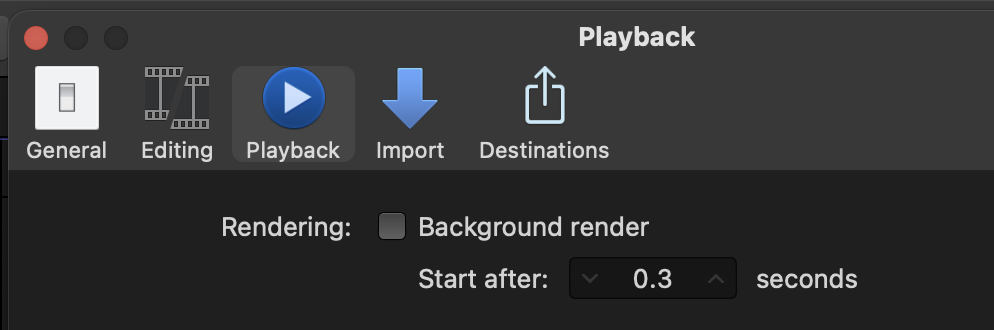
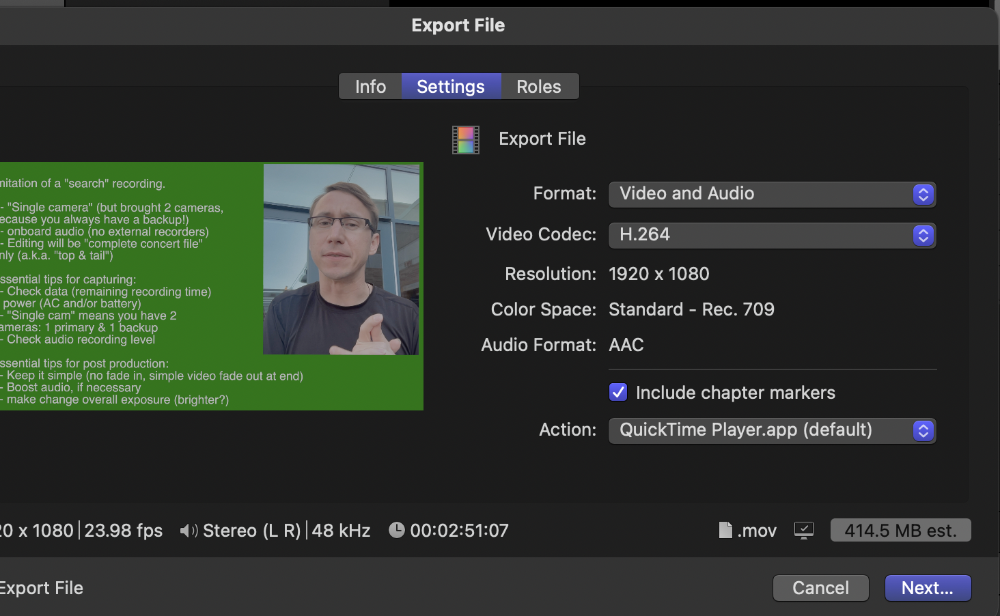

> 🧪 **Status: In Development.** From the instructor's **Post Production "Mini"** slides (2024),
> Phase 1. The video tutorials carry most of the teaching; this page is the map around them, plus
> the two things the slides say the videos forgot. The slides are a bit outdated, so check
> **Technical verification** before trusting a menu name.

## 🎯 What you'll practice

**Post Mini** is a set of small, bite-sized activities that train you to do basic post-production
for Hall-Musco Conservatory recordings. Phase 1 is the smallest whole job: **one video file and
one audio file in, a synced, trimmed, faded, finished file out.**

`VIDEO + GOOD AUDIO → SYNC → TRIM → FADE → QC → EXPORT H.264 VIDEO + WAV AUDIO` (Lecture 04)

## 🗝️ Key terms

**library** · **project** · **leave files in place** · **background render** · **pan** ·
**cross dissolve** · **limiter** · **H.264** · **QC**

Definitions are on [Final Cut Pro at Chapman](../../fcp-at-chapman/).

## 📍 Logistics

- **Software:** Final Cut Pro and Logic.
- **Where:** confirm with the instructor which computers, and whether this can be done at home.
- **Raw files and video tutorials:** [Post Mini Phase 1 folder (SharePoint)](https://chapman0.sharepoint.com/:f:/s/AdamBoreckiLargeFilesTeachingResources/EofgKL84N9FIrDUd1luHGSUB0_EqCZbKmVWWo1rKstzZqg?e=ZtC6H7).
  Chapman sign-in.
- **Read first:** the house rules on [Final Cut Pro at Chapman](../../fcp-at-chapman/).

## 🧰 Ingredients

- A video file.
- An audio file (the better recording, from a separate recorder).

## ⚠️ Missing from the videos

The slides call out two things the Phase 1 videos forgot to mention. Do both.

**1. Turn off Background render.** **Final Cut Pro → Settings…**, then **Playback**:

**2. Export as H.264.** When you export, choose the **H.264** video codec. The default, Apple
ProRes, makes files that are too large for our live concert recordings.

🚩 Background render is off before you import anything.

## 🗂️ The job, in order

Watch the Phase 1 videos, then work through this. It's the slides' summary of what Phase 1
teaches, in order.

1. **Data management.** Make the gig folder, `YYMMDD [longer concert name]`, with `r [abbr]` and
   `e [abbr]` subfolders inside. Put the raw files in `r`, in a `From [source]` folder if they came
   from a drive.
2. **Settings.** Background render off. Close any other Final Cut libraries.
3. **New library, new project.**
4. **Import** with **File → Import** only, not click-and-drag, with **Leave files in place**
   checked.
5. **Project settings.** Change to **1080p**. In the metadata, set the title to **Recording** and
   delete all other metadata.
6. **Get around the timeline.** Zoom in and out; change the clip height so you can see the
   waveforms.
7. **Pan mode.** The slides say "Pan mode: Left or Right"; the video shows which setting, and
   on which clip. Whatever it is, the result has to be proper stereo.
8. **Sync by hand.** Line the audio file up with the camera's own sound, by eye on the waveforms
   and then by ear.
9. **Trim.** Cut with **⇧ ⌘ B** (blade all) and remove what's before the start and after the end.
10. **Fade.** A **cross dissolve** on the video at the end, and an audio fade-out.
11. **Limiter.** Add the **Limiter** audio effect. Find the peak level (for example, about
    −12 dB) and apply about that much gain (about +12 dB).
12. **Export** with **File → Share → Export File**: a 1080p `.mov` in **H.264**, not ProRes. Then
    export again as audio only, for example WAV.
13. **QC.** Open both files and check them against the definition of done.

🚩 Audio and video are in sync at the start, the middle, and the end, not just the start.

## ✅ Definition of done

- 🚩 A 1080p video file, trimmed, exported as H.264.
- 🚩 A WAV audio file, trimmed.
- 🚩 Proper stereo: left is left, right is right, and it isn't summed to mono.
- 🚩 No video fade-in.
- 🚩 A video fade-out at the end.
- 🚩 The audio fade-out sounds OK.

## 💭 Before you leave

**Q1 (multiple choice).** You're about to import the raw files. Which way is right for this
course?

- a) Drag them from Finder into the timeline
- ✅ b) **File → Import**, with **Leave files in place** checked
- c) **File → Import**, letting Final Cut copy them into the library
- d) Open them in QuickTime first, then drag them in

**Q2 (fill in the blank).** Phase 1's export settings: ________ resolution, the ________ video
codec, plus a separate ________ audio file.

✅ **Answer.** 1080p, H.264 (not ProRes), and a WAV audio-only file.

**Q3 (short answer).** The peak of your synced audio is about −12 dB. What do the slides have you
add, and how much gain do you apply?

✅ **Answer.** A **Limiter** effect, with about +12 dB of gain, bringing the peaks up near the top
without clipping.

**Q4 (multiple choice).** Which fades does a finished Phase 1 file have?

- a) A video fade-in and a video fade-out
- ✅ b) No video fade-in; a video fade-out, and an audio fade-out
- c) No fades at all
- d) An audio fade-in only

## ⚙️ Technical verification

- ❓ The exact pan-mode setting for the stereo audio file, as shown in the video.
- ❓ The limiter amounts (−12 dB peak, +12 dB gain) are the slides' example, not a fixed rule.
  Confirm what target the instructor wants now.
- ❓ The SharePoint folder link is from the 2024 slides. Confirm it still opens and still has the
  raw files and videos.
- The slides' menu name is **Settings…**; older Final Cut versions call it **Preferences…**.

## 🤖 AI use disclosure

Written by AI (Claude, via Claude Code) from the instructor's 2024 Post Production "Mini" slides
(Phase 1) and their screenshots, and the Lecture 04 slides. The numbered order is the slides'
summary list, lightly put in sequence; nothing was tested in Final Cut for this page.
