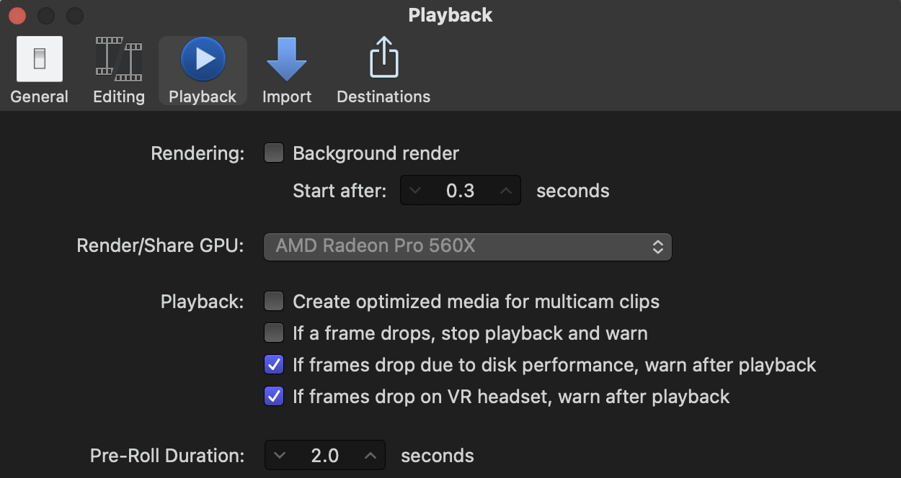

> 🧪 **Status: In Development.** From the instructor's **Post Production "Mini"** slides (2024),
> Phase 2. The video tutorials carry most of the teaching; this page is the map around them. Do
> [Post Mini 1](../../post-mini-1/) first.

## 🎯 What you'll practice

A mock **search** recording (an audition-style recording): two camera angles, no separate audio.
You'll sync them with a **multicam clip**, pick the best camera and the best audio, fix the
picture's exposure and framing, and deliver one clean file.

The recording you'll edit says it out loud: a "single camera" job still means two cameras, a
primary and a backup, because you always bring a backup. Keep the edit simple: no fade-in, a
simple video fade-out at the end, boost the audio if it needs it, maybe a brighter exposure.

## 🗝️ Key terms

**multicam clip** · **active video angle** · **active audio angle** · **optimized media** ·
**exposure** · **color board** · **scale** · **global fix**

Definitions are on [Final Cut Pro at Chapman](../../fcp-at-chapman/).

## 📍 Logistics

- **Software:** Final Cut Pro.
- **Where:** confirm with the instructor which computers, and whether this can be done at home.
- **Raw files and video tutorials:** [Post Mini Phase 2 folder (SharePoint)](https://chapman0.sharepoint.com/:f:/s/AdamBoreckiLargeFilesTeachingResources/Epu_TViitppMj-VnHMqC_PcBiYpV0LqqKguqLX7OJMTaSQ?e=y6Iar0).
  Chapman sign-in.

## 🧰 Ingredients

- Two camera angles.
- No separate audio: each camera's own sound is all there is.

## ⚠️ Missing from the videos

Turn off **Create optimized media for multicam clips** too, in the same place as Background
render: **Final Cut Pro → Settings…**, then **Playback**.

🚩 Background render **and** optimized media for multicam clips are both off before you import.

## 🗂️ The job, in order

1. **Everything from Phase 1 first:** gig folder (`YYMMDD …` with `e` and `r` subfolders), one
   library open, **File → Import** with **Leave files in place**, Background render off.
2. **Create a multicam clip** from the two camera angles, so Final Cut syncs them.
3. **Go into the multicam clip,** look at both angles, then **leave it** to get back to the
   project timeline.
4. **Pick the angles.** Right-click → **Active Video Angle** for the best camera, and
   **Active Audio Angle** for the best-sounding recording.
5. **Fix the picture inside the multicam clip.** These are **global** fixes: made once inside the
   clip, they apply everywhere it's used, unlike a fix on one piece in the project timeline.
   - **Exposure:** with a color board, boost the **midtones** and **highlights**, and maybe lower
     the **shadows** a little.
   - **Framing:** rotate to level it, and zoom in with **Scale** to crop.
6. **Audio, as in Phase 1.** Adjust the level a bit if needed, add a **Limiter**, and fade out.
7. **Video, as in Phase 1.** ⇧ ⌘ B to cut; trim the unnecessary parts at both ends; add the fade-out.
8. **Project settings, as in Phase 1:** 1080p; metadata title **Recording**, everything else
   deleted.
9. **Export, as in Phase 1:** H.264. Then QC against the definition of done.

🚩 The active video angle and the active audio angle are each the one you meant to pick.

## ✅ Definition of done

- 🚩 A 1080p video deliverable (.mp4 or .mov), exported as H.264.
- 🚩 The Final Cut library is small: imported with **Leave files in place**, Background render off, and optimized media for multicam off.
- 🚩 Proper stereo.
- 🚩 Good-quality audio, reasonably loud, and the audio fade-out is OK.
- 🚩 No video fade-in, and a video fade-out at the end.
- 🚩 The framing is corrected (level, and cropped where needed).
- 🚩 The exposure is reasonably bright.

## 💭 Before you leave

**Q1 (multiple choice).** You brightened the exposure **inside** the multicam clip instead of on
a piece of it in the project timeline. What does that do?

- a) Nothing; it has to be done in the project timeline
- ✅ b) It's a global fix: it applies everywhere that multicam clip is used
- c) It only affects the export, not playback
- d) It changes the original camera file on disk

**Q2 (fill in the blank).** To choose which camera the audience sees, right-click → Active
________ Angle; to choose which recording they hear, Active ________ Angle.

✅ **Answer.** Active **Video** Angle and Active **Audio** Angle.

**Q3 (short answer).** Your library is 40 GB for a 3-minute clip. Name two settings you'd check.

✅ **Answer.** Any two of: **Leave files in place** wasn't checked at import (the media was
copied in); **Background render** is on; **Create optimized media for multicam clips** is on.

**Q4 (multiple choice).** It's a "single camera" search recording. Why were there two cameras?

- a) To make a multicam edit with lots of cuts
- ✅ b) You always bring a backup: one primary camera and one backup
- c) One records audio and one records video
- d) The second one is only for the stage manager

## ⚙️ Technical verification

- ❓ The exact steps to create a multicam clip and to go into and out of it are in the videos,
  not the slides. Confirm against the current Final Cut before writing them here as steps.
- ❓ Which color tool to use for exposure: the slides say a **color board**; newer Final Cut
  versions add other color tools. Confirm which one the course wants.
- ❓ The SharePoint folder link is from the 2024 slides. Confirm it still opens.
- The slides' Phase 2 tip text says "disable background render" next to the optimized media
  screenshot, a copy-paste slip; the screenshot and the slide title are about **optimized media
  for multicam clips**, and the summary lists both settings.

## 🤖 AI use disclosure

Written by AI (Claude, via Claude Code) from the instructor's 2024 Post Production "Mini" slides
(Phase 2), including the text visible in the Phase 2 export screenshot. Nothing was tested in
Final Cut for this page.
