> 🧪 **Status: In Development.** Drafted November 6, 2026 from the instructor's notes and photos
> taken while a student set up the medium screen in Salmon, plus photos of the large screen from
> earlier gigs (faces pixelated). The menu path for front and rear projection is confirmed from
> photos of the projector's own menu. Several details are still open: see **Technical
> verification**.

## 🎚️ What this is

The checklist for any event that asks for **a projector and a screen**: a lecture, a recital with
slides, a film with live music. **Early Music Ensemble** asks for the screen at every concert, so
expect this one often. Most of the time it's in **Salmon Recital Hall**, but the same steps work
anywhere you can carry a projector.

It's not the [Electroacoustic Showcase Gig Checklist](../../electroacoustic-gig-checklist/). That
one covers one very specific kind of concert, with rear projection as one small part of it. This
page is the general job: get a picture on a screen, get the laptop's sound into the room, keep it
running, and put it all away.

There are two screens. Call the smaller one **medium**, never "small": people hear "small" and
think it won't be big enough. It is.

| | **Medium screen** | **Large screen** |
|---|---|---|
| What it is | A pull-up screen on a tripod | A big folding frame with a screen surface stretched on it |
| People to set it up | 1 is fine | **2 or more, ideally 3. Never 1.** |
| Projection | **Front only** (the back is solid black) | **Front or rear**, with the matching surface |

## 🗝️ Key terms

**front projection** · **rear projection** · **INSTALLATION** setting · **screen surface** ·
**unbalanced** · **balanced** · **DI box** · **3.5 mm** · **dual TS** · **XLR** · **gaff tape** ·
**strike** · **finish the job**

## 🧰 Equipment and materials

- [ ] A **projector.** The **dark gray Panasonic** is the default: use it unless there's a reason
  not to. There's also a **white** projector, and **two ViewSonic** projectors. The ViewSonics
  aren't as good, but they work nicely and are the best choice when the projector has to travel.
- [ ] A **projector cart** to set it on
- [ ] A **screen:** medium or large. For the large one, the **surface that matches** front or rear
  projection (see **Large screen**)
- [ ] An **HDMI cable** from the laptop to the projector, long enough for the route you'll tape
  down, and any **adapter** the laptop needs (most new laptops have no HDMI port). The projector
  end needs nothing extra: the dark gray Panasonic keeps its own **HDMI-to-DVI adapter** on it.
- [ ] **Audio from the laptop,** one of:
  - a **3.5 mm to XLR** cable, for a short run
  - a **stereo DI box** (the **On-Stage DB2050**), a cable from the laptop's 3.5 mm jack to the
    DI's inputs (**3.5 mm to dual RCA** for the DB2050), and **XLR cables**, for a long run
- [ ] **Power:** an extension cord or power strip for the projector, from the Salmon storage
  closet, **BH 102**
- [ ] **Gaff tape.** Rolls hang by the door in the back alcove (see **Power and cables**)
- [ ] The **presenter's laptop** and **its power supply**

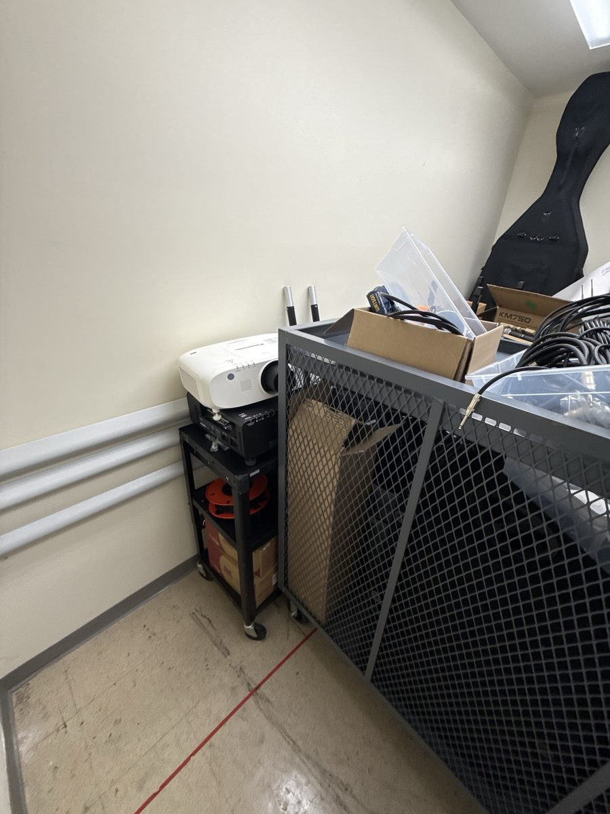

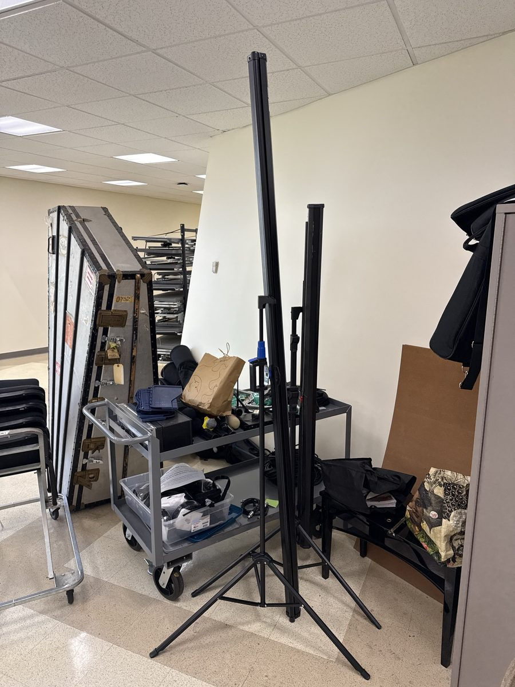

BH 102 is a **double door**. For anything wide, like the large screen, open the fixed half too: it
has a **flush bolt** on its top edge, and the door half can't open until the bolt's lever is flipped
back.

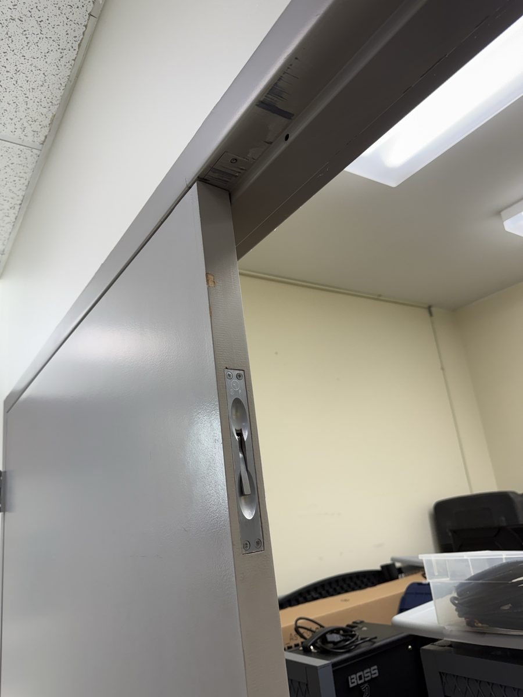

## ⚠️ Before you touch anything

- 🚩 **The large screen takes two or more people, ideally three.** Never set it up or take it down
  alone, not even "just holding it for a second." It's tall, wide, and catches air like a sail.
- 🔌 **Cables across a walkway get taped flat with gaff tape**, the whole width of the walkway.
  Gaff tape, not duct tape: duct tape leaves glue on the floor.
- 🌡️ **Let the projector cool down before you unplug it.** Press **STANDBY** and wait for the fan
  to stop (see **Strike**).
- 🙋 **Ask when you're not sure.** The presenter knows their slides; your supervisor knows the room.

## 📅 Days before — plan the event and the people

- 🚩 Find out **which screen** (medium or large) and **front or rear** projection. If it's rear,
  it has to be the large screen.
- 🚩 Find out **whose laptop** plays the slides or video, and **what ports** it has. Ask now, not
  at load-in, so the right adapter is in the bag.
- 🚩 Find out whether the laptop plays **sound** into the room. If it does, plan the audio run
  (see **Laptop audio**).
- 🚩 Plan **who's in the room.** The best case: the engineer is upstairs and can run down quickly
  if anything needs fixing. The engineer may need to stay in the hall for the whole event: decide
  which before the day.
- 🚩 Plan **the end.** Someone **must be back at the end** to strike. If the engineer can't be
  there for cleanup, sort out who will **before** the event, not after.
- 🚩 Book the crew past the end time on the program. If the event is supposed to end at 1:45 or
  1:50, plan for the crew to be there **until 2:00 or later**. Events run over, and strike takes time.

**Q1 (short answer).** The event is scheduled to end at 1:50. Your engineer has a class at 2:00 and
says, "I'll be back at the end." What's the problem, and what do you do about it now?

✅ **Answer.** If the event runs late or strike takes longer than ten minutes, nobody will be there
to put the gear away. Plan the crew past the end time (2:00 or later), and settle **before the
event** who strikes if the engineer has to leave. Finishing the job is part of the job.

## 🖼️ Medium screen — front projection only

The back of the medium screen is solid black, so the projector goes **in front**, on the audience
side.

- 🚩 Stand the tripod up with its legs spread fully, where the screen will go.
- 🚩 Seat the **screen case** in the black cradle at the top of the tripod, against the blue knob.

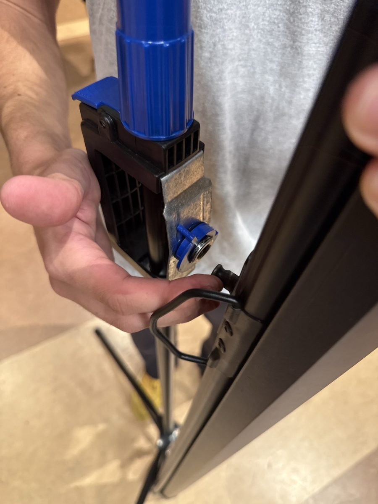

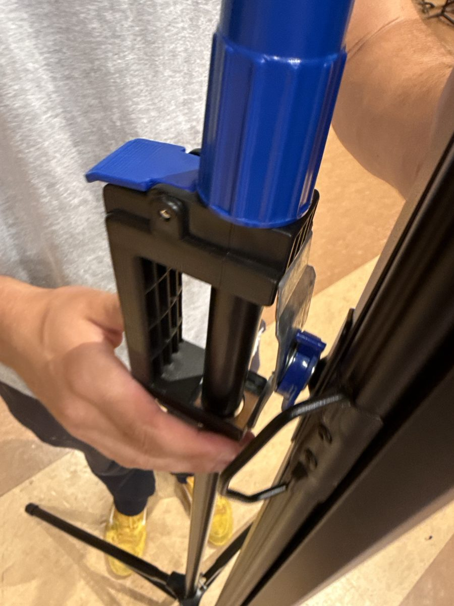

- 🚩 Pull the screen up out of the case by its **top bar** and hook the bar's **wire loop** onto the
  hook at the top of the pole.

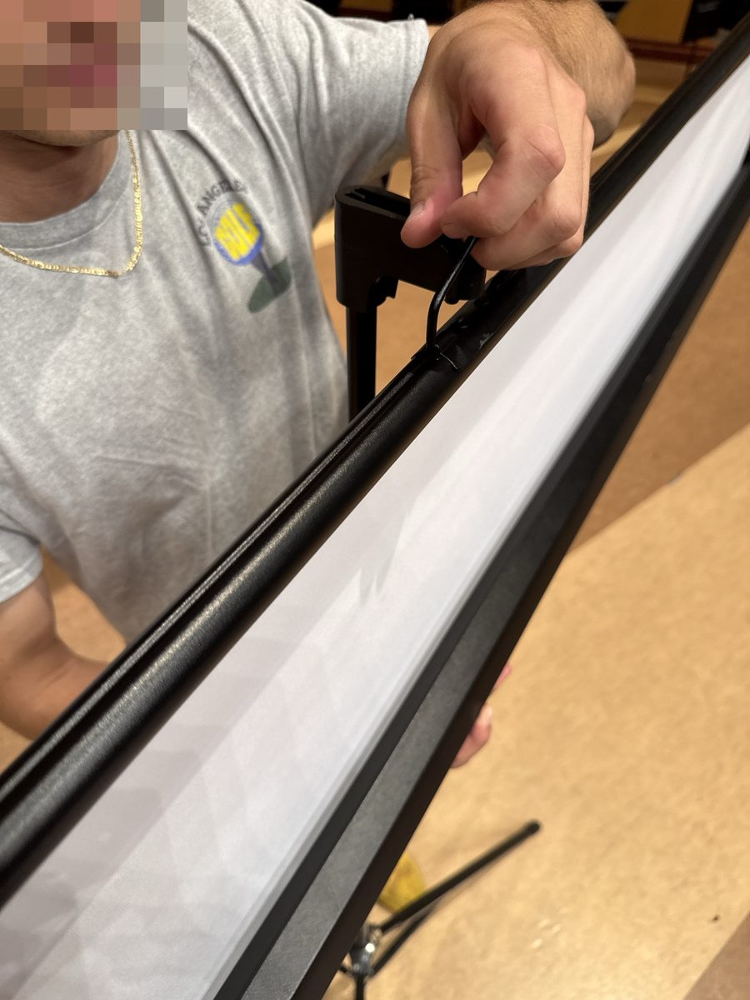

- 🚩 Raise the **pole** until the screen hangs flat, with no wrinkles across it, and lock the pole.

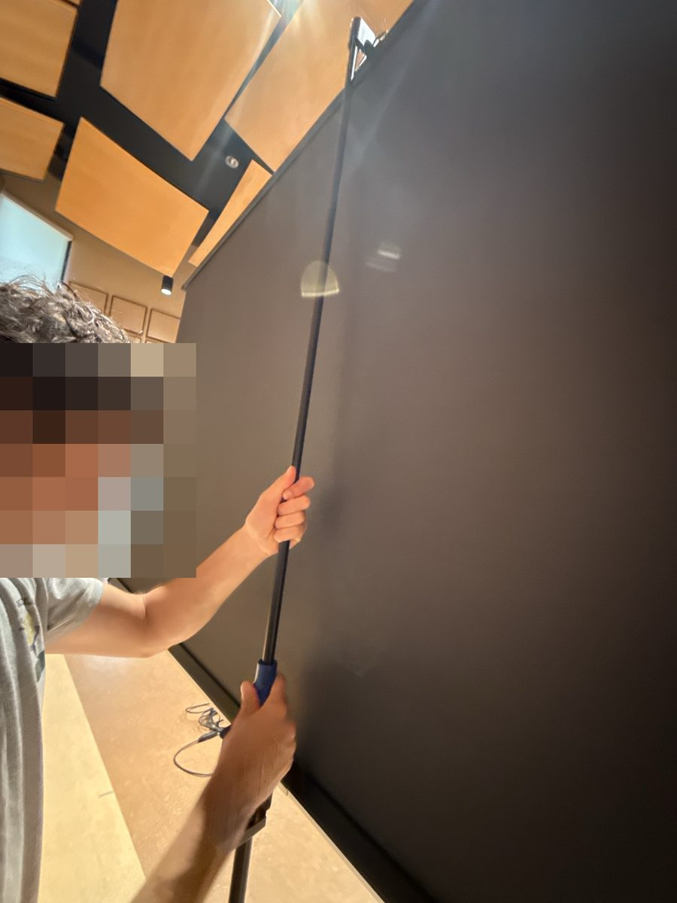

- 🚩 Check the white side faces the audience and the screen is level.

## 🖼️ Large screen — two or more people, ideally three

The large screen can do **front or rear** projection, and it has **two different surfaces** that
go on the frame. **Rear projection needs the rear surface.** Front projection needs the front one.
Check you've got the right one before it goes on the frame.

- 🚩 Count your crew: **at least two, ideally three.** If you're alone, stop and wait.
- 🚩 Lay the frame pieces out on the floor and join them. The corners are labeled with colored tape:
  match each label to its piece.

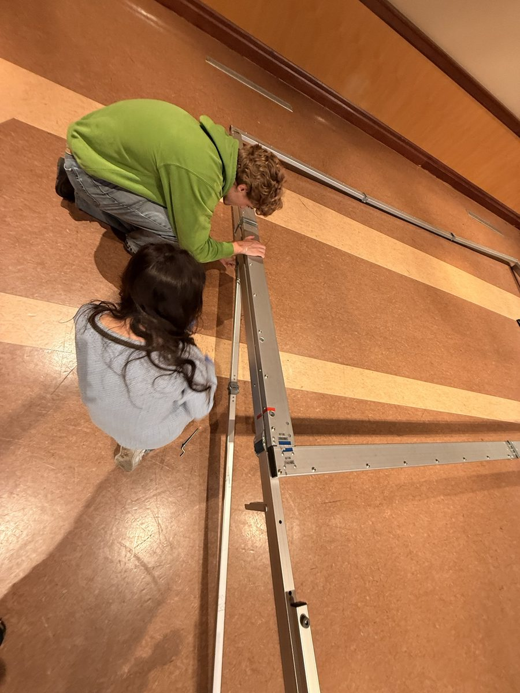

- 🚩 Fit the **legs and braces** on the frame.

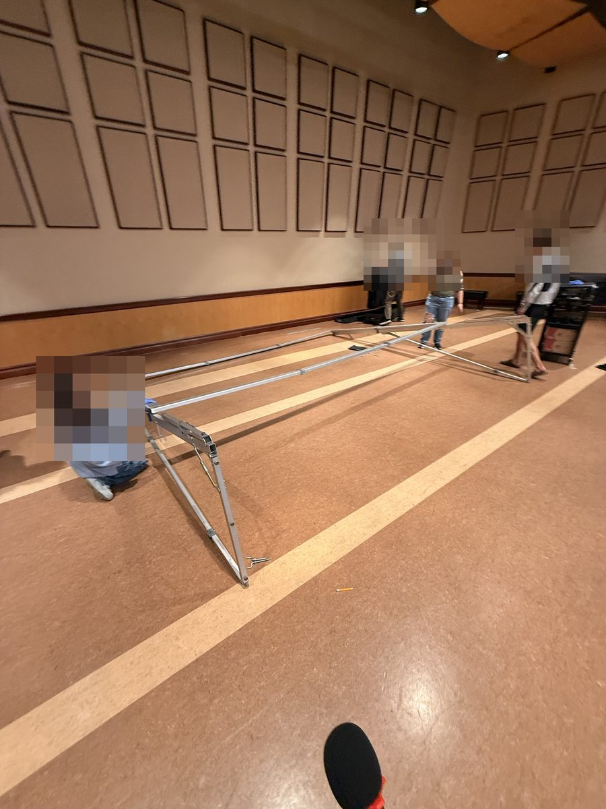

- 🚩 Fit the **matching surface** (front or rear) **while the frame is still on the floor**, so it's
  stretched flat, with no wrinkles or gaps at the edges.
- 🚩 Stand the frame up **together**, on a count, everyone holding it.

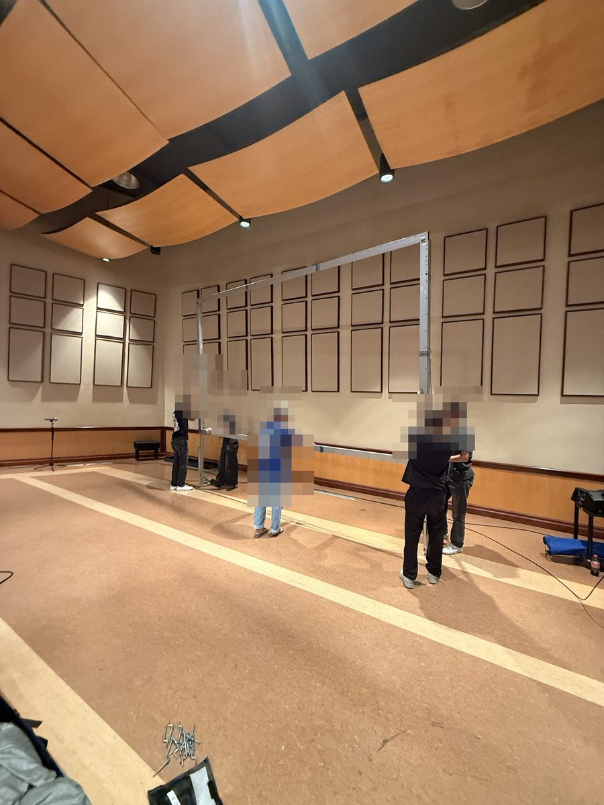
- 🚩 For **rear projection**, leave room behind the screen for the projector and its throw. Nobody
  walks between the projector and the screen during the event.

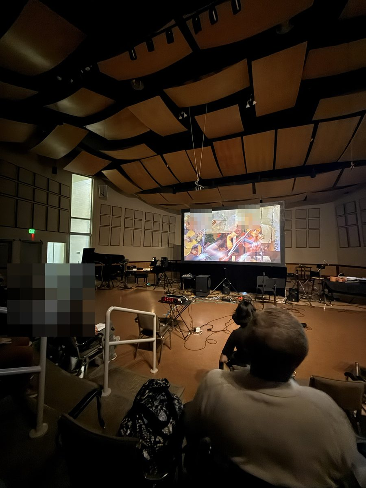

## 📽️ Projector

- 🚩 Put the projector on its cart, facing the screen: **in front** of the screen for front
  projection, **behind** it for rear.
- 🚩 Plug it in, and press **POWER ON**.

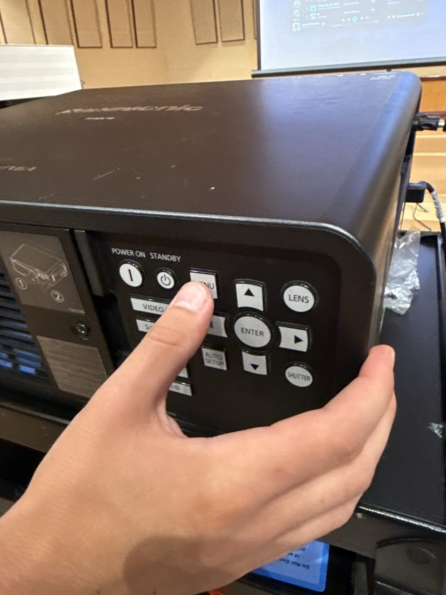

- 🚩 Press **MENU**. With **▲ ▼**, highlight **PROJECTOR SETUP**, and press **ENTER**.

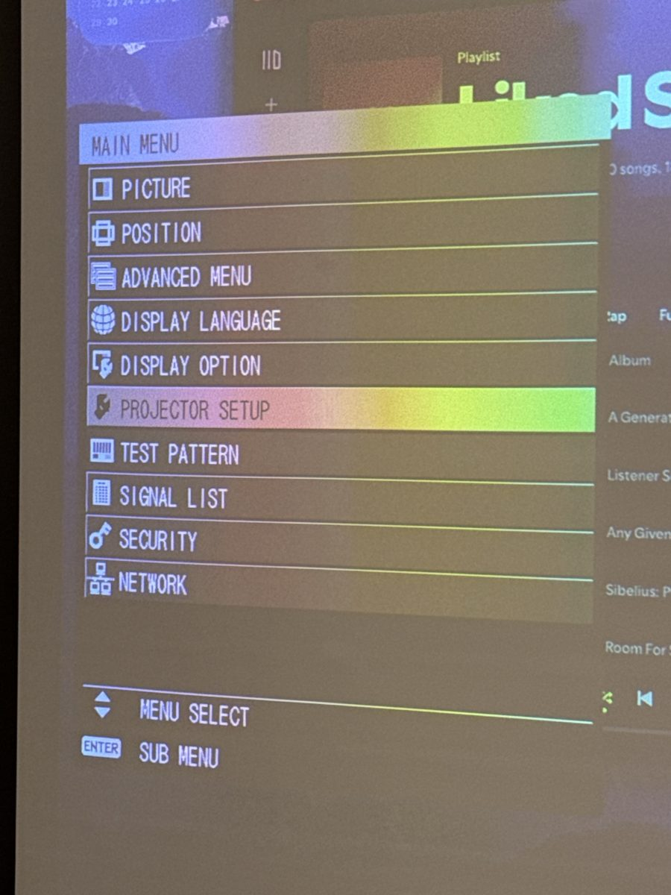

- 🚩 Highlight **INSTALLATION**, and set it with **◀ ▶**:
  - **FRONT/FLOOR** for front projection (the medium screen, or the large one with its front surface)
  - **REAR/FLOOR** for rear projection (the large screen with its rear surface)

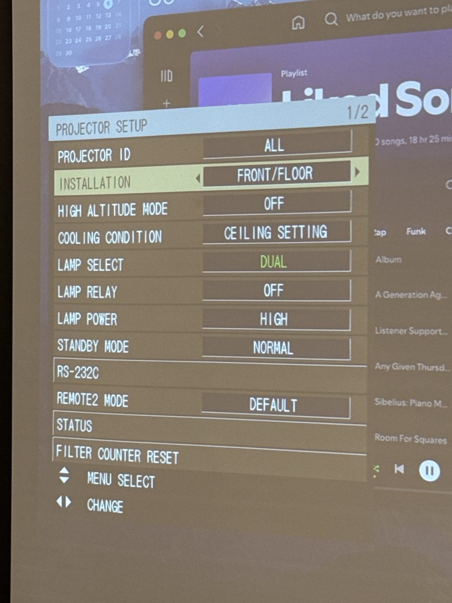

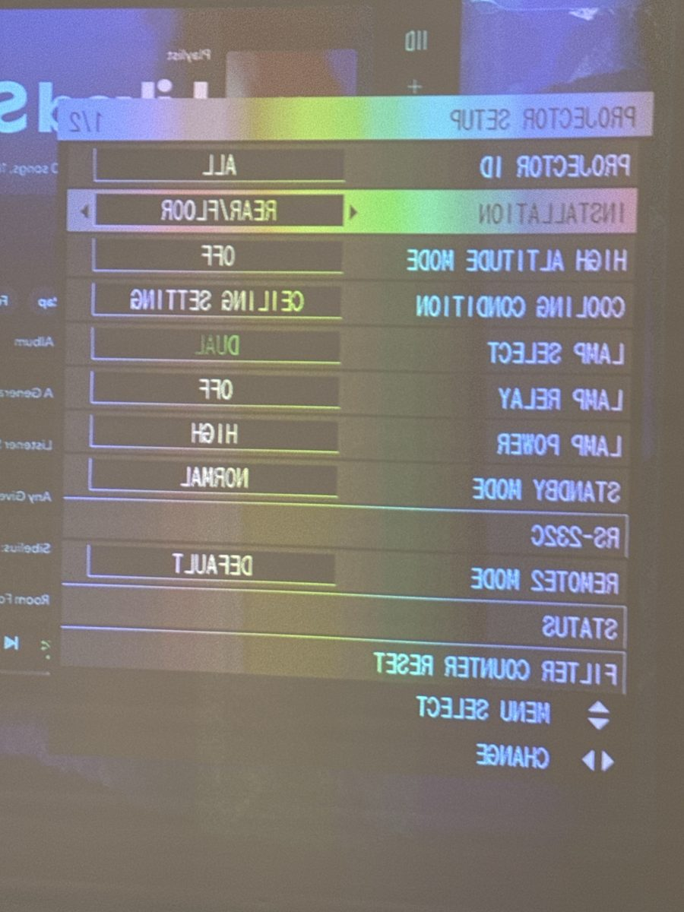

- 🚩 Close the menu.
- 🚩 Fill the screen: move the cart, then fine-tune with **LENS**, until the picture fills the
  screen, is square, and is in focus.

**Q2 (multiple choice).** The event wants the **medium** screen. What's **INSTALLATION** set to?

- ✅ a) **FRONT/FLOOR**
- b) **REAR/FLOOR**
- c) Either. The medium screen works from both sides.
- d) It doesn't matter for a tripod screen.

**Q3 (short answer).** You set up the large screen for rear projection and set **INSTALLATION** to
**REAR/FLOOR**. Standing behind the screen with the projector, the text reads backwards. Is
something wrong?

✅ **Answer.** No. With rear projection, the projector flips the image so the audience on the
other side sees it the right way round. From behind the screen, it's supposed to look backwards.
Check it from the audience's side.

## 💻 The laptop

- 🚩 Plug in the laptop's **power supply.** Don't run a presentation on battery.
- 🚩 Connect the **HDMI cable** from the laptop to the projector's HDMI-to-DVI adapter. That's the
  only input this projector is used with. Check the picture appears.
- 🚩 Decide **mirror** (the screen shows what the laptop shows) or **extend** (the screen is a
  second display), and set it in the laptop's display settings. Presenter view needs extend.
- 🚩 Keep the laptop **awake.** On a Mac, the free app **Amphetamine** (Mac App Store) stops it
  sleeping or dimming the screen mid-event. Install it before the day: it needs the laptop owner's
  App Store account.
- 🚩 Turn on **Do Not Disturb**, so no notification pops up on the big screen.

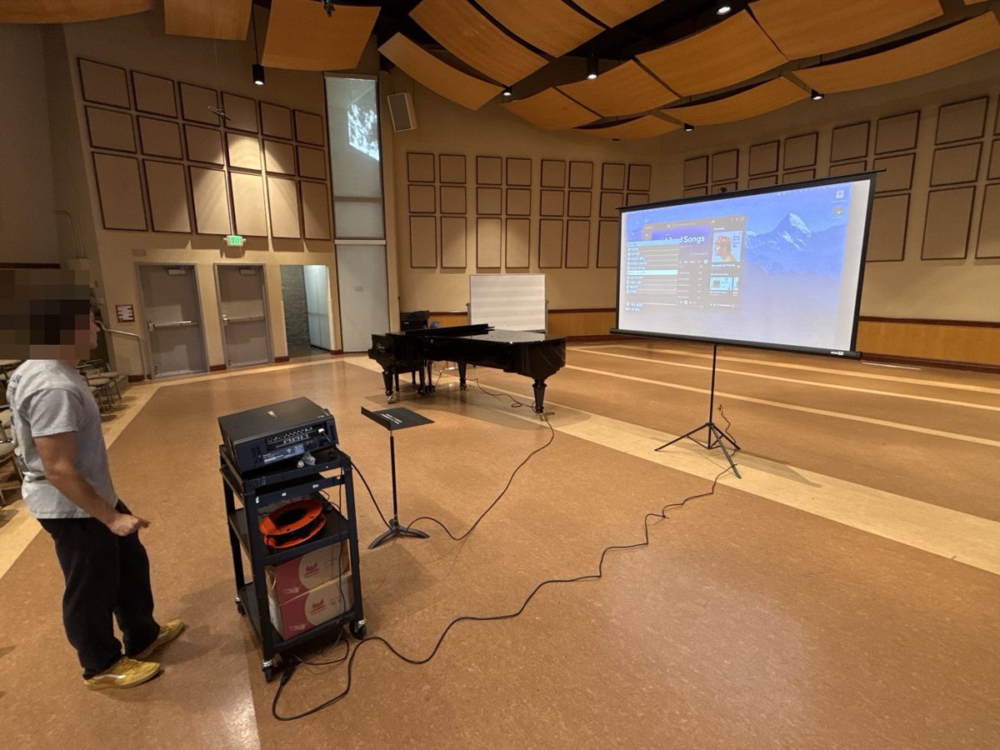

## 🔊 Laptop audio

If the laptop plays sound into the room, it goes into the hall's sound system through the stage
box. Ask whoever runs the console (FOH) which input to use.

- 🚩 **A short run:** a **3.5 mm to XLR** cable from the laptop's headphone jack into the stage box
  works. It's an **unbalanced** signal on an XLR plug: fine over a short distance.
- 🚩 **A long run:** from the laptop's 3.5 mm jack into a **stereo DI box**, then **XLR** out of
  the DI. In Salmon that's the **On-Stage DB2050**, with a **3.5 mm to dual RCA** cable into it.
  From the DI you can chain XLR cables as long as you need.

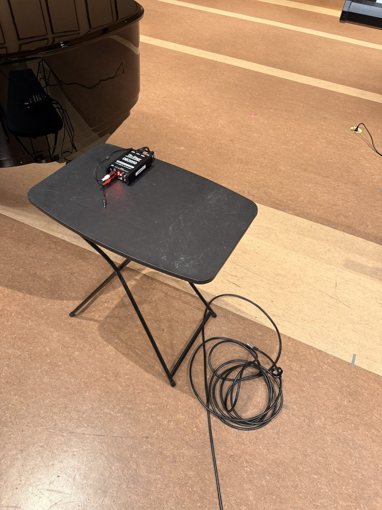
- 🚩 Play something from the laptop and check with FOH that the right channel moves, in stereo if
  the laptop's sound is stereo.

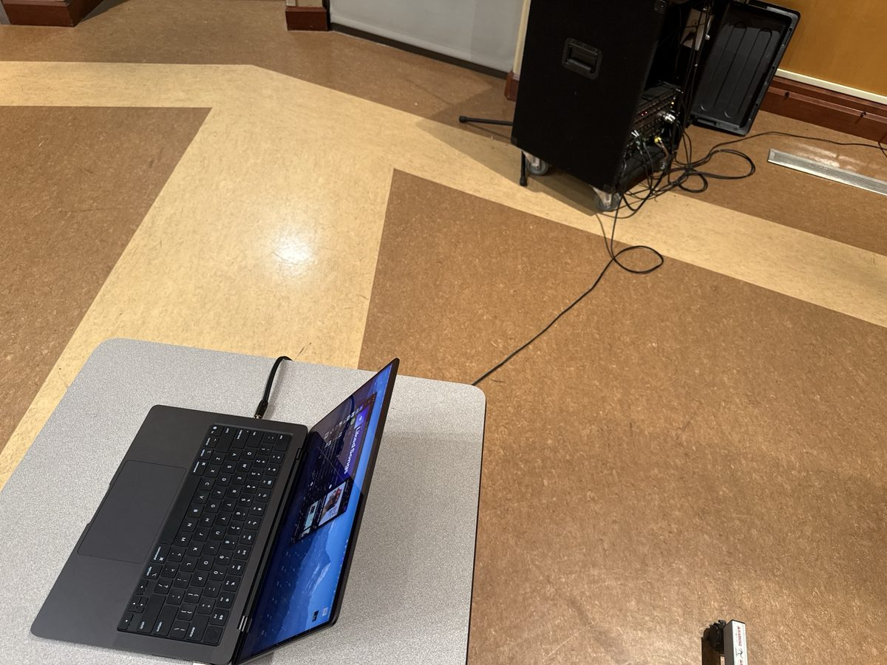

**Q4 (short answer).** Why does a 3.5 mm to XLR cable work fine for a short run, but a long run
should go through a DI box?

✅ **Answer.** A 3.5 mm to XLR cable carries an **unbalanced** signal, which picks up more noise
the longer the cable. A DI turns it into a **balanced** signal on XLR, which can run long without
picking up noise.

## 🔌 Power and cables

- 🚩 Find the power. In Salmon there are **outlets in the floor** (the round covers): use the one
  nearest the projector. Power strips and extension cords come from **BH 102**.
- 🚩 Run every cable along an edge, out of walkways: along a wall, under the screen, behind a piano
  leg. Not diagonally across the floor.
- 🚩 Tape down every cable that crosses a path, with **gaff tape**. The rolls hang by the door in
  the back alcove.
- 🚩 Look at the cables from the audience. Tidier than the photos on this page is the goal: no
  loose loops, nothing anyone could trip on.

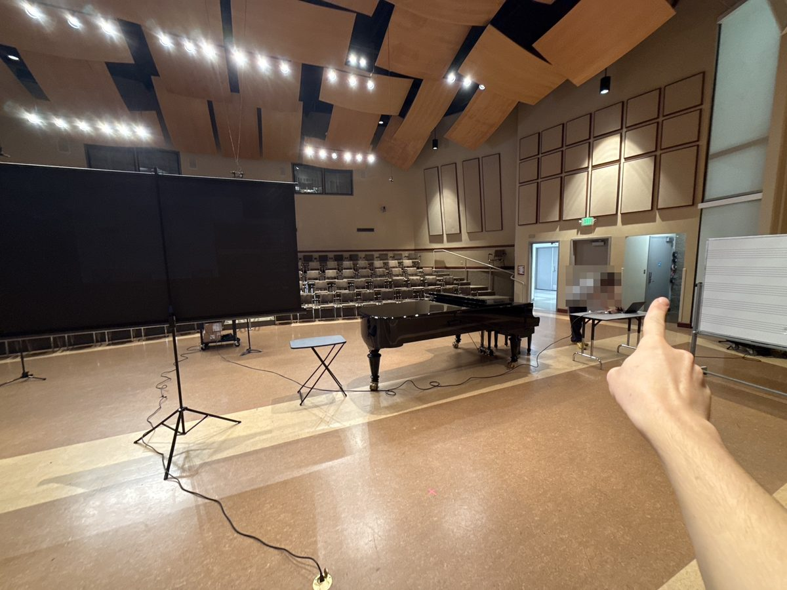

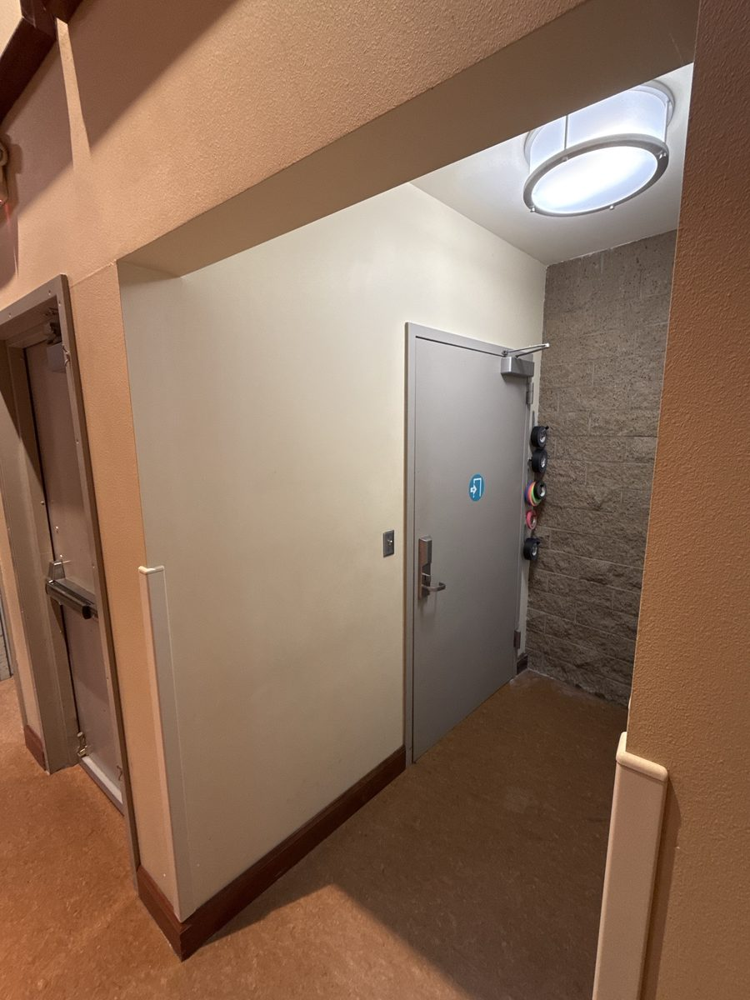

## ✅ Before doors

- 🚩 Test with **the presenter's actual laptop** and their actual slides or video, not a stand-in.
- 🚩 Leave the laptop alone for a few minutes. The screen should still be on: if it sleeps, check
  Amphetamine.
- 🚩 Play any sound or video with sound once, at the level the event will use.
- 🚩 Walk the room: the picture is readable from the back row, and every cable is taped or out of
  the way.
- 🚩 Tell the presenter how to reach you if something goes wrong: upstairs, or in the hall.

## 🎬 During the event

- 🚩 Stay where you planned to be: upstairs and ready to run down, or in the hall.
- 🚩 Write down anything that went wrong and what fixed it.

## 🏁 Strike — finish the job

The event isn't over when the applause stops. **Finish the job:** everything back where it lives,
in better shape than you found it.

- 🚩 Set the projector's **INSTALLATION** back to **FRONT/FLOOR**, so the next crew starts from
  front projection.
- 🚩 Press **STANDBY** on the projector. **Wait for the fan to stop** before you unplug it.
- 🚩 Leave the **HDMI-to-DVI adapter** on the projector. It stays with it.
- 🚩 Lower the **medium screen** gently: let the pole down slowly, unhook the top bar, and guide
  it back into the case by hand. Don't let it snap back.
- 🚩 Take down the **large screen** with **two or more people, ideally three**, in the reverse
  order you built it.
- 🚩 Pull up every piece of tape, and check the floor for leftover bits.
- 🚩 Coil every cable, and put the projector, screen, cables, power strips and gaff tape back
  where they came from.
- 🚩 Close BH 102 properly: the fixed half of the double door fully closed and its flush bolt over,
  then the other half.
- 🚩 Check nothing belonging to the presenter is left behind: laptop, adapter, power supply.

## ✅ Definition of done

- 🚩 The picture filled the screen, readable from the back, for the whole event.
- 🚩 The laptop's sound (if any) played in the room, and the laptop never slept.
- 🚩 Everything is struck, put away, and the floor is clear of tape.

## 💭 Before you leave

- 🚩 Tell your supervisor anything that went wrong or was missing, so the next crew doesn't find
  out the hard way.

## ⚙️ Technical verification

**Confirmed (instructor's notes and photos, November 6, 2026):**

- Two screens: the **medium** tripod screen (front projection only; its back is solid black) and
  the **large** folding-frame screen (front or rear, with a different surface for each).
- The large screen needs two or more people, ideally three.
- The dark gray Panasonic is the default projector. There's also a white projector and two
  ViewSonics (lower quality, good for portable use).
- The Panasonic's panel buttons and the menu path **MENU → PROJECTOR SETUP → INSTALLATION**, with
  **FRONT/FLOOR** and **REAR/FLOOR**, from photos of the projector's own menu.
- Laptop audio: 3.5 mm to XLR works for short runs; 3.5 mm to dual TS into a DI, then XLR, for long ones.
- Gaff tape hangs by the door in the back alcove.
- Power strips are kept in the Salmon storage closet, BH 102.
- The large screen's surface goes on while the frame is still on the floor, before it's stood up.
- The dark gray Panasonic keeps an HDMI-to-DVI adapter on it; that's the only input used.
- Long laptop runs: the On-Stage DB2050 stereo DI, fed by a 3.5 mm to dual RCA cable (photo).
- INSTALLATION goes back to FRONT/FLOOR at strike (instructor's call, November 6, 2026: there was no
  agreed default before).

**Still open:**

- **Projector models:** the dark gray Panasonic's and the white one's model numbers, and the
  ViewSonics' model.
- **The input's name** on the Panasonic's panel or menu (the DVI input the adapter sits on), and
  whether it has to be picked by hand after power-on.
- **How the DB2050 is powered** (its red light was on in the photo: battery, adapter, or phantom
  power from the stage box) and which output the XLRs come from.
- **How to close the menu** (MENU again, or another button), and what **LENS**, **SHUTTER** and
  **AUTO SETUP** do on this model. SHUTTER may blank the picture without turning the projector off,
  which would be useful between items, but that's untested here.
- **How long the Panasonic's fan runs** after STANDBY before it's safe to unplug.
- **Medium screen:** what the **blue tab** and the **blue knob** on the tripod head each do, whether
  the case has to be turned or locked level, and how the pole locks.
- **Large screen:** how to tell the front and rear surfaces apart; what the corner labels say;
  the leg height setting; and the black skirt seen below the screen at a concert.
- **Where the projectors and screens live:** probably BH 102 with the power strips, but not confirmed.
- **Which way the BH 102 flush bolt's lever goes** to lock (the same open item as Vocal Jazz).
- **The stage box input** FOH normally uses for laptop audio in Salmon.
- **The alcove's name** (which door the gaff tape hangs beside), so the step can say exactly where.
- **Early Music Ensemble photos** from past concerts, if the instructor has them.

## 🤖 AI use disclosure

Drafted by AI (Claude, via Claude Code) from the instructor's dictated notes and photos taken
November 6, 2026, plus photos from earlier gigs. The facts are theirs; the AI arranged them into
the site's checklist format, wrote the questions, added standard safety lines (taping cables,
letting a lamp projector cool), pixelated faces, and listed what isn't confirmed. Not yet run step
by step at a real event.
