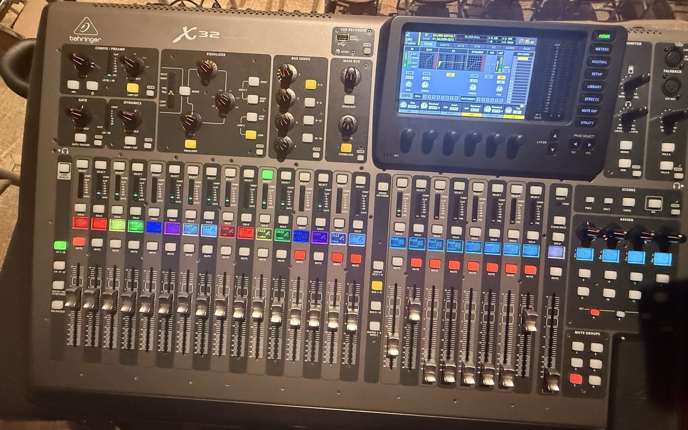
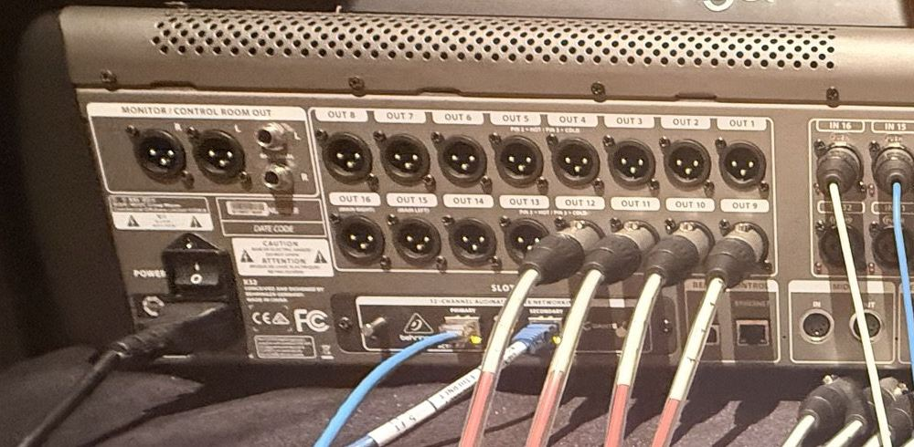
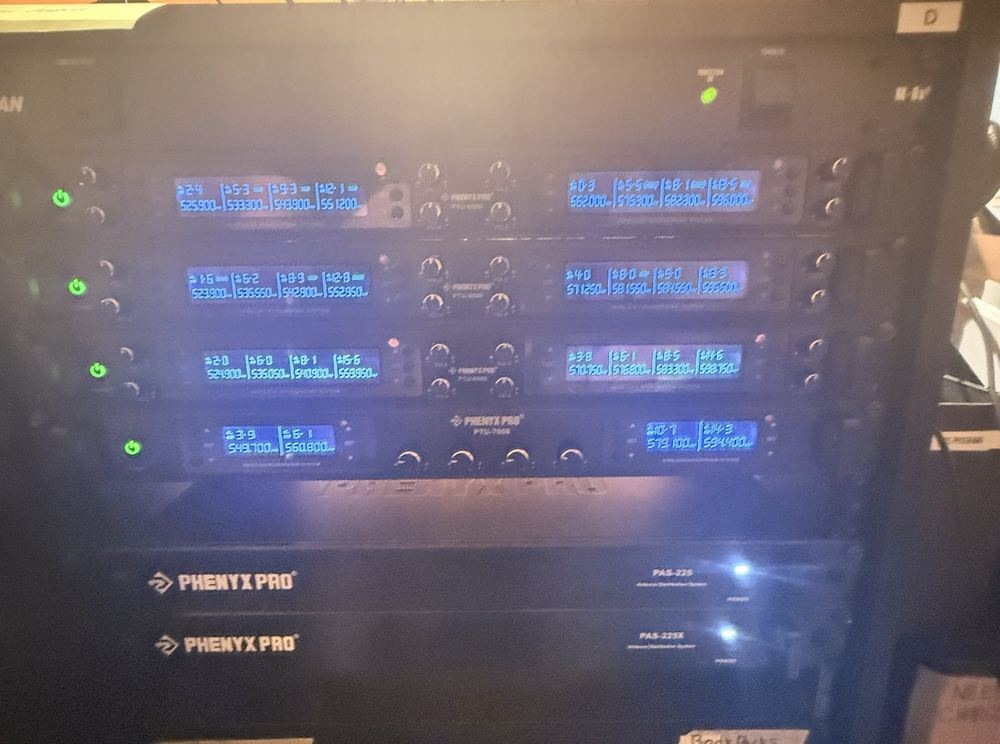
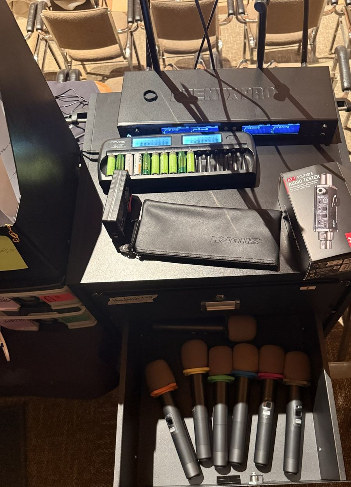
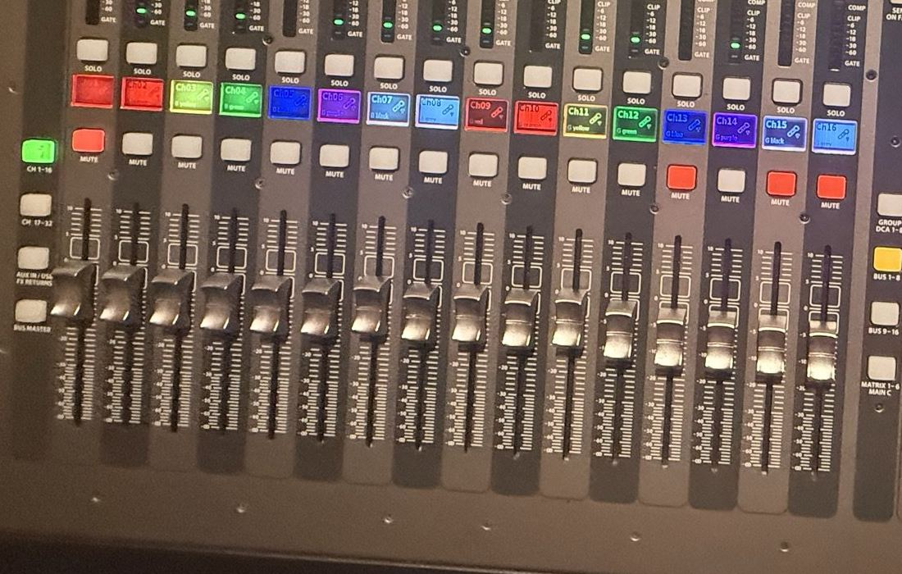
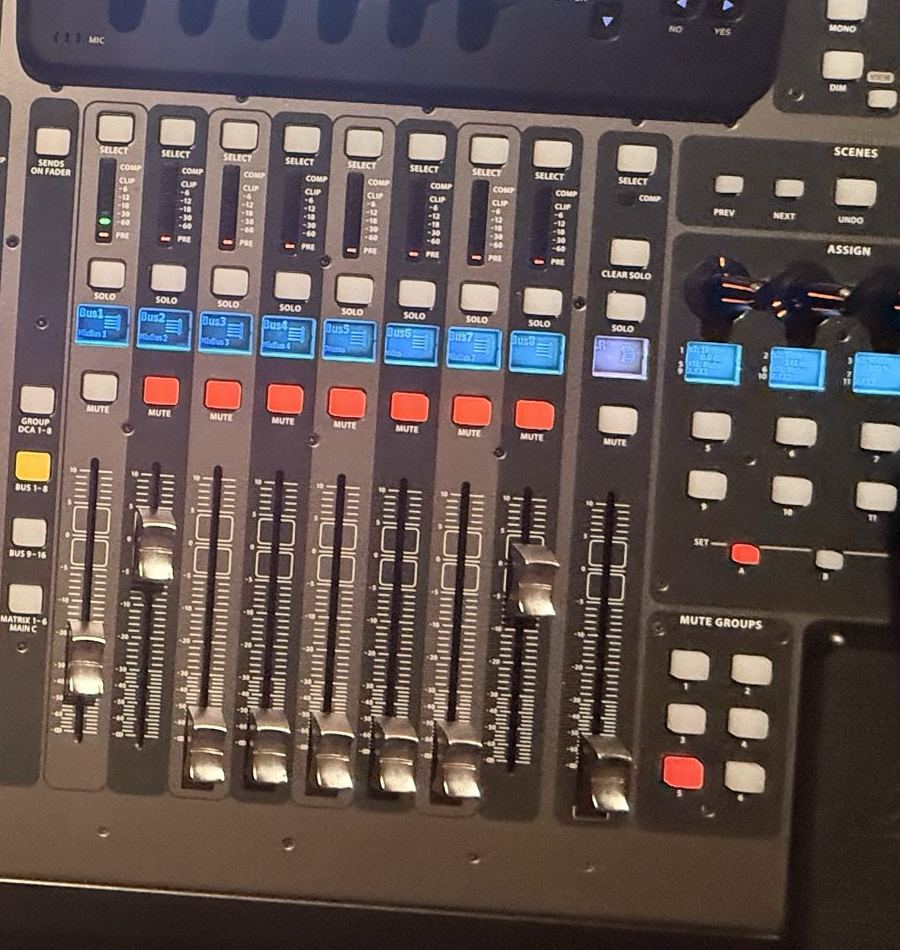
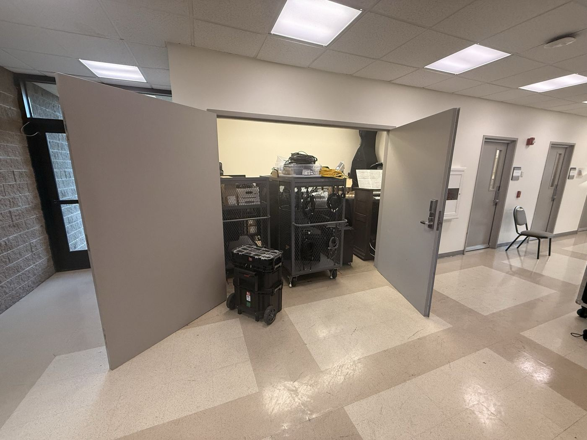
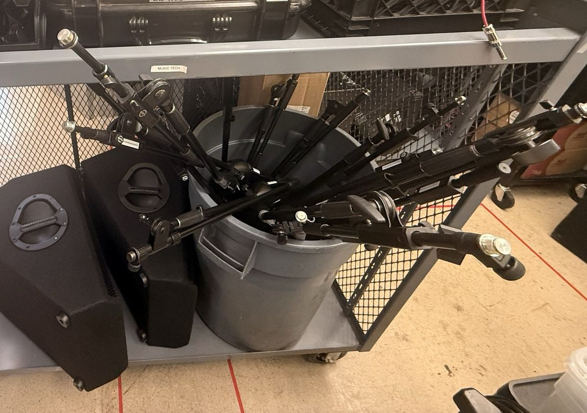

> 🧪 **Status: In Development.** Written October 2026 from the instructor's request for the
> simplest possible Salmon sound setup. The facts come from the **Vocal Jazz Gig Checklist** (the
> mics, the batteries, the wireless rack, BH 102) and the **Salmon Simulator** project's notes and
> photos of the hall. A few details are still open. See **Technical verification**.

## 🎚️ What this is

The smallest Salmon sound job: **a few wireless mics through the house speakers**, for a talk, an
announcement, or a master class. No wedges, no recording, no routing. You turn on the board, put
batteries in the mics, turn on the wireless rack, and run the faders.

Need wedges, a dozen singers, or a multitrack? That's the **Vocal Jazz Gig Checklist**.

## 🗝️ Key terms

**wireless handheld** · **receiver** · **fader** · **MUTE** · **Main LR** · **unity (0 dB)** ·
**layer** · **feedback**

## 🕹️ Practice first

- [Mixer Lab: Mic 8 is dead everywhere](https://adamborecki.github.io/mixer-lab/#/x32-vj-muted): a
  mic that won't come through on Salmon's X32, and the mute button that explains it. Free play on
  the X32 has the hall too: pick **Song: Vocal Jazz in Salmon** and try the faders and Main LR.

## 🧰 Equipment and materials

- [ ] As many **wireless handhelds** as you need, from the **FOH mic drawer** (switched off, no
  batteries)
- [ ] **Two AA cells per mic**, from the charger on top of the mic cabinet. Spares are in the bin
  near the FOH computer.
- [ ] *(If you need them)* **Mic stands**, from the storage closet (**BH 102**)

## ⚠️ Before you touch anything

- 🔊 **Treat the house speakers as live.** Their amp is normally left on, so anything that comes
  out of Main LR goes straight into the hall.
- 🔇 That's why **Main LR goes all the way down** before the X32 is switched on, and before any mic
  goes live.
- 🎤 **The mic's single button does two things.** A **tap** mutes or unmutes it. **Press and hold**
  switches it on or off.
- 🔋 **Never put alkaline batteries in the charger.** It's for the rechargeable cells only.
- 🛑 **Leave the gain knobs and the routing alone.** They're already set. This checklist only uses
  the faders and the mute buttons.

## 🔌 Turn it on

- 🚩 Check the X32's **Main LR** fader is **all the way down**. It's the rightmost fader, next to
  the **MUTE GROUPS** buttons.
- 🚩 Switch the **X32** on. The **POWER** switch is on the **back**, right next to where the power
  cord plugs in. From behind the console, that's the left end.
- 🚩 Switch the **wireless rack** on. Its master switch is the **Furman** at the **top** of the
  rack.

## 🔋 Batteries and mics

- 🚩 The mics are named by **windscreen**, then **ring color**. **Black** windscreens are 1–8,
  **gray** are 9–16. Start with the lowest numbers: black/red is 1, black/orange is 2.
- 🚩 For each mic: **two batteries** in, the right way round. Then **press and hold** the button to
  switch it on.
- 🚩 Talk into each mic and watch **its own channel's meter** move on the X32. Each channel's
  little screen names its mic: **B yellow** is the black windscreen with the yellow ring.

## 🎚️ Faders, mutes, and the main volume

- 🚩 **Layer**: the green-lit **CH 1-16** button, left of the faders, shows the mics on the input
  faders. If the faders show something else, press it.
- 🚩 **MUTE**: every channel has one. Lit red means muted. The mics you're using are **unmuted**.
- 🚩 **Faders**: each mic you're using goes to about **0** (unity, marked 0 next to the fader).
  Every channel you're **not** using goes **all the way down**.
- 🚩 **Main LR is the main volume**: everything goes through it to the house speakers. While
  someone talks into a mic, bring it up **slowly** until they're comfortable to hear at the back of
  the hall.
- 🚩 **Squealing (feedback)?** Pull **Main LR** down first. Then bring it back up more slowly, and
  keep the mic in front of the speakers, not pointed at them.

**Q1 (multiple choice).** A mic's meter moves when someone talks into it, but nobody hears it in
the hall. Which one is **not** a likely cause?

- a) Its channel's MUTE is lit.
- b) Its fader is all the way down.
- c) Main LR is all the way down.
- ✅ d) The mic's batteries are dead.

**Q2 (short answer).** Why does Main LR come up last, and slowly?

✅ **Answer.** Everything goes through it, so it's the one fader that controls how loud the whole
room is. Bringing it up slowly, with someone talking, lets you stop before it's too loud or starts
to squeal.

## 🎤 Mic stands

- 🚩 Need stands? They're in the storage closet, **BH 102**, outside Salmon: in the gray bin on the
  **Live Sound cart**.
- 🚩 Close BH 102 behind you. It's a double door: push the fixed half **fully closed first**, flip
  its **flush bolt** (on its top edge) all the way over, then close the other half.

## 🧰 If a mic isn't coming through

Work down this list in order and stop when it's fixed.

- 🚩 **Does its meter move?** No: the mic is **off** or **muted at the mic**. A **tap** unmutes it;
  **press and hold** switches it on. Still nothing: new batteries, or swap in another mic.
- 🚩 **Meter moves, but no sound?** Its channel's **MUTE**, then its **fader**, then **Main LR**.
- 🚩 **Still nothing?** Look for a red **MUTE GROUPS** button. Don't switch it off yourself: ask
  your supervisor. Same for the routing and the gain.

## 🏁 Put it away

- 🚩 **Main LR all the way down**, and every fader you moved back down.
- 🚩 Every handheld switched **off** (press and hold), **batteries out**. Rechargeables go back in
  the charger; alkalines never do.
- 🚩 Mics back in the **FOH mic drawer**.
- 🚩 Switch the **wireless rack off**, at the **Furman on top**.
- 🚩 Switch the **X32 off**, at the same **POWER** switch on the back.
- 🚩 Mic stands back in **BH 102**, and its door closed and bolted.

## ✅ Definition of done

- 🚩 Every mic you used came through the house speakers, on its own channel.
- 🚩 Main LR and the faders are down, the X32 and the wireless rack are off, and the mics are in the
  drawer with no batteries.
- 🚩 Any stands are back in BH 102, with the door bolted.

## 💭 Before you leave

- 🚩 Did anything not work the way this page says? Tell your supervisor.

## ⚙️ Technical verification

**Already confirmed in the Vocal Jazz Gig Checklist (October 2026):** the mics live in the FOH
drawer and take two AA cells; the charger is on top of the mic cabinet and never takes alkalines;
spares are in the bin near the FOH computer; the mic's button is tap to mute, hold for power; the
windscreen and ring-color naming; X32 channel names follow the mics; the wireless rack's master
switch is the Furman on top; the storage closet is BH 102, a double door with a flush bolt on the
fixed half.

**From the Salmon Simulator project's notes and photos (`adamborecki/salmon`):**

- **The X32 is switched on and off on purpose** (not left on), and the FOH power strip, the
  Mac mini, the mains rack's power, and the main-speaker amp are normally left on. That's why this
  page has no step for the house speakers. The Simulator's own notes mark the mains as "current
  practice may evolve", so this one is worth a quick confirm.
- **The X32's POWER switch** is on its rear panel next to the power inlet, from the photo of the
  back of the console.
- **The house speakers** are passive ceiling speakers, driven by a Crown Com-Tech 210 in the
  stage-side mains rack.
- **Mic stands** live in a bin on the Live Sound cart in BH 102 (photo, and the instructor's
  request, 2026-10-24).
- **The photos:** the X32 top, the mic cabinet and the wireless rack were taken on Vocal Jazz
  nights, so the faders, mutes and mute group in them are that gig's, not a required state. One
  MUTE GROUPS button was lit when the photo was taken.

**Still open:**

- **Is Main LR the only path to the house speakers?** Not checked against the X32's output
  routing.
- **"Leave the gain alone"** is the AI's choice for a first-timer, relying on the Vocal Jazz rule
  that every wireless channel sits at 30 dB. If a mic is too quiet with its fader at 0, that's a
  question for the supervisor, not a knob.
- **Is a mute group normally left on?** The photo shows one lit. If it's part of the normal setup,
  the troubleshooting step should say which one, and what it mutes.
- **Which mics are paired with which receiver channels** if fewer than 16 are in use: this page
  assumes mic n on channel n, as in Vocal Jazz.
- **Which way the flush bolt's lever goes** to lock (same open item as Vocal Jazz).

## 🤖 AI use disclosure

Drafted by AI (Claude, via Claude Code) from the instructor's spoken request (turn on the board,
batteries in the mics, the wireless rack, the main volume, mutes and faders, stands in the closet),
the facts already confirmed in the Vocal Jazz Gig Checklist and Reset, and the Salmon Simulator
project's notes. The photos are the Simulator's, cropped to leave out people. The troubleshooting
order and the feedback step are the AI's, condensed from the Vocal Jazz checklist. Not yet run step
by step in the hall.
