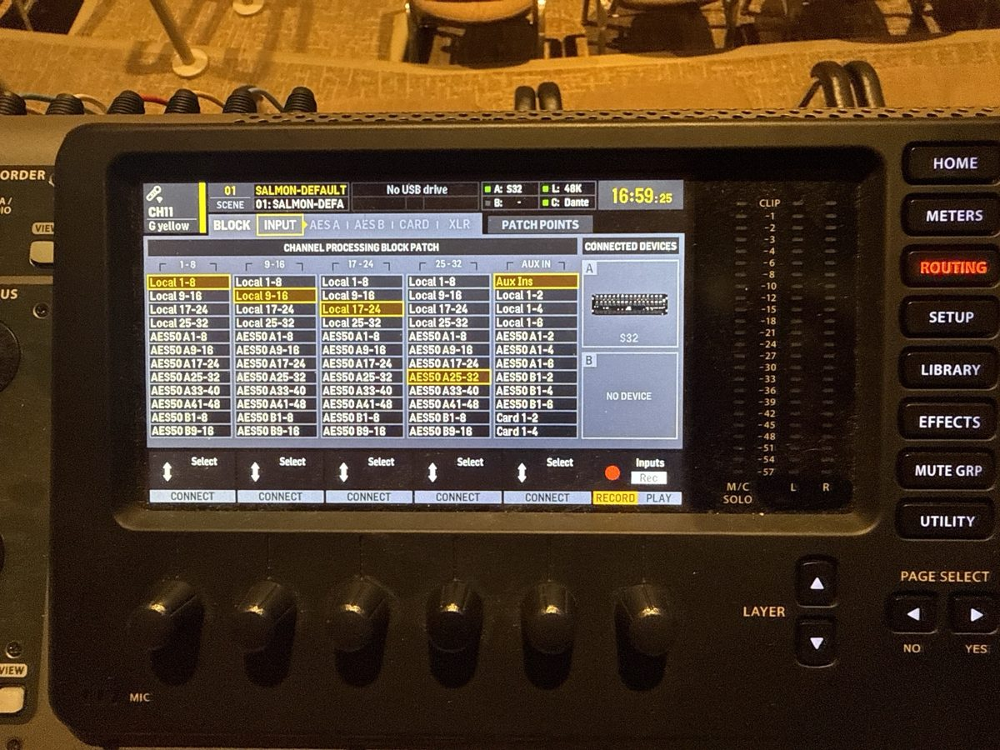
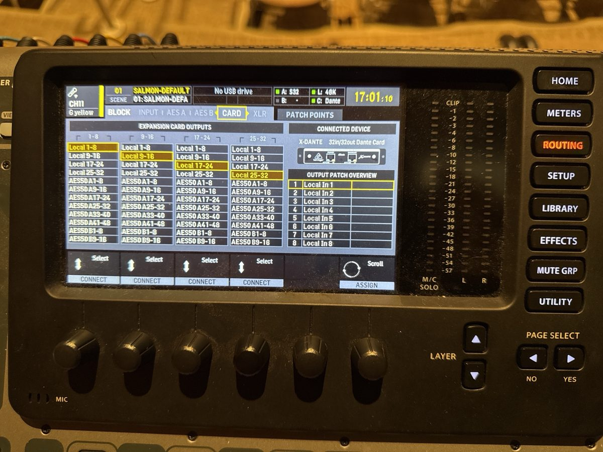
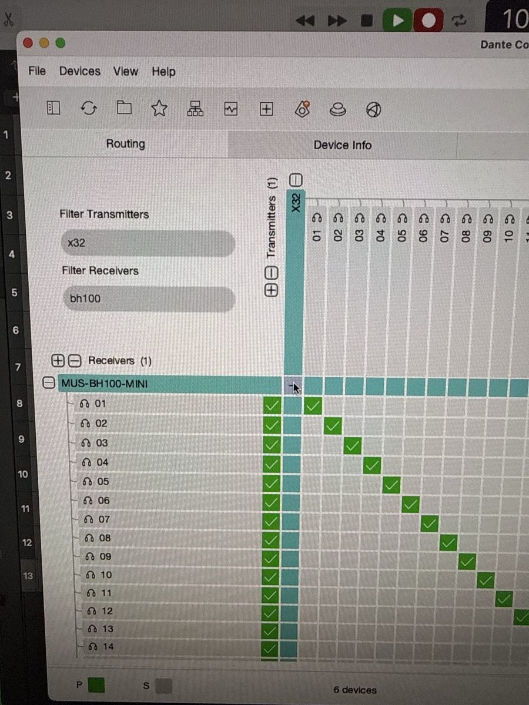
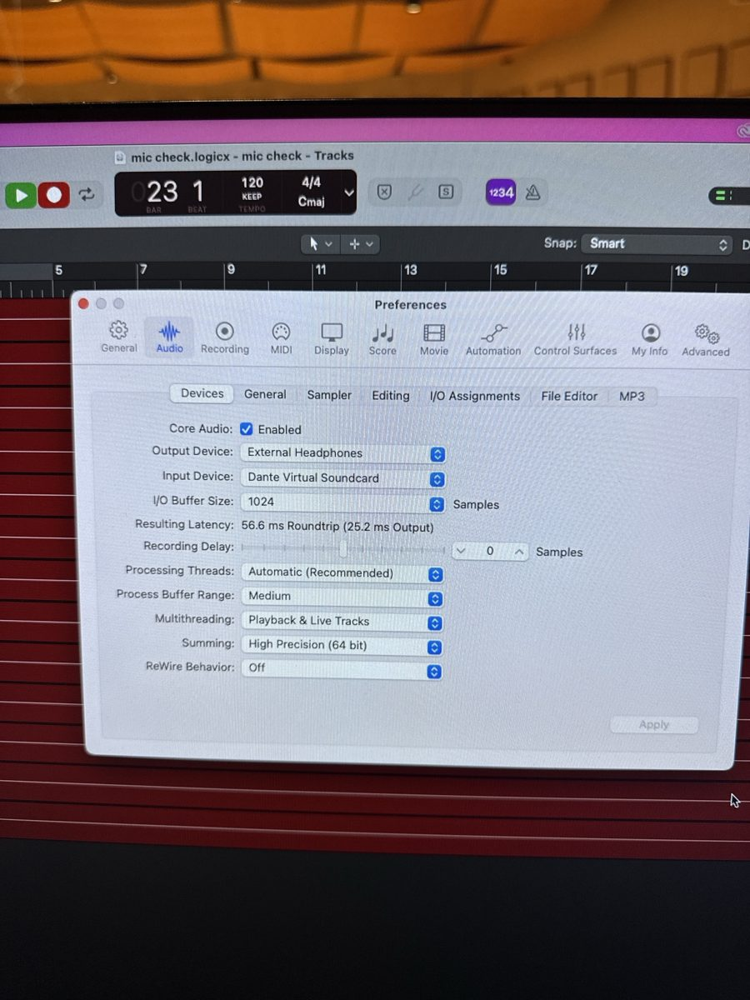
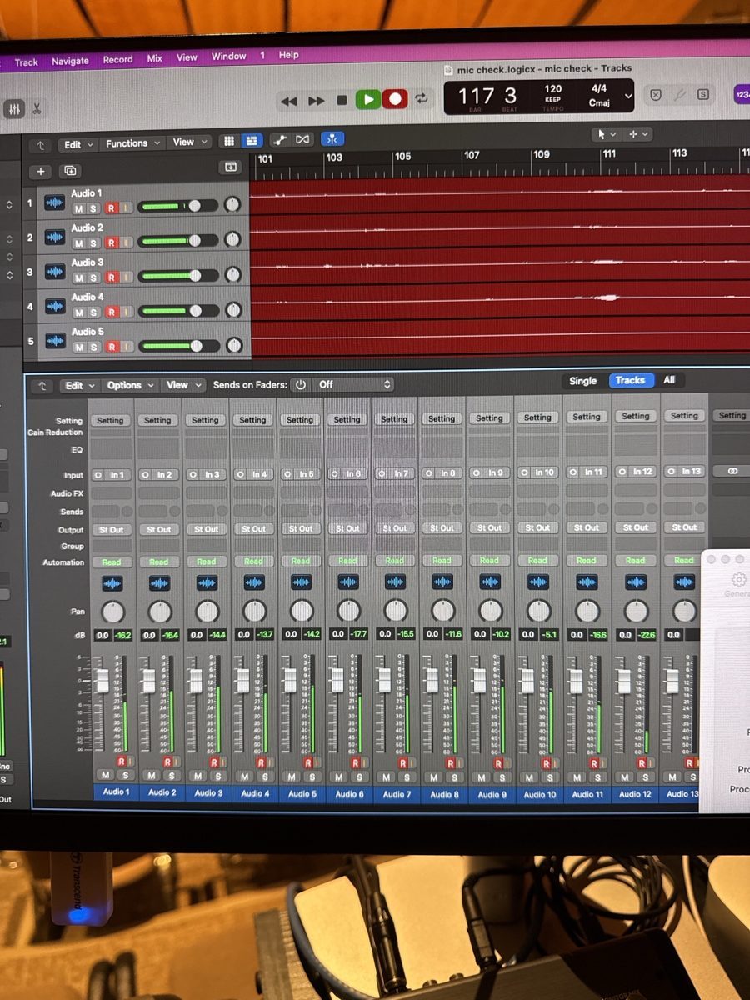
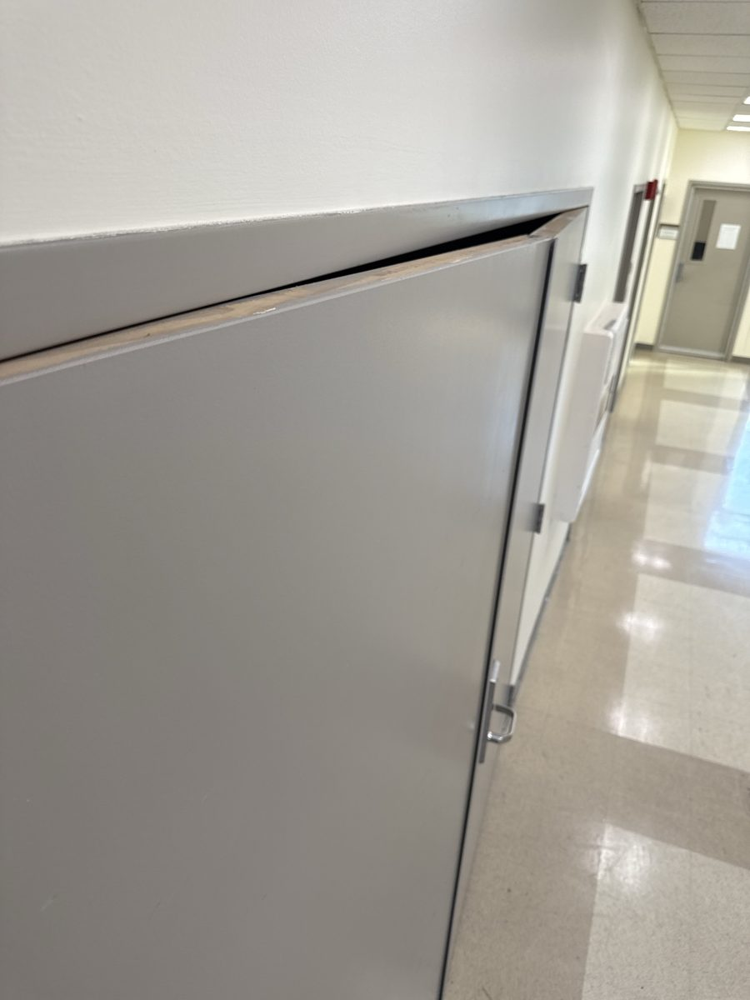
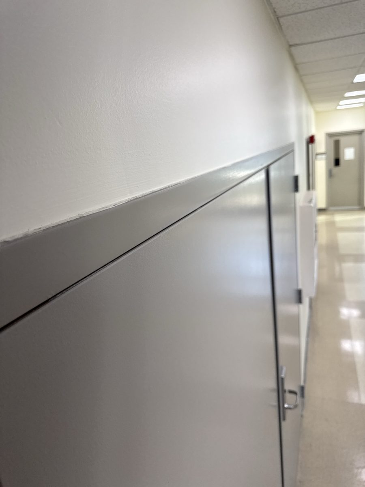
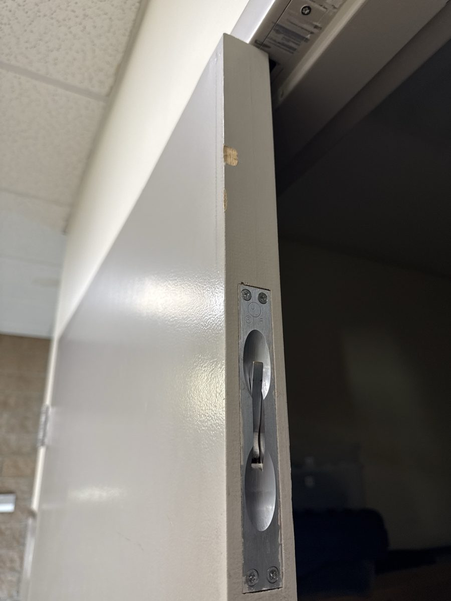

> 🧪 **Status: In Development.** Drafted October 2026 from a walkthrough dictated by a student
> engineer who runs this gig, plus the instructor's notes and the facts already confirmed in the
> **Salmon Simulator** project (the mics, the batteries, the wedges, the line check). Photos of the
> X32's routing pages, Dante Controller, Logic and the BH 102 closet confirmed the console and
> recording steps on 2026-10-20. The **wireless rack on and off** step is new practice from fall
> 2026: earlier crews didn't do it. A few details are still open. See **Technical verification**.

## 🎚️ What this is

The gig checklist for **Vocal Jazz** in Salmon Recital Hall. It's a vocals-only setup: **wireless
handheld mics** for the singers, three **wedges** on stage so they can hear each other, and the
**Behringer X32** at FOH. If there's time, you also make a **multitrack test recording** in Logic
over Dante. That's worth doing, because the group often records right after the concert.

The X32 should already be in the state the **Vocal Jazz Reset** leaves it in. The first console
step below checks that. If the last person didn't reset it, fix the routing before anything else.

## 🗝️ Key terms

**wireless handheld** · **receiver** · **LOCAL input** · **AES50** · **stage box** · **Bus 1** ·
**wedge** · **speakON** · **daisy chain** · **line check** · **low cut** · **Dante** ·
**Dante Virtual Soundcard** · **one-to-one routing**

## 🕹️ Practice first

Two browser simulators rehearse this gig before you're in the room. A phone works for both.

- [Mixer Lab: Vocal Jazz in Salmon](https://adamborecki.github.io/mixer-lab/#/x32-vj-local): eight faults from this checklist and
  the reset, on a virtual X32 with this gig's rig (thirteen handhelds, the S32, the NX3000 and three
  wedges). Free play on the X32 has it too: pick **Song: Vocal Jazz in Salmon**.
- [Salmon: Ready by 5:00](https://adamborecki.github.io/salmon/battery-check/): the Vocal Jazz scenario, in photos of the real hall.
  It's 4:50 PM: pick the mics or the monitors, then run the line check.

Neither one has the Dante recording in Logic yet, and both are still being built: where a simulator
and this checklist disagree, the checklist wins. Tell your supervisor what you found.

## 🧰 Equipment and materials

- [ ] The **16 wireless handhelds**, in the FOH mic drawer (switched off, no batteries)
- [ ] **32 charged AA cells**, from the charger on top of the mic cabinet. **Fresh alkalines** for a
  high-stakes gig; spares are in the bin near the FOH computer.
- [ ] **Three passive wedges** and **speakON cables**, from the storage closet (BH 102)
- [ ] An **XLR cable** from the stage box to the monitor amp
- [ ] **Headphones** for the X32
- [ ] *(Optional)* The **FOH Mac mini** with Logic, Dante Virtual Soundcard, and Dante Controller

## ⚠️ Before you touch anything

- 🔋 **Never put alkaline batteries in the charger.** The charger is for the rechargeable cells
  only.
- 🎤 **The mic's single button does two things.** A **tap** mutes or unmutes it. **Press and hold**
  switches it on or off. Singers fiddle with their mics, so this is the first thing to suspect.
- 🔌 **Power order:** mixer and sources first, **amps last**. At the end of the gig, amps off
  **first**.
- 🙋 **Ask when you're not sure.** The director and your supervisor know things this checklist
  can't.

## 🚗 Arrival — about 4:30 PM

- 🚩 Get to the Salmon booth about **4:30 PM**. Singers rehearsal usually ends around **4:45 PM**,
  but sometimes it ends early, and every extra minute helps.
- 🚩 If you're working with another engineer, split the jobs now. One does **mics and batteries**;
  the other does **the monitors**. The two jobs come back together at the wedge check.

**Q1 (short answer).** Arrival time: ______ · Singers out at: ______ · Downbeat: ______

✅ **Answer.** There's no fixed answer. Write in tonight's times: it's a log entry, not a test.

## 📡 Power and console

- 🚩 Switch the **wireless rack** on. Its master switch is the **Furman on top** of the rack. This
  step is new: earlier crews left the rack on all the time. From now on it goes on at the start of
  the gig and off at the end.
- 🚩 X32 **ROUTING → INPUT** (the channel processing block patch): **1–8 = Local 1-8**,
  **9–16 = Local 9-16**, **17–24 = Local 17-24**, and **25–32 = AES50 A25-32** (the stage box).
  The wireless receivers plug into the console's own rear panel, so if 1–24 show AES50, nothing
  from the mics reaches the console. Fix this first.
- 🚩 Every wireless channel has the **same gain: 30 dB**. Identical gains let the singers balance
  themselves, the way an ensemble should.
- 🚩 Every wireless channel has **LOW CUT on at 80 Hz**, and **no dynamics**: gate off, compressor
  off.
- 🚩 Bus 1 is the wedges (Monitor 1).
- 🚩 Don't count on a saved scene. Scene **01: SALMON-DEFAULT** exists, but check each setting
  above yourself.

🕹️ In Mixer Lab: [Thirteen mics, no meters](https://adamborecki.github.io/mixer-lab/#/x32-vj-local) (the routing),
[Somebody helped](https://adamborecki.github.io/mixer-lab/#/x32-vj-gain) (the gains), and
[The reset was never done](https://adamborecki.github.io/mixer-lab/#/x32-vj-lowcut) (low cut and dynamics).

## 🔊 Monitors — the monitor engineer

- 🚩 At about **4:45 PM**, go down to the storage closet (**BH 102**) and bring out the three
  wedges and the speakON cables. This is the heavy part, so do it before anything else.
- 🚩 While Singers is clearing the stage, bring the wedges and cables in.
- 🚩 Switch the **Behringer amp (NX3000)** on.
- 🚩 Run an **XLR** from the stage box's **OUT 1** (it carries the X32's Output 1, the wedge mix)
  into the amp's **Channel A** input. Channel A is the simplest channel to use, so use it every time.
- 🚩 **speakON** from the amp's **Channel A** output into the first wedge.
- 🚩 **Daisy-chain** the wedges: a speakON from the first wedge's second jack into the next wedge,
  and again into the third. The two jacks on a wedge work the same, so either one is fine.
- 🚩 Set the wedges in an **arc that opens toward the mixer**, each one **facing out toward the
  performers**.

🕹️ In Mixer Lab: [Silent wedges](https://adamborecki.github.io/mixer-lab/#/x32-vj-amp) (the amp's input) and
[The right-hand wedge is dead](https://adamborecki.github.io/mixer-lab/#/x32-vj-chain) (the speakON chain). In Salmon:
[Ready by 5:00](https://adamborecki.github.io/salmon/battery-check/), and pick the monitors.

## 🎤 Mics and batteries — the mic engineer

- 🚩 The mics are named by **windscreen**, then **ring color**. **Black** windscreens are 1–8,
  **gray** are 9–16. The ring order is red, orange, yellow, green, blue, purple, black, gray, so
  black/red is 1 and gray/gray is 16.
- 🚩 Mics **1–13** go to the singers. **14–16** are spares that stay at FOH: one can be the
  engineer's talkback mic, and another can be run to the stage to replace a dead one.
- 🚩 For each mic: put **two batteries** in from the charger, the right way round. Then **press and
  hold** to switch it on.
- 🚩 Talk into each mic at the X32 and watch **its own channel's meter** move. A mic that shows on
  the wrong channel, or not at all, gets set aside for a spare. Don't send it to the stage.

🕹️ In Salmon: [Ready by 5:00](https://adamborecki.github.io/salmon/battery-check/), and pick the mics.

## 🔈 Wedge check, then line check

- 🚩 **Wedge check first, before the singers.** Play something you know through Bus 1 (the
  Mac mini plays into the X32), and confirm **all three wedges** play it.
- 🚩 **Line check:** down the line in color order, **black/red first**. Each singer talks into
  their own mic. Confirm two things for each one: their **meter moves** at the X32, and they're in
  the **wedges**.

**Q2 (multiple choice).** A singer's mic is missing from the wedges. You put it in the mains and
you hear it clearly there. What does that tell you?

- a) The mic is switched off.
- b) The mic is muted on the X32.
- ✅ c) The mic and its channel are fine: the problem is in the path to the wedges.
- d) The battery is dead.

**Q3 (short answer).** Why does every wireless channel get the same gain at this gig?

✅ **Answer.** So the singers balance themselves the way an ensemble does, and the board doesn't
quietly favor one voice. Any difference you hear is the singers, not the preamps.

## 🧰 If a mic isn't in the wedges

Work down this list in order and stop when it's fixed.

- 🚩 **Is there signal at the mixer?** Watch the channel's meter while the singer talks.
- 🚩 **Muted on the mixer?** Unmute it.
- 🚩 **Neither of those?** Then the mic is **off** or **muted** at the mic. A **tap** unmutes it;
  **press and hold** switches it on.
- 🚩 **Still nothing in the wedges?** **Reseat every cable** in the monitor path: the stage box
  XLR, the amp, and each speakON. Sometimes something just isn't plugged in all the way.
- 🚩 **Check the mains.** If the mic comes through the mains, the mic and the X32 channel are
  fine. Look at the monitor path you set up instead.
- 🚩 Last: the **routing** on the X32, or **Dante**.

🕹️ In Mixer Lab: [Mic 8 is dead everywhere](https://adamborecki.github.io/mixer-lab/#/x32-vj-muted),
[Mic 5 can't hear themselves](https://adamborecki.github.io/mixer-lab/#/x32-vj-send), and
[The mics work, the wedges don't](https://adamborecki.github.io/mixer-lab/#/x32-vj-link). Salmon's
[Ready by 5:00](https://adamborecki.github.io/salmon/battery-check/) ends on the line check, with things going wrong.

## 🎛️ Optional — multitrack test recording (Dante → Logic)

Only if time allows. It's a rehearsal for the recording session that often follows the concert.

- 🚩 X32 **ROUTING → CARD** (expansion card outputs): **1–8 = Local 1-8**, **9–16 = Local 9-16**,
  **17–24 = Local 17-24**, **25–32 = Local 25-32**. The X32 has one card, the **X-DANTE**
  (32 in / 32 out). Each card output is a **direct out** of one input: card out 1 is input 1, and
  so on.

- 🚩 Mac mini: open **Dante Virtual Soundcard** and start it.
- 🚩 **Dante Controller**: filter transmitters to `x32` and receivers to `bh100`. Route
  **X32 → MUS-BH100-MINI** (the FOH Mac mini) one to one. Pro tip: **hold Control and click** the
  square where the two devices intersect, and it maps every channel one to one in one go: a
  diagonal of green ticks.

- 🚩 **Logic → Settings → Audio → Devices**: **Input Device = Dante Virtual Soundcard**, **Output
  Device = External Headphones** (listen on headphones at FOH). Set this **first**.

- 🚩 Create one new audio track per mic, and set the inputs in order: **In 1** on track 1, **In 2**
  on track 2, and so on (13 tracks for 13 singers). Record-enable them all (**R**).
- 🚩 Record a short test and play it back. Every track should have its own singer on it.

**Q4 (short answer).** In Logic, what do you set **before** you create the tracks, and why?

✅ **Answer.** The audio interface, to Dante Virtual Soundcard. Until Logic is using it, the
Dante inputs aren't there to choose from when you set each track's input.

## 🏁 End of the gig

- 🚩 Amp **(NX3000) off first**, before anything else gets unplugged.
- 🚩 Every handheld switched off (press and hold), batteries out. Rechargeables go back in the
  charger, and alkalines never do.
- 🚩 Mics back in the FOH drawer.
- 🚩 Switch the **wireless rack off** at the **Furman on top**.
- 🚩 Wedges and speakON cables back in the storage closet (**BH 102**). It's a double door: push
  the fixed half **fully closed first**, flush with the frame and no gap at the top, then flip its
  **flush bolt** (the lever on its top edge) all the way over so it locks into the frame. Then
  close the other half.

- 🚩 Run the **Vocal Jazz Reset** on the X32.

## ✅ Definition of done

- 🚩 Every singer's mic was on its own channel, in the wedges, and checked before downbeat.
- 🚩 The wireless rack was switched on at the start and off at the end.
- 🚩 The wedges and cables are back in BH 102 with the latch fully closed.
- 🚩 The X32 is reset for the next Vocal Jazz.

## 💭 Before you leave

- 🚩 Did anything go wrong tonight that the next engineer should know about? Tell your supervisor.

## ⚙️ Technical verification

**Confirmed from photos (instructor, 2026-10-20):**

- X32 **ROUTING → INPUT**: Local 1-8, Local 9-16, Local 17-24, AES50 A25-32. Connected devices:
  the S32 on AES50 A, the Dante card on C, 48 kHz.
- X32 **ROUTING → AES A** (the S32's outputs): blocks 1–8 and 9–16 carry **Output 1-8** and
  **Output 9-16**, so S32 OUT 1 carries the X32's Output 1.
- X32 **ROUTING → CARD**: Local 1-8 through Local 25-32 on the **X-DANTE** (32 in / 32 out), the
  only card in the X32.
- Dante Controller: transmitter **X32**, receiver **MUS-BH100-MINI**, one to one.
- Logic: Input Device **Dante Virtual Soundcard**, Output Device **External Headphones**; tracks on
  In 1–In 13.
- Gain **30 dB**.
- X32 channel names follow the mics (channel 11 is **G yellow**).
- BH 102: a double door; the fixed half has a flush bolt on its top edge.

**Confirmed (instructor or the student engineer who runs this gig, October 2026):**

- Arrive around 4:30; Singers usually ends around 4:45, sometimes early.
- The wireless rack's master switch is the **Furman on top**. Switching the rack off after the
  gig is new practice.
- ROUTING: inputs 1–24 on LOCAL, 25–32 over the stage box (AES50) by default.
- The NX3000's Channel A for the wedges; wedges in an arc that opens toward the mixer, facing the
  performers; daisy-chained on speakON.
- The mic's button: tap = mute, hold = power. Mics 1–13 for the singers, 14–16 spares at FOH.
- The troubleshooting order and the "heard in the mains, so it's the monitor path" check.
- The storage closet is **BH 102**.
- The Dante steps: card outputs as direct outs, Dante Virtual Soundcard as Logic's interface,
  Ctrl-click for one-to-one routing in Dante Controller.

**Still open:**

- **Low cut at 80 Hz** is the AI's recommendation, not yet the instructor's decision (the
  instructor was thinking 100 Hz). The group may have low basses: at 100 Hz, the X32's low cut
  starts taking weight off notes around 73–82 Hz. 80 Hz keeps them and still removes rumble and
  most handling noise. A mic that's still boomy can go to 100–120 Hz at soundcheck.
- **Bus 1 → Output 1.** S32 OUT 1 carries the X32's Output 1 (confirmed), and on 2026-10-08 a
  tape-labeled purple XLR ran from S32 OUTPUT 1 to the NX3000's CH A. Whether Output 1 is set to
  Bus 1 (the X32's OUT 1-16 routing page) isn't in the photos.
- **Where the Logic session is saved.** The test session was named "mic check".
- **The wedge-check playback.** The Mac mini plays into the X32 through its audio interface; which
  X32 input and which file to use aren't written down here.
- **Which way the flush bolt's lever goes** to lock (up or down) isn't clear from the photos.
- **Is a gate on any channel by default?** "No dynamics" is the rule. The saved scene isn't to be
  trusted, so check the gates every time.

## 🤖 AI use disclosure

Drafted by AI (Claude, via Claude Code) from a dictated walkthrough by a student engineer who runs
this gig, the instructor's notes and follow-up answers (October 2026), and facts already confirmed
in the Salmon Simulator project. The steps and their order are theirs; the AI arranged them into
the site's checklist format and listed what isn't confirmed yet. Not yet checked step by step at a
real gig.
