> 🧪 **Status: In Development.** Drafted November 2026 from the Vocal Jazz Ensemble's recording
> session in Salmon, the instructor's photos of it and answers to follow-up questions. The two
> students in one photo agreed to be shown; a phone and a name tag are blurred, and one photo is
> cropped. This page adds the recording to the [Vocal Jazz Gig Checklist](../../vocal-jazz-gig-checklist/):
> everything there still applies. A few details are still open. See **Technical verification**.

## 🎚️ What this is

Vocal Jazz has rehearsals, a dress rehearsal and one concert, and the tech setup is almost the same
for all of them: the [Vocal Jazz Gig Checklist](../../vocal-jazz-gig-checklist/). For the
**concert** the **mains** are on. For **rehearsals** they're off, and the singers use the
**wedges**.

A **recording session** is the one that's different. There's **no audience**, so the mains stay
off, and you add **four condensers**: an **ORTF pair** for the room and **two on the piano**. Then
the X32 sends every input over **Dante** to **Logic** on the FOH Mac mini, one track per input.

What matters, in order:

1. **Everything ready, and the singers happy** hearing themselves in the wedges.
2. **The four condensers**, every meter moving.
3. **The Logic multitrack**, set up and checked on its meters before the first take.

## 🗝️ Key terms

**ORTF** · **stereo bar** · **pencil condenser** · **+48 V (phantom power)** · **S32** ·
**AES50** · **LOCAL input** · **ROUTING → INPUT** · **ROUTING → CARD** · **X-DANTE** ·
**Dante Controller** · **Dante Virtual Soundcard** · **input device** · **record-enable**

## 🕹️ Practice first

- [Mixer Lab: Vocal Jazz v2, the recording session](https://adamborecki.github.io/mixer-lab/#/x32-vjr-tour): fourteen
  scenarios on this rig, from the mains and the wedges to the ORTF bar, +48 V, the X32's card,
  Logic's inputs and Dante Controller, ending with this session's own buzz on the S32.
- [Mixer Lab: Vocal Jazz in Salmon](https://adamborecki.github.io/mixer-lab/#/x32-vj-mains): the
  Vocal Jazz basics (the mains test, the wedges, the routing, the gains), if you haven't done them.

The simulator's piano mics are stand-ins (the ensemble's recording has no piano track), and it's
still being built: where it and this checklist disagree, the checklist wins. Tell your supervisor
what you found.

## 🧰 Equipment and materials

- [ ] Everything on the [Vocal Jazz Gig Checklist](../../vocal-jazz-gig-checklist/): handhelds,
  batteries, wedges and speakON cables, headphones
- [ ] **Four pencil condensers**: two for the ORTF pair, two for the piano
- [ ] A **stereo bar** with **ORTF** marks, and a tall stand for it
- [ ] **Two boom stands** for the piano mics
- [ ] **Four XLR cables**, one of the ORTF pair's **marked** with a colored ring so left and right
  can be told apart
- [ ] The **FOH Mac mini** with Logic, Dante Virtual Soundcard and Dante Controller; headphones on
  its **SSL 2+**

## ⚠️ Before you touch anything

- 🔌 **Power order:** mixer and sources first, **amps last**. At the end, amps off **first**.
- ⚡ **+48 V:** plug a condenser in **before** you switch its +48 V on, and switch it off before you
  unplug the mic. Switching it with the channel live makes a loud pop.
- 👀 **Watch the meters.** If one you expect isn't moving, stop, say so, and fix it before the take.
- 🙋 **Ask when you're not sure.** The director and your supervisor know things this checklist
  can't.

## 🚗 The Vocal Jazz setup first

- 🚩 Run the [Vocal Jazz Gig Checklist](../../vocal-jazz-gig-checklist/): the wireless rack on,
  the X32's routing, the wedges, the mics and batteries, the wedge check and the line check.
- 🚩 **Mains off.** No audience at a recording session: the singers hear themselves in the wedges,
  and nothing from the hall's speakers ends up in the room mics. (For the concert, they're on.)
- 🚩 X32 **ROUTING → INPUT**: **1–8 = Local 1-8**, **9–16 = Local 9-16**, **17–24 = Local 17-24**,
  **25–32 = AES50 A25-32**. If another group left a block on AES50, those singers' channels are dead.

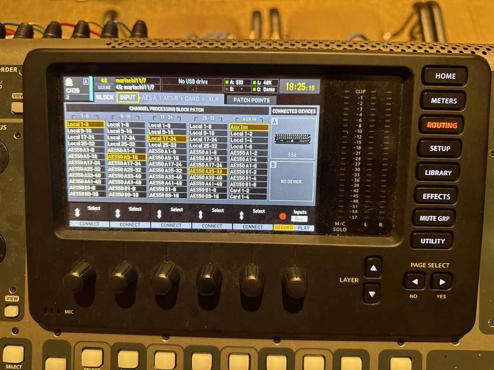

- 🚩 **The singers happy** in the wedges before anything else. Everything after this waits for it.

**Q1 (short answer).** Why are the mains off for the recording session but on for the concert?

✅ **Answer.** A recording session has no audience. The singers hear themselves in the wedges, and
the hall's speakers would only send the choir back into the room mics. The concert has an audience,
so the mains are on.

## 🎤 The ORTF pair (the room)

- 🚩 **ORTF** is **17 cm** between the capsules and **110°** between the mics. The stereo bar is
  marked for it.
- 🚩 The **capsules** go on the **ORTF marks**, not the mic clips. With the clips on the marks, the
  capsules end up far outside them.

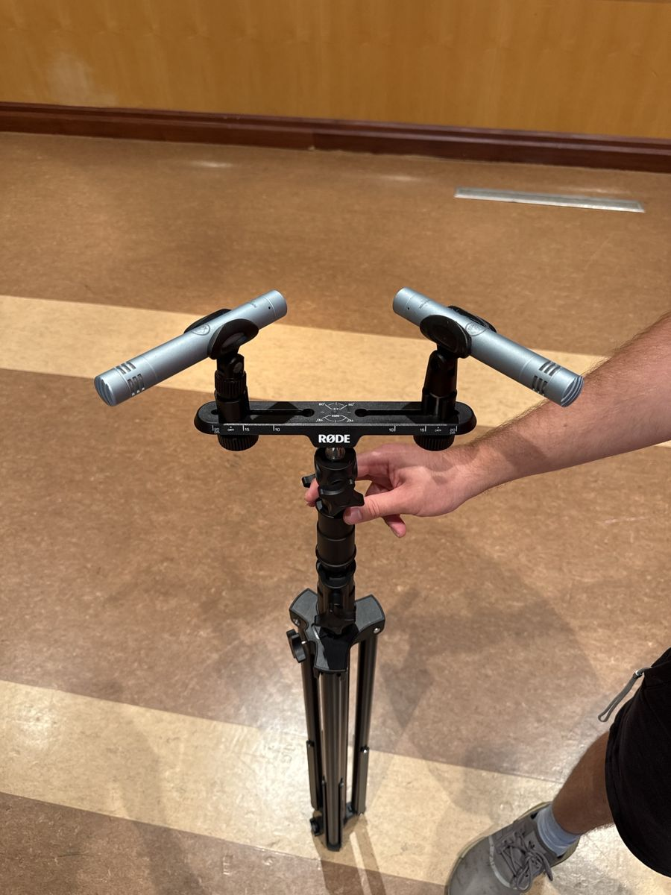

- 🚩 So the mics **cross**. Mount one a little **higher** than the other so they clear each other.
- 🚩 Tilt both **down**, toward the singers.

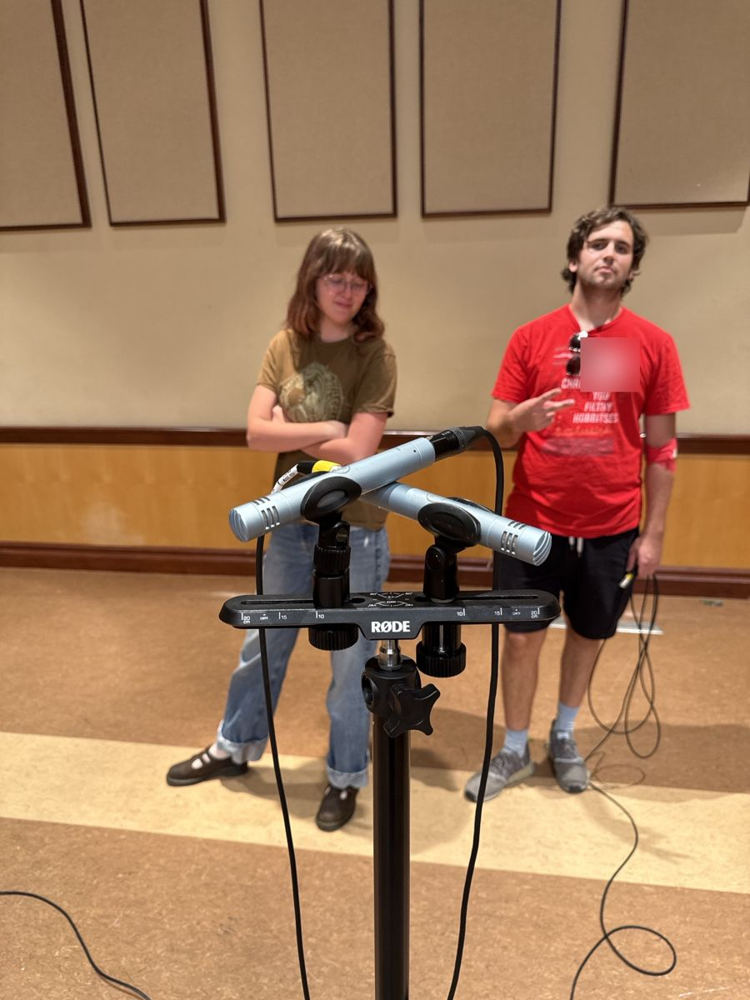

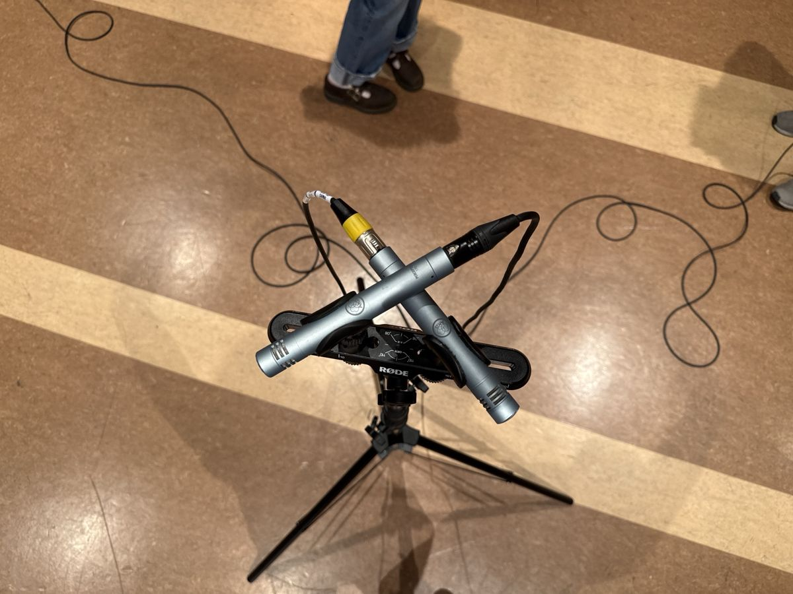

- 🚩 **Wrap each XLR once** around the stand, so a tug on the cable doesn't move the mics.

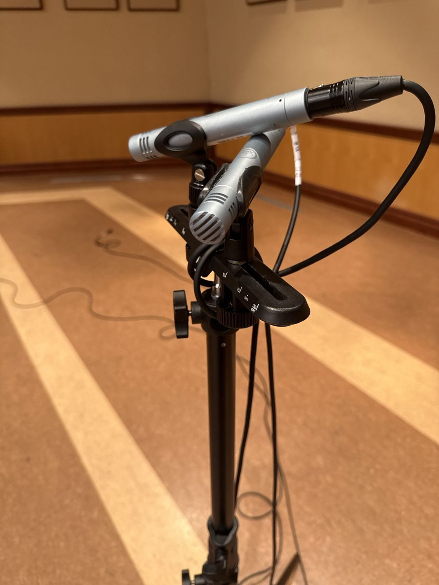

- 🚩 **Mark one cable** so left and right can be told apart on the floor and at the stage box.

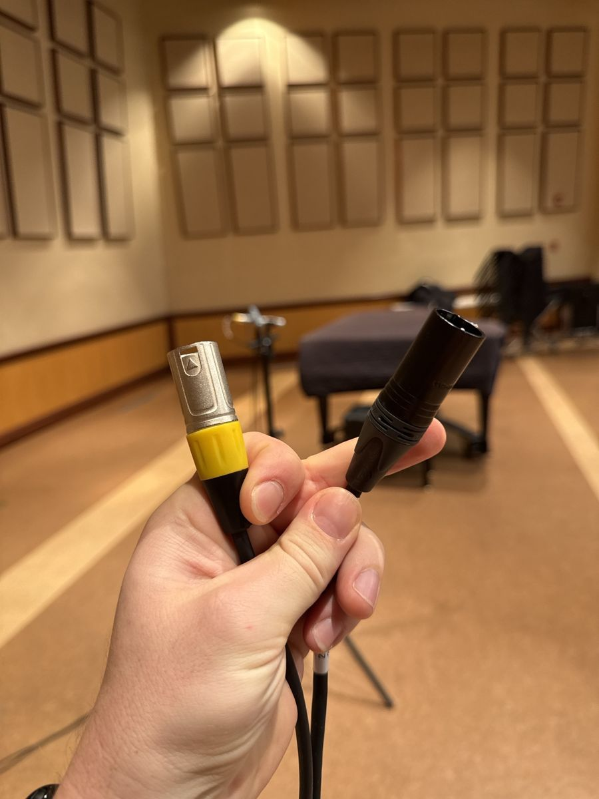

**Q2 (multiple choice).** On the stereo bar, what goes on the ORTF marks?

- a) The mic clips
- ✅ b) The capsules
- c) The XLR connectors
- d) The middle of each mic

## 🎹 The piano mics

- 🚩 Two pencil condensers on **boom stands**, reaching in over the strings from the piano's curved
  side, with the lid up on the long stick.
- 🚩 **Close** to the strings is the jazz and pop sound; further away is the classical one. For a
  quick setup, put them **close**.

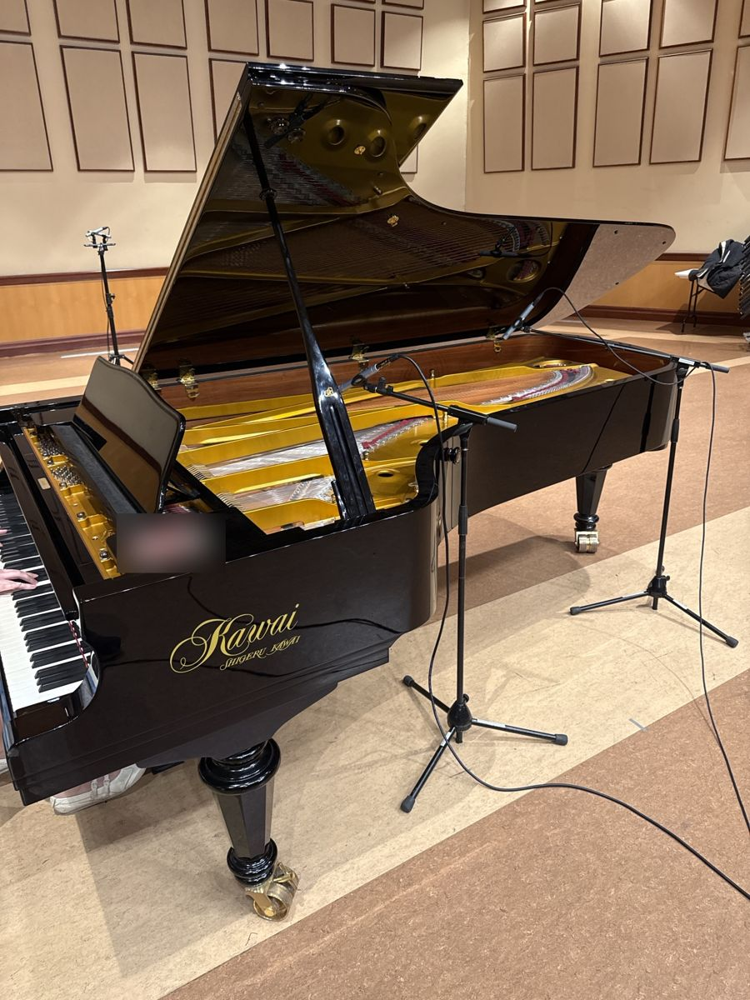

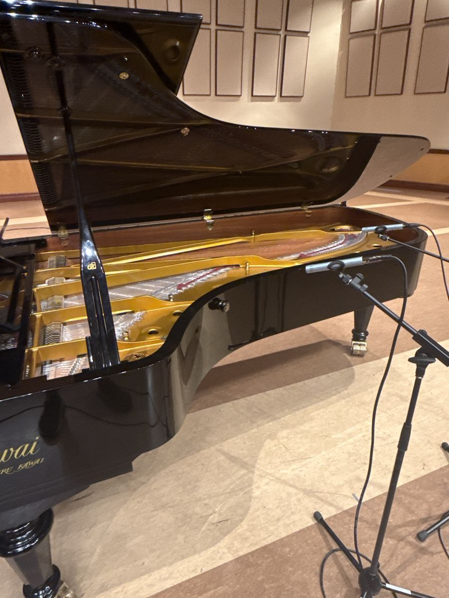

## 🔌 Into the S32, with +48 V

- 🚩 Into the **S32**: ORTF **left** on **IN 25**, **right** on **IN 26**, the two piano mics on
  **IN 27** and **IN 28**.
- 🚩 CH 25–32 listen to the S32 (**AES50 A25-32**, from the routing check above), so they land on
  **CH 25–28**.
- 🚩 **+48 V** on **CH 25–28**, then set each channel's **GAIN**.
- 🚩 Check all four **meters**, and check left and right: have someone talk on the left side of
  the room, and CH 25 should be louder than CH 26.

## 🧰 If the S32 buzzes: go local

At the session there was a **buzz** on the S32's inputs, more a hum than a crackle. Maybe radio
interference, maybe an unshielded cable somewhere nobody can reach. It wasn't found, and with the
singers waiting, you go around it instead.

- 🚩 Unplug the four condenser XLRs from the S32 and run them to the X32's **own** rear panel:
  **IN 29–32**, in the same order. (IN 25–28 already have the PTU-7000, the lav and headset
  receiver.)
- 🚩 X32 **ROUTING → INPUT**: **25–32 = Local 25-32**.

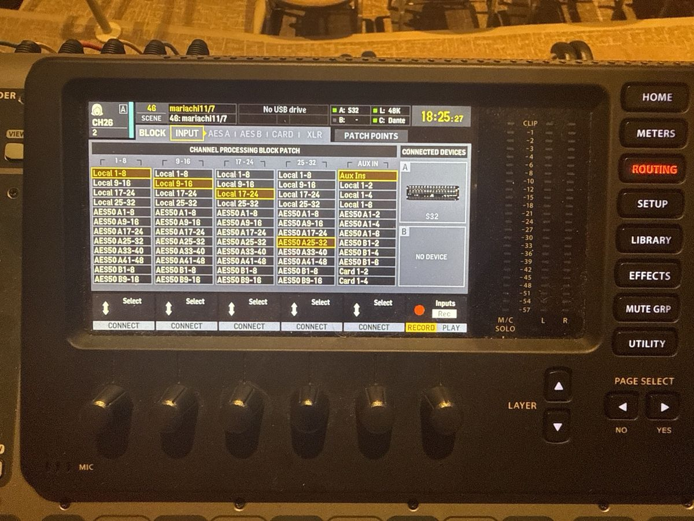

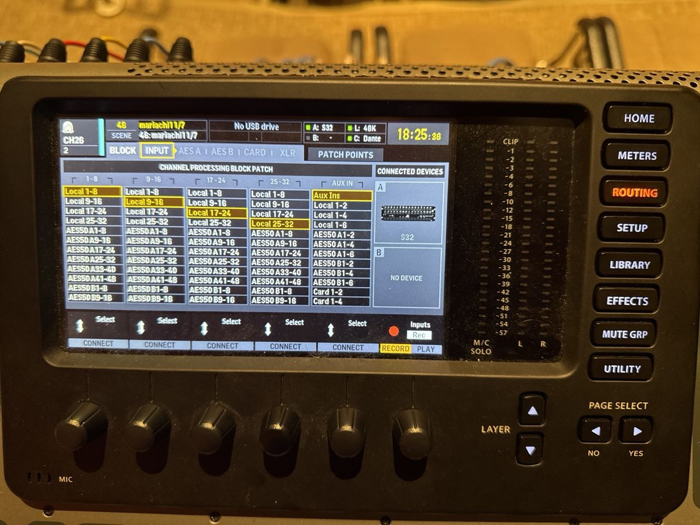

- 🚩 The condensers are on **CH 29–32** now. Set **+48 V** and **GAIN** again on 29–32: expect
  what you set on 25–28 not to come with them.
- 🚩 Check **all four meters**. At the session, Logic's track for one of them showed no level after
  the move, and nobody knows now whether it was +48 V, the mic or a cable. That's the lesson: stop
  and find out.
- 🚩 Logic's inputs move too: see the next section.

**Q3 (multiple choice).** After the move, three of the four condensers show signal and one is flat.
What do you do first?

- a) Record anyway and fix it in the mix
- b) Turn its GAIN all the way up
- ✅ c) Stop, and check that channel: its +48 V, then the mic and its cable
- d) Move all four back to the S32

## 🎛️ The Logic multitrack (Dante → Logic)

- 🚩 X32 **ROUTING → CARD**: **1–8 = Local 1-8**, **9–16 = Local 9-16**, **17–24 = Local 17-24**,
  **25–32 = Local 25-32**. The **X-DANTE** card sends the X32's **inputs**, not its channels: card
  out 29 is the X32's own IN 29. (With the condensers still on the S32, see **Technical
  verification**.)

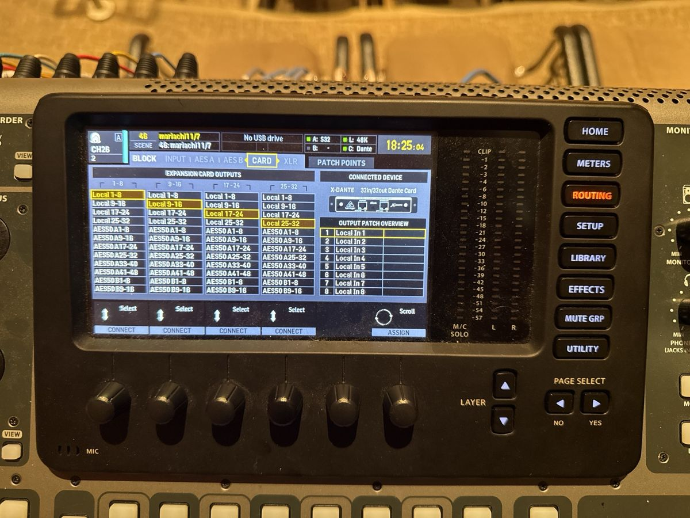

- 🚩 Mac mini: open **Dante Virtual Soundcard** and start it.
- 🚩 **Dante Controller**: route the **X32** to the Mac mini (**MUS-BH100-MINI**) one to one.
  **Hold Control and click** the square where the two devices meet: a diagonal of ticks.
- 🚩 **Logic → Settings → Audio → Devices**: **Input Device = Dante Virtual Soundcard**, **Output
  Device = SSL 2+** (your headphones plug into the SSL 2+). Set this **first**.
- 🚩 New audio tracks: in **Choose a track type**, pick **Audio**, set **Audio Input** to the first
  input, tick **Ascending**, and set how many tracks. The session used **In 1–16** for the
  handheld channels and four more for the condensers.

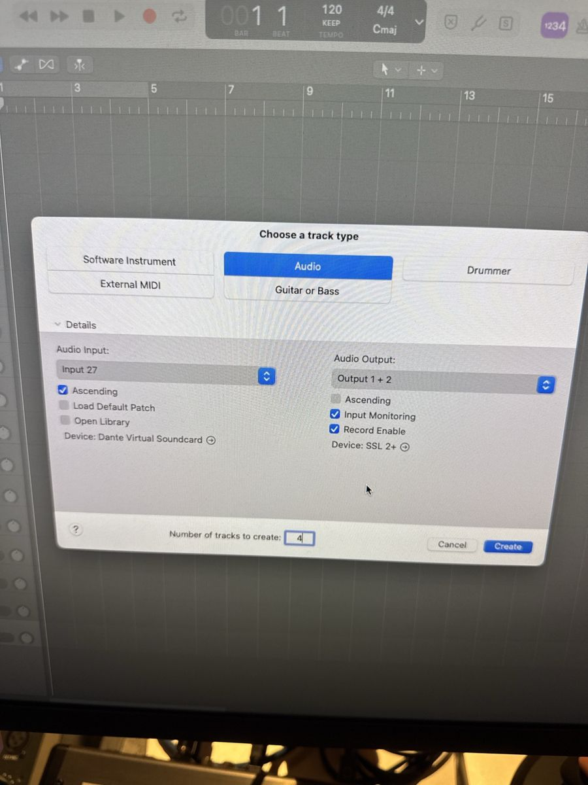

- 🚩 To move several tracks at once: select them, **hold Option**, and pick the first input. Logic
  gives them ascending inputs. That's how the session's four condenser tracks moved from In 27–30
  to **In 29–32** after the condensers went local.

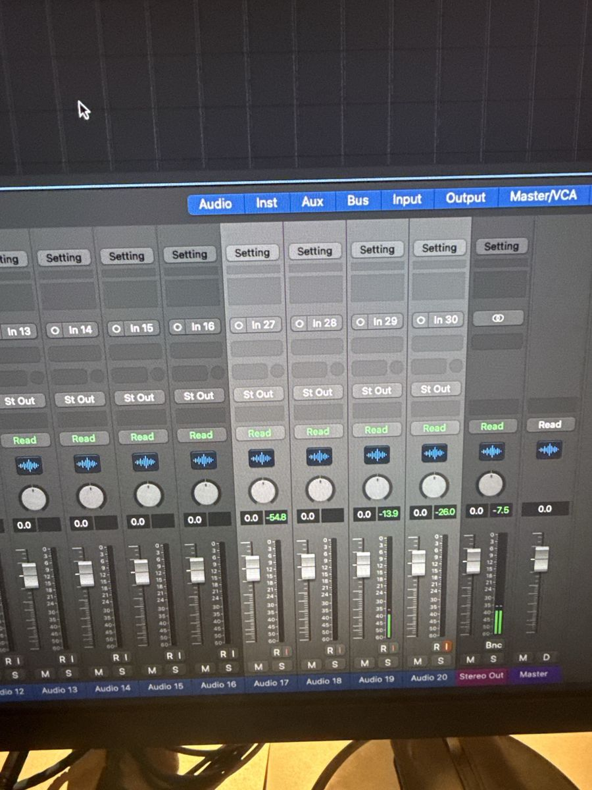

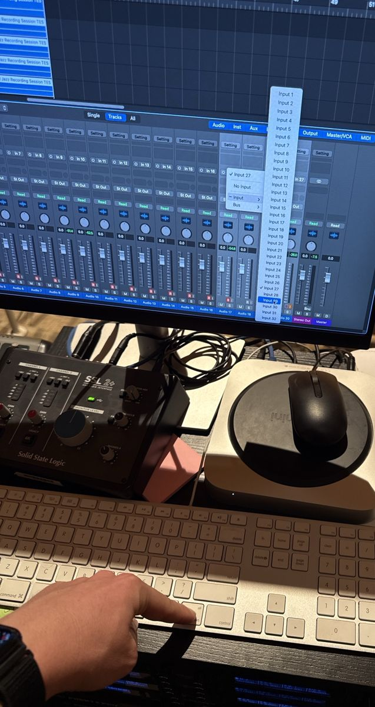

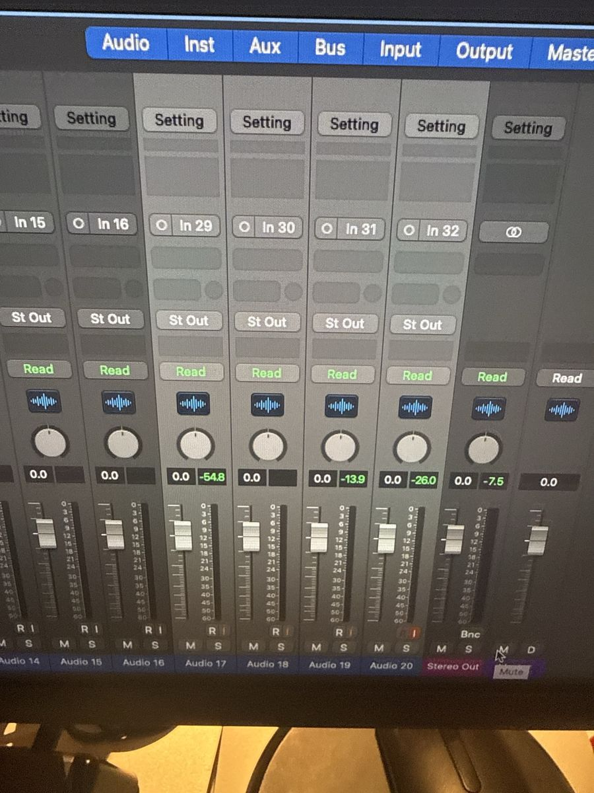

- 🚩 **Record-enable** every track (**R**). Record a short test and play it back: every track has
  its own singer or mic on it, and no meter you expect is flat.

**Q4 (short answer).** The condensers moved from the S32 to the X32's IN 29–32. Name two things you
have to change or set again so they're recorded.

✅ **Answer.** Any two of: ROUTING → INPUT 25–32 to Local 25-32; +48 V and GAIN on CH 29–32; Logic's
four tracks to In 29–32 (select them, hold Option, pick In 29).

**Q5 (short answer).** Tonight's inputs: ORTF L ______ · ORTF R ______ · Piano ______ / ______ ·
Logic tracks ______ to ______

✅ **Answer.** There's no fixed answer. Write in tonight's inputs: it's a log entry, not a test.

## 🏁 End of the session

- 🚩 Amp (**NX3000**) **off first**.
- 🚩 **+48 V off** on the condensers' channels before you unplug them. Condensers and the stereo
  bar back where they came from.
- 🚩 If you went local: unplug the four XLRs from IN 29–32 and put **ROUTING → INPUT 25–32** back
  on **AES50 A25-32**.
- 🚩 Handhelds off, batteries out, the wireless rack off, wedges back in BH 102: the end of the
  [Vocal Jazz Gig Checklist](../../vocal-jazz-gig-checklist/).
- 🚩 Run the **Vocal Jazz Reset** on the X32.

## ✅ Definition of done

- 🚩 The singers heard themselves in the wedges, with the mains off.
- 🚩 All four condensers had moving meters before the first take.
- 🚩 Every Logic track was record-enabled on the right input, checked with a short test.
- 🚩 The X32's routing is back where you found it, and the X32 is reset for the next Vocal Jazz.

## 💭 Before you leave

- 🚩 Did anything go wrong today that the next engineer should know about? Tell your supervisor.

## ⚙️ Technical verification

**Confirmed (instructor, with photos from the session, November 2026):**

- Rehearsals, the dress rehearsal and the concert use the Vocal Jazz setup; the mains are on for the
  concert and off for rehearsals. A recording session has no audience, so they're off, and it adds
  four condensers: two on the piano and an ORTF pair for the room.
- The condensers on the S32: the ORTF pair on IN 25 and 26, the piano on IN 27 and 28.
- ORTF on the stereo bar: the capsules on the ORTF marks, not the clips; the mics crossed, one higher
  than the other; angled down; each XLR wrapped once.
- Piano mics: close for jazz and pop, further for classical; close by default for a quick setup.
- A buzz or hum on the S32's inputs; the workaround was the X32's own IN 29–32 and **ROUTING →
  INPUT 25–32 = Local 25-32** (photos).
- **ROUTING → CARD**: Local 1-32 on the X-DANTE card (photo).
- Logic: Input Device Dante Virtual Soundcard, Output Device SSL 2+; the condenser tracks moved from
  In 27–30 to In 29–32 with Option held (photos). One of them (In 30) showed no level; the cause is
  unknown.

**Still open:**

- **Which cable is marked**, and for which side. The photos have a yellow ring on one; red for the
  right side is a common convention, but neither is confirmed as Salmon's.
- **The mics and the bar.** The pencil condensers look like AKG Perception 170s, and the bar is a
  RØDE stereo bar with ORTF and 110° marks; neither model is confirmed.
- **How close the piano mics go**, and which one goes on IN 27 and which on IN 28.
- **Where the ORTF stand goes** in the room, and how high.
- **How the mains are turned off** for a recording session: the X32's MAIN LR, or the Mix5's
  4/5 LEVEL in the hall's mains rack.
- **The card while the condensers are on the S32.** The card sends inputs: with CARD 25–32 on Local
  25-32, card outs 25–28 carry the X32's own IN 25–28 (the PTU-7000), not the S32. Recording the
  condensers from the S32 would need **CARD 25–32 = AES50 A25-32**. Not tried in Salmon.
- **Do +48 V and GAIN carry over** when CH 25–32 move from AES50 to Local? On the X32 they belong to
  the input (the S32's preamp or the X32's own), so this page expects not. Not checked.
- **The buzz** is a known issue: its source wasn't found.
- **Where the Logic session is saved**, and its name.

## 🤖 AI use disclosure

Drafted by AI (Claude, via Claude Code) from the instructor's photos of the Vocal Jazz Ensemble's
recording session and answers to follow-up questions (November 2026), and from the Vocal Jazz and
CME gig checklists. The steps, the gear facts and the session's story are the instructor's; the AI
arranged them into the site's checklist format, wrote the questions, and listed what isn't confirmed
yet. Not yet checked step by step at a real session.
