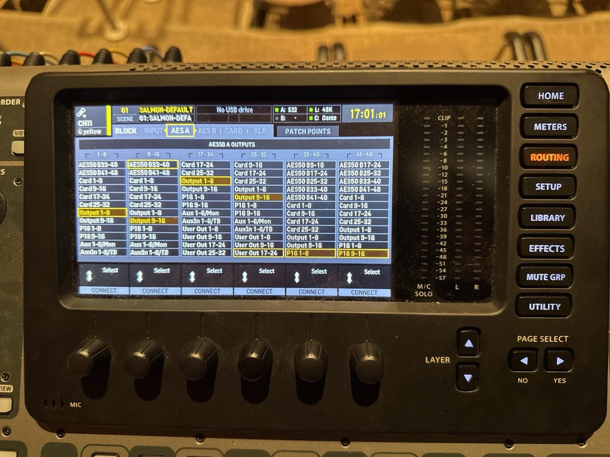

> 🧪 **Status: In Development.** Started October 2026 from the instructor's notes, a student
> engineer's walkthrough of the gig, and what the **Salmon Simulator** project has already
> confirmed. The routing, the 30 dB gain, and the no-dynamics rule are the instructor's own; the
> X32 page names come from photos of the console (2026-10-20). The low-cut frequency is still a
> recommendation. See **Technical verification**.

## 🎚️ What this is

The state the downstairs Salmon audio system should be left in after Vocal Jazz. The X32 and the
wireless gear go back to a known setup, so the next Vocal Jazz engineer can check it in a minute
instead of rebuilding it. The gig itself is the **Vocal Jazz Gig Checklist**; this is only the
putting-back. The upstairs video reset (BH 208/209) is the separate **Salmon Reset**.

## 🎛️ X32 — routing

- 🚩 **ROUTING → INPUT:** 1–8 **Local 1-8**, 9–16 **Local 9-16**, 17–24 **Local 17-24**. The
  wireless receivers plug into the X32's own rear panel, so these channels have to listen to Local,
  not AES50.
- 🚩 **ROUTING → INPUT:** 25–32 **AES50 A25-32** (the stage box). That's the default, so leave it.
- 🚩 **ROUTING → AES A:** 1–8 **Output 1-8**, 9–16 **Output 9-16**, so the S32's outputs carry the
  X32's Outputs 1–16.
- 🚩 **Bus 1 = the wedges (Monitor 1)**, out on Output 1 to S32 OUT 1 and the monitor amp.
- 🚩 **ROUTING → CARD:** 1–8 **Local 1-8** through 25–32 **Local 25-32**, on the X-DANTE card.
  Card out 1 is input 1, so the next multitrack recording only needs Dante Controller and Logic.
- 🚩 Don't rely on a saved scene. Scene 01 **SALMON-DEFAULT** exists, but check every setting on
  this page yourself.

## 🎚️ X32 — every wireless channel

- 🚩 **The same gain** on every channel: **30 dB**.
- 🚩 **LOW CUT** on, at **80 Hz**.
- 🚩 **No dynamics**: gate **off**, compressor **off**.

**Q1 (short answer).** A channel shows the right gain and low cut, but nothing from its mic reaches
the meter. Which routing page setting do you check first?

✅ **Answer.** Its input block's source. The wireless mics come in on LOCAL, so a block left on
AES50 hears the stage box instead and the mic never arrives.

## 📡 Wireless

- 🚩 Every handheld switched **off** (press and hold), **batteries out**.
- 🚩 Rechargeable cells back **in the charger** on top of the mic cabinet. **Never** put an alkaline
  in the charger.
- 🚩 All 16 handhelds back in the **FOH mic drawer**.
- 🚩 The **wireless rack off**, at the **Furman on top**.

## 🔊 Monitors and room

- 🚩 The **NX3000 off** before you unplug anything from it.
- 🚩 Three wedges and the speakON cables back in the storage closet, **BH 102**.
- 🚩 Close BH 102's fixed door half **fully**, flush with the frame, and flip its **flush bolt**
  (on its top edge) all the way over. Then close the other half.
- 🚩 The **Mac mini** is normally left on: quit Logic and leave the machine running.

## ✅ Definition of done

- 🚩 X32 inputs 1–24 on LOCAL, 25–32 on AES50.
- 🚩 Every wireless channel at 30 dB, low cut at 80 Hz, no gate, no compressor.
- 🚩 Mics in the drawer with no batteries, cells in the charger, wireless rack off.
- 🚩 Wedges and cables in BH 102, the fixed half flush and bolted.

## ⚙️ Technical verification

**Confirmed (instructor, 2026-10-19 and 2026-10-20):** inputs 1–24 on Local and 25–32 on AES50
A25-32; the S32's outputs carry Output 1-16; card outputs Local 1-32 on the X-DANTE, the X32's
only card; gain 30 dB; no dynamics, with low cut on; scene 01 SALMON-DEFAULT exists but isn't to
be trusted; the wireless rack's master switch is the Furman on top; the storage closet is BH 102,
a double door with a flush bolt on the fixed half. The page names and values come from photos of
the console. The mic drawer, the charger, and "never alkaline in the charger" are already
confirmed in the Salmon Simulator project.

**Still open:**

- **Low cut at 80 Hz** is the AI's recommendation; the instructor was thinking 100 Hz. The group
  may have low basses, and 80 Hz leaves their lowest notes alone while still cutting rumble.
- **Should the reset save a trusted scene?** The current saved scene isn't trusted. A fresh
  "Vocal Jazz" scene, stored after this reset, could make the next check quicker.
- **Is Output 1 set to Bus 1?** The X32's OUT 1-16 page isn't in the photos.
- **Which way the flush bolt's lever goes** to lock.
- **Is the Mac mini always left on**, or does it get shut down after a Logic session?
- **Does the reset include the mains?** Nothing here touches the mains path yet.

## 🤖 AI use disclosure

Drafted by AI (Claude, via Claude Code) from the instructor's October 2026 notes and answers, a
student engineer's walkthrough of the Vocal Jazz gig, and facts already recorded in the Salmon
Simulator project. Not yet run as a procedure at the console.
